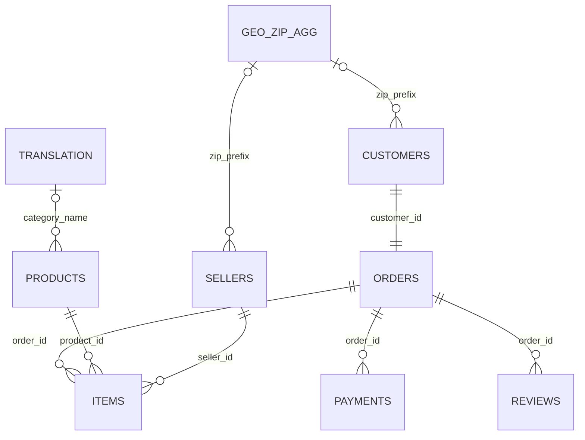

# T-00 — 02 RELATIONAL INTEGRITY

Customers are order-address identities (`customer_id`), while `customer_unique_id` links observed people across orders. Orders and customers are one-to-one in this extract; customer_unique_id is not a customer-table primary key. Items use (order_id, order_item_id), payments use (order_id, payment_sequential). Product and seller IDs and translated Portuguese category names are unique candidate keys. Review ID alone is not safe: preserve source-row provenance in a review table and explicitly manage order-level label aggregation. Geolocation has no unique ZIP key.



The diagram shows logical optional children and a derived ZIP lookup, not the raw geolocation table. Aggregate child tables separately to order grain, then validate one-to-one merges. Never sum payments after joining item rows. Repeated products within an order represent units; do not deduplicate them. Multiple sellers need explicit item-level distances aggregated with price weighting or min/max, not an arbitrary first seller.

Geolocation: drop exact duplicate coordinate rows, screen the approximate Brazil box (a heuristic, not a political boundary), then median coordinates by ZIP prefix. Preserve missing ZIP lookups. Distance is Haversine straight-line km, not road distance or delivery routing. Median coordinates are static extract proxies with no historical version evidence.

Review labeling: exclude all orders with more than one distinct score (202), even if some have consistent binary labels. Retain unanimous scores, use earliest creation to enforce pre-review eligibility, and latest answer for conservative label maturity. Latest-answer label selection is only a sensitivity option, not ground truth. Review creation is survey-generation time; score/text exist at answer, so creation eligibility is conservative.

```json
{
  "conflicting_binary_orders": 96,
  "conflicting_score_orders": 202,
  "duplicate_order_product_excess": 10225,
  "financial_abs_difference_gt_001_brl": 303,
  "financial_abs_difference_gt_1_brl": 250,
  "financial_difference_brl": {
    "count": 98665,
    "iqr_outliers": 10221,
    "mean": 0.02909228196422187,
    "negative": 38411,
    "quantiles": {
      "0.0": -51.61999999999999,
      "0.01": -4.618527782440651e-14,
      "0.25": -3.552713678800501e-15,
      "0.5": 0.0,
      "0.75": 3.552713678800501e-15,
      "0.95": 1.4210854715202004e-14,
      "0.99": 4.973799150320701e-14,
      "1.0": 182.81000000000003
    },
    "std": 1.129221375852064,
    "zero": 20242
  },
  "foreign_keys": [
    {
      "child": "orders",
      "column": "customer_id",
      "null": 0,
      "parent": "customers",
      "unmatched_nonnull_rows": 0,
      "unmatched_unique": 0
    },
    {
      "child": "order_items",
      "column": "order_id",
      "null": 0,
      "parent": "orders",
      "unmatched_nonnull_rows": 0,
      "unmatched_unique": 0
    },
    {
      "child": "order_items",
      "column": "product_id",
      "null": 0,
      "parent": "products",
      "unmatched_nonnull_rows": 0,
      "unmatched_unique": 0
    },
    {
      "child": "order_items",
      "column": "seller_id",
      "null": 0,
      "parent": "sellers",
      "unmatched_nonnull_rows": 0,
      "unmatched_unique": 0
    },
    {
      "child": "order_payments",
      "column": "order_id",
      "null": 0,
      "parent": "orders",
      "unmatched_nonnull_rows": 0,
      "unmatched_unique": 0
    },
    {
      "child": "order_reviews",
      "column": "order_id",
      "null": 0,
      "parent": "orders",
      "unmatched_nonnull_rows": 0,
      "unmatched_unique": 0
    },
    {
      "child": "products",
      "column": "product_category_name",
      "null": 610,
      "parent": "translation",
      "unmatched_nonnull_rows": 13,
      "unmatched_unique": 2
    },
    {
      "child": "customers",
      "column": "customer_zip_code_prefix",
      "null": 0,
      "parent": "geolocation",
      "unmatched_nonnull_rows": 278,
      "unmatched_unique": 157
    },
    {
      "child": "sellers",
      "column": "seller_zip_code_prefix",
      "null": 0,
      "parent": "geolocation",
      "unmatched_nonnull_rows": 7,
      "unmatched_unique": 7
    }
  ],
  "geo_invalid_global_coordinates": 0,
  "geo_multiple_coordinate_zips": 17781,
  "geo_outside_brazil_approx_box": 42,
  "geo_zip_count": 19015,
  "missing_items": 775,
  "missing_payments": 1,
  "missing_reviews": 768,
  "naive_inner_common_order_join_rows": 117329,
  "naive_left_children_present_join_rows": 119143,
  "order_children": {
    "order_items": {
      "multi_record_orders": 9803,
      "orders_present": 98666,
      "records_per_order": {
        "count": 98666,
        "iqr_outliers": 9803,
        "mean": 1.1417306873695092,
        "negative": 0,
        "quantiles": {
          "0.0": 1.0,
          "0.01": 1.0,
          "0.25": 1.0,
          "0.5": 1.0,
          "0.75": 1.0,
          "0.95": 2.0,
          "0.99": 3.0,
          "1.0": 21.0
        },
        "std": 0.5384523739205161,
        "zero": 0
      }
    },
    "order_payments": {
      "multi_record_orders": 2961,
      "orders_present": 99440,
      "records_per_order": {
        "count": 99440,
        "iqr_outliers": 2961,
        "mean": 1.0447103781174578,
        "negative": 0,
        "quantiles": {
          "0.0": 1.0,
          "0.01": 1.0,
          "0.25": 1.0,
          "0.5": 1.0,
          "0.75": 1.0,
          "0.95": 1.0,
          "0.99": 2.0,
          "1.0": 29.0
        },
        "std": 0.38116563065686343,
        "zero": 0
      }
    },
    "order_reviews": {
      "multi_record_orders": 547,
      "orders_present": 98673,
      "records_per_order": {
        "count": 98673,
        "iqr_outliers": 547,
        "mean": 1.0055841010205426,
        "negative": 0,
        "quantiles": {
          "0.0": 1.0,
          "0.01": 1.0,
          "0.25": 1.0,
          "0.5": 1.0,
          "0.75": 1.0,
          "0.95": 1.0,
          "0.99": 1.0,
          "1.0": 3.0
        },
        "std": 0.07506032115194176,
        "zero": 0
      }
    }
  }
}
```
Latest-answer sensitivity counts (low-score binary):

```json
{
  "false": 84179,
  "true": 14494
}
```
