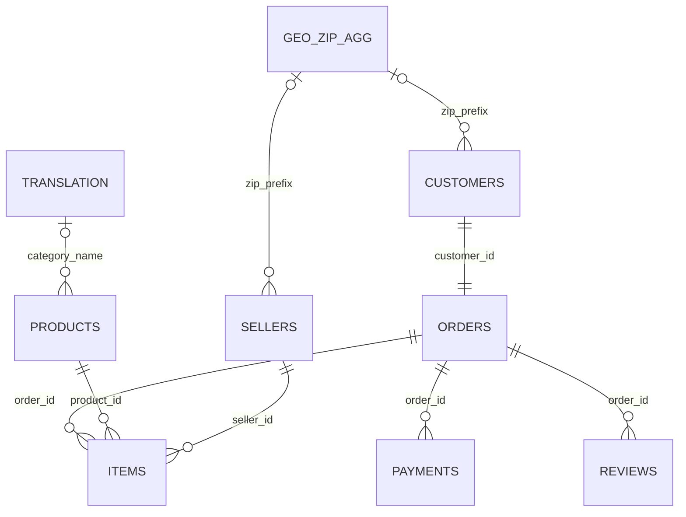

# T-00 — Final Olist Dataset Audit Report

Audit date: 2026-10-10 (Africa/Cairo). Scope: pre-implementation due diligence.

## A. Executive Summary

Olist Intelligence remains a realistic four-student DEPI project, subject to instructor approval. Prioritize relational analytics, delivery risk and post-review NLP; make customer intelligence descriptive and defer future CLV. FastAPI and a dedicated frontend remain the intended integration route. No production application, model artifacts, final team allocation or Master Execution Plan was built.

Measured facts are derived from the nine local CSVs using Python 3.10.20. Recommendations and prediction-time assumptions are explicitly distinguished below. Dataset coverage is historical, not evidence of current Brazilian commerce.

- **SQL Business Analytics: GO — MVP.** Nine relational tables support observed sales, freight, payments, delivery and reviews; preserve grain and distinguish recorded payments from net revenue.
- **Customer Segmentation: CONDITIONAL GO — MVP descriptive; Advanced clustering.** 96,096 customers; only 3.12% repeat. Use descriptive recency/monetary and cohort profiles; benchmark clustering stability against seller/order/category alternatives.
- **Future Customer Value Prediction: NO-GO — Deferred.** 90-day windows have only 210, 233 and 299 repeat buyers. Zero-heavy observed marketplace payments are not lifetime value or profit.
- **Delivery Delay Prediction: CONDITIONAL GO — MVP.** 96,470 calendar-label examples, 6,534 late. Lightweight out-of-time lift exists; delivered-only selection and availability assumptions limit deployment claims.
- **Review Risk Prediction: CONDITIONAL GO — Advanced.** 98,400 purchase-stage labels; weak out-of-time purchase baseline. Prefer post-delivery intervention only for reviews not yet created.
- **Portuguese Review NLP: GO — MVP primary DL track.** 40,950 nonempty messages; strong classical baseline. Ratings are weak sentiment labels, and actual language proportions need manual validation.
- **Tabular Deep Learning: CONDITIONAL GO — Optional.** Enough rows for an MLP comparison; no evidence it beats trees, little justification for a complex tabular network.
- **FastAPI Model Serving: GO — MVP future architecture.** Serve versioned feature contracts and probabilities; no backend implemented in T-00.
- **Explainable AI: GO — MVP.** Explain fitted predictions, not causality. Verify SHAP compatibility later; logistic coefficients provide a baseline.
- **MLflow / MLOps: GO — Advanced lightweight tracking.** Record hashes, splits, parameters and metrics; avoid an elaborate platform for four students.

## B. Dataset Inventory

All files were fully loaded and profiled. Numeric summaries use pandas sample standard deviation and 1.5×IQR flags. Flags are screening indicators, not proof of errors; monetary floating-point residuals near zero must use cent tolerances. Identifier/ZIP numerical distributions have no business interpretation. Category summaries are limited to 15 values; review text and raw IDs are never exported. CSV blank fields are parsed as missing by pandas; whitespace-only nonnull values are separately counted. Candidate keys are hypotheses tested below, not declared constraints.

## customers

File `99,441` rows × `5` columns; 9,033,957 bytes. Full duplicate excess: 0. Candidate key ['customer_id']; duplicate key excess 0; null key rows 0.

- `customer_city`: object; missing 0 (0.0000%); whitespace 0; unique 4,119. Top categories: {"belo horizonte": 2773, "brasilia": 2131, "campinas": 1444, "curitiba": 1521, "goiania": 692, "guarulhos": 1189, "niteroi": 849, "osasco": 746, "porto alegre": 1379, "rio de janeiro": 6882, "salvador": 1245, "santo andre": 797, "santos": 713, "sao bernardo do campo": 938, "sao paulo": 15540}.
- `customer_id`: object; missing 0 (0.0000%); whitespace 0; unique 99,441.
- `customer_state`: object; missing 0 (0.0000%); whitespace 0; unique 27. Top categories: {"BA": 3380, "CE": 1336, "DF": 2140, "ES": 2033, "GO": 2020, "MA": 747, "MG": 11635, "MT": 907, "PA": 975, "PE": 1652, "PR": 5045, "RJ": 12852, "RS": 5466, "SC": 3637, "SP": 41746}.
- `customer_unique_id`: object; missing 0 (0.0000%); whitespace 0; unique 96,096.
- `customer_zip_code_prefix`: int64; missing 0 (0.0000%); whitespace 0; unique 14,994. Numeric summary: {"count": 99441, "iqr_outliers": 0, "mean": 35137.47458291851, "negative": 0, "quantiles": {"0.0": 1003.0, "0.01": 1327.0, "0.25": 11347.0, "0.5": 24416.0, "0.75": 58900.0, "0.95": 90550.0, "0.99": 97513.0, "1.0": 99990.0}, "std": 29797.938996206118, "zero": 0}.

## geolocation

File `1,000,163` rows × `5` columns; 61,273,883 bytes. Full duplicate excess: 261,831. Candidate key ['geolocation_zip_code_prefix']; duplicate key excess 981,148; null key rows 0.

- `geolocation_city`: object; missing 0 (0.0000%); whitespace 0; unique 8,011. Top categories: {"belo horizonte": 27805, "brasilia": 10470, "curitiba": 16593, "goiania": 5661, "guarulhos": 11340, "niteroi": 6534, "osasco": 7658, "porto alegre": 13521, "recife": 6168, "rio de janeiro": 62151, "salvador": 11865, "santo andre": 6863, "sao bernardo do campo": 8112, "sao paulo": 135800, "são paulo": 24918}.
- `geolocation_lat`: float64; missing 0 (0.0000%); whitespace 0; unique 717,363. Numeric summary: {"count": 1000163, "iqr_outliers": 168240, "mean": -21.17615291038396, "negative": 998827, "quantiles": {"0.0": -36.6053744107061, "0.01": -30.104535674977235, "0.25": -23.60354554038031, "0.5": -22.91937749486411, "0.75": -19.97962033957529, "0.95": -7.673935632134225, "0.99": -2.501042206708081, "1.0": 45.06593318269697}, "std": 5.715866308822852, "zero": 0}.
- `geolocation_lng`: float64; missing 0 (0.0000%); whitespace 0; unique 717,615. Numeric summary: {"count": 1000163, "iqr_outliers": 42348, "mean": -46.39054132093579, "negative": 1000160, "quantiles": {"0.0": -101.46676644931476, "0.01": -57.65070011329355, "0.25": -48.573172180526896, "0.5": -46.63787866960149, "0.75": -43.7677088028139, "0.95": -38.50438614872029, "0.99": -34.93864131076286, "1.0": 121.10539381057764}, "std": 4.269748306619603, "zero": 0}.
- `geolocation_state`: object; missing 0 (0.0000%); whitespace 0; unique 27. Top categories: {"BA": 36045, "CE": 11674, "DF": 12986, "ES": 16748, "GO": 20139, "MG": 126336, "MS": 10431, "MT": 12031, "PA": 10853, "PE": 16432, "PR": 57859, "RJ": 121169, "RS": 61851, "SC": 38328, "SP": 404268}.
- `geolocation_zip_code_prefix`: int64; missing 0 (0.0000%); whitespace 0; unique 19,015. Numeric summary: {"count": 1000163, "iqr_outliers": 0, "mean": 36574.16646586607, "negative": 0, "quantiles": {"0.0": 1001.0, "0.01": 1318.0, "0.25": 11075.0, "0.5": 26530.0, "0.75": 63504.0, "0.95": 91750.0, "0.99": 98010.0, "1.0": 99990.0}, "std": 30549.335710319865, "zero": 0}.

## order_items

File `112,650` rows × `7` columns; 15,438,671 bytes. Full duplicate excess: 0. Candidate key ['order_id', 'order_item_id']; duplicate key excess 0; null key rows 0.

- `freight_value`: float64; missing 0 (0.0000%); whitespace 0; unique 6,999. Numeric summary: {"count": 112650, "iqr_outliers": 12134, "mean": 19.990319928983578, "negative": 0, "quantiles": {"0.0": 0.0, "0.01": 4.4198, "0.25": 13.08, "0.5": 16.26, "0.75": 21.15, "0.95": 45.12, "0.99": 84.52, "1.0": 409.68}, "std": 15.806405412297083, "zero": 383}.
- `order_id`: object; missing 0 (0.0000%); whitespace 0; unique 98,666.
- `order_item_id`: int64; missing 0 (0.0000%); whitespace 0; unique 21. Numeric summary: {"count": 112650, "iqr_outliers": 13984, "mean": 1.1978339991122948, "negative": 0, "quantiles": {"0.0": 1.0, "0.01": 1.0, "0.25": 1.0, "0.5": 1.0, "0.75": 1.0, "0.95": 2.0, "0.99": 4.0, "1.0": 21.0}, "std": 0.7051240313951733, "zero": 0}.
- `price`: float64; missing 0 (0.0000%); whitespace 0; unique 5,968. Numeric summary: {"count": 112650, "iqr_outliers": 8427, "mean": 120.65373901464716, "negative": 0, "quantiles": {"0.0": 0.85, "0.01": 9.99, "0.25": 39.9, "0.5": 74.99, "0.75": 134.9, "0.95": 349.9, "0.99": 890.0, "1.0": 6735.0}, "std": 183.63392805025939, "zero": 0}.
- `product_id`: object; missing 0 (0.0000%); whitespace 0; unique 32,951.
- `seller_id`: object; missing 0 (0.0000%); whitespace 0; unique 3,095.
- `shipping_limit_date`: datetime64[ns]; missing 0 (0.0000%); whitespace 0; unique 93,318. Range 2016-09-19 00:15:34 → 2020-04-09 22:35:08.

## order_payments

File `103,886` rows × `5` columns; 5,777,138 bytes. Full duplicate excess: 0. Candidate key ['order_id', 'payment_sequential']; duplicate key excess 0; null key rows 0.

- `order_id`: object; missing 0 (0.0000%); whitespace 0; unique 99,440.
- `payment_installments`: int64; missing 0 (0.0000%); whitespace 0; unique 24. Numeric summary: {"count": 103886, "iqr_outliers": 6313, "mean": 2.853348863176944, "negative": 0, "quantiles": {"0.0": 0.0, "0.01": 1.0, "0.25": 1.0, "0.5": 1.0, "0.75": 4.0, "0.95": 10.0, "0.99": 10.0, "1.0": 24.0}, "std": 2.6870506738564797, "zero": 2}.
- `payment_sequential`: int64; missing 0 (0.0000%); whitespace 0; unique 29. Numeric summary: {"count": 103886, "iqr_outliers": 4526, "mean": 1.0926785129853878, "negative": 0, "quantiles": {"0.0": 1.0, "0.01": 1.0, "0.25": 1.0, "0.5": 1.0, "0.75": 1.0, "0.95": 1.0, "0.99": 3.0, "1.0": 29.0}, "std": 0.7065837791949956, "zero": 0}.
- `payment_type`: object; missing 0 (0.0000%); whitespace 0; unique 5. Top categories: {"boleto": 19784, "credit_card": 76795, "debit_card": 1529, "not_defined": 3, "voucher": 5775}.
- `payment_value`: float64; missing 0 (0.0000%); whitespace 0; unique 29,077. Numeric summary: {"count": 103886, "iqr_outliers": 7981, "mean": 154.10038041699553, "negative": 0, "quantiles": {"0.0": 0.0, "0.01": 6.69, "0.25": 56.79, "0.5": 100.0, "0.75": 171.8375, "0.95": 437.635, "0.99": 1039.9164999999994, "1.0": 13664.08}, "std": 217.49406386472435, "zero": 9}.

## order_reviews

File `99,224` rows × `7` columns; 14,451,670 bytes. Full duplicate excess: 0. Candidate key ['review_id']; duplicate key excess 814; null key rows 0.

- `order_id`: object; missing 0 (0.0000%); whitespace 0; unique 98,673.
- `review_answer_timestamp`: datetime64[ns]; missing 0 (0.0000%); whitespace 0; unique 98,248. Range 2016-10-07 18:32:28 → 2018-10-29 12:27:35.
- `review_comment_message`: object; missing 58,247 (58.7025%); whitespace 27; unique 36,159.
- `review_comment_title`: object; missing 87,656 (88.3415%); whitespace 2; unique 4,527.
- `review_creation_date`: datetime64[ns]; missing 0 (0.0000%); whitespace 0; unique 636. Range 2016-10-02 00:00:00 → 2018-08-31 00:00:00.
- `review_id`: object; missing 0 (0.0000%); whitespace 0; unique 98,410.
- `review_score`: int64; missing 0 (0.0000%); whitespace 0; unique 5. Numeric summary: {"count": 99224, "iqr_outliers": 14575, "mean": 4.08642062404257, "negative": 0, "quantiles": {"0.0": 1.0, "0.01": 1.0, "0.25": 4.0, "0.5": 5.0, "0.75": 5.0, "0.95": 5.0, "0.99": 5.0, "1.0": 5.0}, "std": 1.3475791311150982, "zero": 0}.

## orders

File `99,441` rows × `8` columns; 17,654,914 bytes. Full duplicate excess: 0. Candidate key ['order_id']; duplicate key excess 0; null key rows 0.

- `customer_id`: object; missing 0 (0.0000%); whitespace 0; unique 99,441.
- `order_approved_at`: datetime64[ns]; missing 160 (0.1609%); whitespace 0; unique 90,733. Range 2016-09-15 12:16:38 → 2018-09-03 17:40:06.
- `order_delivered_carrier_date`: datetime64[ns]; missing 1,783 (1.7930%); whitespace 0; unique 81,018. Range 2016-10-08 10:34:01 → 2018-09-11 19:48:28.
- `order_delivered_customer_date`: datetime64[ns]; missing 2,965 (2.9817%); whitespace 0; unique 95,664. Range 2016-10-11 13:46:32 → 2018-10-17 13:22:46.
- `order_estimated_delivery_date`: datetime64[ns]; missing 0 (0.0000%); whitespace 0; unique 459. Range 2016-09-30 00:00:00 → 2018-11-12 00:00:00.
- `order_id`: object; missing 0 (0.0000%); whitespace 0; unique 99,441.
- `order_purchase_timestamp`: datetime64[ns]; missing 0 (0.0000%); whitespace 0; unique 98,875. Range 2016-09-04 21:15:19 → 2018-10-17 17:30:18.
- `order_status`: object; missing 0 (0.0000%); whitespace 0; unique 8. Top categories: {"approved": 2, "canceled": 625, "created": 5, "delivered": 96478, "invoiced": 314, "processing": 301, "shipped": 1107, "unavailable": 609}.

## products

File `32,951` rows × `9` columns; 2,379,446 bytes. Full duplicate excess: 0. Candidate key ['product_id']; duplicate key excess 0; null key rows 0.

- `product_category_name`: object; missing 610 (1.8512%); whitespace 0; unique 73. Top categories: {"automotivo": 1900, "bebes": 919, "beleza_saude": 2444, "brinquedos": 1411, "cama_mesa_banho": 3029, "cool_stuff": 789, "esporte_lazer": 2867, "fashion_bolsas_e_acessorios": 849, "informatica_acessorios": 1639, "moveis_decoracao": 2657, "papelaria": 849, "perfumaria": 868, "relogios_presentes": 1329, "telefonia": 1134, "utilidades_domesticas": 2335}.
- `product_description_lenght`: float64; missing 610 (1.8512%); whitespace 0; unique 2,960. Numeric summary: {"count": 32341, "iqr_outliers": 2078, "mean": 771.4952846232337, "negative": 0, "quantiles": {"0.0": 4.0, "0.01": 84.0, "0.25": 339.0, "0.5": 595.0, "0.75": 972.0, "0.95": 2063.0, "0.99": 3286.199999999997, "1.0": 3992.0}, "std": 635.1152246349538, "zero": 0}.
- `product_height_cm`: float64; missing 2 (0.0061%); whitespace 0; unique 102. Numeric summary: {"count": 32949, "iqr_outliers": 1892, "mean": 16.937661234028347, "negative": 0, "quantiles": {"0.0": 2.0, "0.01": 2.0, "0.25": 8.0, "0.5": 13.0, "0.75": 21.0, "0.95": 44.0, "0.99": 69.0, "1.0": 105.0}, "std": 13.637554061749494, "zero": 0}.
- `product_id`: object; missing 0 (0.0000%); whitespace 0; unique 32,951.
- `product_length_cm`: float64; missing 2 (0.0061%); whitespace 0; unique 99. Numeric summary: {"count": 32949, "iqr_outliers": 1380, "mean": 30.81507784758263, "negative": 0, "quantiles": {"0.0": 7.0, "0.01": 16.0, "0.25": 18.0, "0.5": 25.0, "0.75": 38.0, "0.95": 65.0, "0.99": 100.0, "1.0": 105.0}, "std": 16.914458054065967, "zero": 0}.
- `product_name_lenght`: float64; missing 610 (1.8512%); whitespace 0; unique 66. Numeric summary: {"count": 32341, "iqr_outliers": 290, "mean": 48.47694876472589, "negative": 0, "quantiles": {"0.0": 5.0, "0.01": 20.0, "0.25": 42.0, "0.5": 51.0, "0.75": 57.0, "0.95": 60.0, "0.99": 63.0, "1.0": 76.0}, "std": 10.245740725237239, "zero": 0}.
- `product_photos_qty`: float64; missing 610 (1.8512%); whitespace 0; unique 19. Numeric summary: {"count": 32341, "iqr_outliers": 849, "mean": 2.1889861166939797, "negative": 0, "quantiles": {"0.0": 1.0, "0.01": 1.0, "0.25": 1.0, "0.5": 1.0, "0.75": 3.0, "0.95": 6.0, "0.99": 8.0, "1.0": 20.0}, "std": 1.7367656379315446, "zero": 0}.
- `product_weight_g`: float64; missing 2 (0.0061%); whitespace 0; unique 2,204. Numeric summary: {"count": 32949, "iqr_outliers": 4551, "mean": 2276.4724877841513, "negative": 0, "quantiles": {"0.0": 0.0, "0.01": 60.0, "0.25": 300.0, "0.5": 700.0, "0.75": 1900.0, "0.95": 10850.0, "0.99": 22538.00000000001, "1.0": 40425.0}, "std": 4282.038730977007, "zero": 4}.
- `product_width_cm`: float64; missing 2 (0.0061%); whitespace 0; unique 95. Numeric summary: {"count": 32949, "iqr_outliers": 912, "mean": 23.196728277034204, "negative": 0, "quantiles": {"0.0": 6.0, "0.01": 11.0, "0.25": 15.0, "0.5": 20.0, "0.75": 30.0, "0.95": 47.0, "0.99": 63.0, "1.0": 118.0}, "std": 12.079047453227835, "zero": 0}.

## sellers

File `3,095` rows × `4` columns; 174,703 bytes. Full duplicate excess: 0. Candidate key ['seller_id']; duplicate key excess 0; null key rows 0.

- `seller_city`: object; missing 0 (0.0000%); whitespace 0; unique 611. Top categories: {"belo horizonte": 68, "campinas": 41, "curitiba": 127, "guarulhos": 50, "ibitinga": 49, "maringa": 40, "osasco": 32, "porto alegre": 28, "ribeirao preto": 52, "rio de janeiro": 96, "santo andre": 45, "sao bernardo do campo": 32, "sao jose do rio preto": 33, "sao paulo": 694, "sorocaba": 32}.
- `seller_id`: object; missing 0 (0.0000%); whitespace 0; unique 3,095.
- `seller_state`: object; missing 0 (0.0000%); whitespace 0; unique 23. Top categories: {"BA": 19, "CE": 13, "DF": 30, "ES": 23, "GO": 40, "MG": 244, "MS": 5, "PB": 6, "PE": 9, "PR": 349, "RJ": 171, "RN": 5, "RS": 129, "SC": 190, "SP": 1849}.
- `seller_zip_code_prefix`: int64; missing 0 (0.0000%); whitespace 0; unique 2,246. Numeric summary: {"count": 3095, "iqr_outliers": 0, "mean": 32291.059450726978, "negative": 0, "quantiles": {"0.0": 1001.0, "0.01": 1139.94, "0.25": 7093.5, "0.5": 14940.0, "0.75": 64552.5, "0.95": 89290.09999999999, "0.99": 95900.0, "1.0": 99730.0}, "std": 32713.453829509002, "zero": 0}.

## translation

File `71` rows × `2` columns; 2,613 bytes. Full duplicate excess: 0. Candidate key ['product_category_name']; duplicate key excess 0; null key rows 0.

- `product_category_name`: object; missing 0 (0.0000%); whitespace 0; unique 71. Top categories: {"alimentos": 1, "artes": 1, "beleza_saude": 1, "casa_construcao": 1, "construcao_ferramentas_iluminacao": 1, "construcao_ferramentas_seguranca": 1, "fashion_esporte": 1, "fashion_underwear_e_moda_praia": 1, "industria_comercio_e_negocios": 1, "instrumentos_musicais": 1, "livros_interesse_geral": 1, "livros_tecnicos": 1, "moveis_quarto": 1, "moveis_sala": 1, "pcs": 1}.
- `product_category_name_english`: object; missing 0 (0.0000%); whitespace 0; unique 71. Top categories: {"art": 1, "books_general_interest": 1, "books_technical": 1, "computers": 1, "construction_tools_lights": 1, "construction_tools_safety": 1, "fashion_sport": 1, "fashion_underwear_beach": 1, "food": 1, "furniture_bedroom": 1, "furniture_living_room": 1, "health_beauty": 1, "home_construction": 1, "industry_commerce_and_business": 1, "musical_instruments": 1}.

## Catalog and financial screening

```json
{
  "product_nonpositive": {
    "product_weight_g": 4,
    "product_length_cm": 0,
    "product_height_cm": 0,
    "product_width_cm": 0
  },
  "payment_installments": {
    "0": 2,
    "1": 52546,
    "2": 12413,
    "3": 10461,
    "4": 7098,
    "5": 5239,
    "6": 3920,
    "7": 1626,
    "8": 4268,
    "9": 644,
    "10": 5328,
    "11": 23,
    "12": 133,
    "13": 16,
    "14": 15,
    "15": 74,
    "16": 5,
    "17": 8,
    "18": 27,
    "20": 17,
    "21": 3,
    "22": 1,
    "23": 1,
    "24": 18
  },
  "payment_types": {
    "credit_card": 76795,
    "boleto": 19784,
    "voucher": 5775,
    "debit_card": 1529,
    "not_defined": 3
  },
  "item_feature_missingness": {
    "product_category_name": {
      "item_missing": 1603,
      "orders_any_missing": 1451
    },
    "product_weight_g": {
      "item_missing": 18,
      "orders_any_missing": 16
    },
    "product_length_cm": {
      "item_missing": 18,
      "orders_any_missing": 16
    },
    "product_height_cm": {
      "item_missing": 18,
      "orders_any_missing": 16
    },
    "product_width_cm": {
      "item_missing": 18,
      "orders_any_missing": 16
    },
    "distance_km": {
      "item_missing": 555,
      "orders_any_missing": 494
    }
  },
  "distance_km": {
    "count": 112095,
    "mean": 596.6828471753226,
    "std": 588.864635434508,
    "quantiles": {
      "0.0": 0.0,
      "0.01": 5.712493518220994,
      "0.25": 183.07750339063978,
      "0.5": 431.7097257224985,
      "0.75": 791.8789380771076,
      "0.95": 2089.847006799731,
      "0.99": 2478.7491983217933,
      "1.0": 3579.262050348394
    },
    "negative": 0,
    "zero": 26,
    "iqr_outliers": 8610
  }
}
```
## Provenance and license

Source: [Olist Kaggle dataset](https://www.kaggle.com/datasets/olistbr/brazilian-ecommerce), checked 2026-10-10. Local file SHA-256 hashes identify this audit snapshot; they do not prove it is an unmodified publisher release, and download/version metadata was not supplied. Publisher page was accessible but its dynamic license field did not render in the browsing tool. CC BY-NC-SA 4.0 is the reported dataset license in available search metadata/independent references, but primary publisher metadata confirmation remains an explicit release gate. Do not treat this audit as a definitive licensing determination.

If confirmed, [Creative Commons BY-NC-SA 4.0](https://creativecommons.org/licenses/by-nc-sa/4.0/) requires credit, license link, indication of changes, noncommercial use and compatible sharing of adaptations. Public access does not mean unrestricted redistribution. Keep raw data and generated derivatives out of Git, link the publisher, and verify terms before publishing data, review examples or commercial services. Model-card licensing does not override dataset obligations.


## C. Data Relationships

Customers are order-address identities (`customer_id`), while `customer_unique_id` links observed people across orders. Orders and customers are one-to-one in this extract; customer_unique_id is not a customer-table primary key. Items use (order_id, order_item_id), payments use (order_id, payment_sequential). Product and seller IDs and translated Portuguese category names are unique candidate keys. Review ID alone is not safe: preserve source-row provenance in a review table and explicitly manage order-level label aggregation. Geolocation has no unique ZIP key.



The diagram shows logical optional children and a derived ZIP lookup, not the raw geolocation table. Aggregate child tables separately to order grain, then validate one-to-one merges. Never sum payments after joining item rows. Repeated products within an order represent units; do not deduplicate them. Multiple sellers need explicit item-level distances aggregated with price weighting or min/max, not an arbitrary first seller.

Geolocation: drop exact duplicate coordinate rows, screen the approximate Brazil box (a heuristic, not a political boundary), then median coordinates by ZIP prefix. Preserve missing ZIP lookups. Distance is Haversine straight-line km, not road distance or delivery routing. Median coordinates are static extract proxies with no historical version evidence.

Review labeling: exclude all orders with more than one distinct score (202), even if some have consistent binary labels. Retain unanimous scores, use earliest creation to enforce pre-review eligibility, and latest answer for conservative label maturity. Latest-answer label selection is only a sensitivity option, not ground truth. Review creation is survey-generation time; score/text exist at answer, so creation eligibility is conservative.

```json
{
  "conflicting_binary_orders": 96,
  "conflicting_score_orders": 202,
  "duplicate_order_product_excess": 10225,
  "financial_abs_difference_gt_001_brl": 303,
  "financial_abs_difference_gt_1_brl": 250,
  "financial_difference_brl": {
    "count": 98665,
    "iqr_outliers": 10221,
    "mean": 0.02909228196422187,
    "negative": 38411,
    "quantiles": {
      "0.0": -51.61999999999999,
      "0.01": -4.618527782440651e-14,
      "0.25": -3.552713678800501e-15,
      "0.5": 0.0,
      "0.75": 3.552713678800501e-15,
      "0.95": 1.4210854715202004e-14,
      "0.99": 4.973799150320701e-14,
      "1.0": 182.81000000000003
    },
    "std": 1.129221375852064,
    "zero": 20242
  },
  "foreign_keys": [
    {
      "child": "orders",
      "column": "customer_id",
      "null": 0,
      "parent": "customers",
      "unmatched_nonnull_rows": 0,
      "unmatched_unique": 0
    },
    {
      "child": "order_items",
      "column": "order_id",
      "null": 0,
      "parent": "orders",
      "unmatched_nonnull_rows": 0,
      "unmatched_unique": 0
    },
    {
      "child": "order_items",
      "column": "product_id",
      "null": 0,
      "parent": "products",
      "unmatched_nonnull_rows": 0,
      "unmatched_unique": 0
    },
    {
      "child": "order_items",
      "column": "seller_id",
      "null": 0,
      "parent": "sellers",
      "unmatched_nonnull_rows": 0,
      "unmatched_unique": 0
    },
    {
      "child": "order_payments",
      "column": "order_id",
      "null": 0,
      "parent": "orders",
      "unmatched_nonnull_rows": 0,
      "unmatched_unique": 0
    },
    {
      "child": "order_reviews",
      "column": "order_id",
      "null": 0,
      "parent": "orders",
      "unmatched_nonnull_rows": 0,
      "unmatched_unique": 0
    },
    {
      "child": "products",
      "column": "product_category_name",
      "null": 610,
      "parent": "translation",
      "unmatched_nonnull_rows": 13,
      "unmatched_unique": 2
    },
    {
      "child": "customers",
      "column": "customer_zip_code_prefix",
      "null": 0,
      "parent": "geolocation",
      "unmatched_nonnull_rows": 278,
      "unmatched_unique": 157
    },
    {
      "child": "sellers",
      "column": "seller_zip_code_prefix",
      "null": 0,
      "parent": "geolocation",
      "unmatched_nonnull_rows": 7,
      "unmatched_unique": 7
    }
  ],
  "geo_invalid_global_coordinates": 0,
  "geo_multiple_coordinate_zips": 17781,
  "geo_outside_brazil_approx_box": 42,
  "geo_zip_count": 19015,
  "missing_items": 775,
  "missing_payments": 1,
  "missing_reviews": 768,
  "naive_inner_common_order_join_rows": 117329,
  "naive_left_children_present_join_rows": 119143,
  "order_children": {
    "order_items": {
      "multi_record_orders": 9803,
      "orders_present": 98666,
      "records_per_order": {
        "count": 98666,
        "iqr_outliers": 9803,
        "mean": 1.1417306873695092,
        "negative": 0,
        "quantiles": {
          "0.0": 1.0,
          "0.01": 1.0,
          "0.25": 1.0,
          "0.5": 1.0,
          "0.75": 1.0,
          "0.95": 2.0,
          "0.99": 3.0,
          "1.0": 21.0
        },
        "std": 0.5384523739205161,
        "zero": 0
      }
    },
    "order_payments": {
      "multi_record_orders": 2961,
      "orders_present": 99440,
      "records_per_order": {
        "count": 99440,
        "iqr_outliers": 2961,
        "mean": 1.0447103781174578,
        "negative": 0,
        "quantiles": {
          "0.0": 1.0,
          "0.01": 1.0,
          "0.25": 1.0,
          "0.5": 1.0,
          "0.75": 1.0,
          "0.95": 1.0,
          "0.99": 2.0,
          "1.0": 29.0
        },
        "std": 0.38116563065686343,
        "zero": 0
      }
    },
    "order_reviews": {
      "multi_record_orders": 547,
      "orders_present": 98673,
      "records_per_order": {
        "count": 98673,
        "iqr_outliers": 547,
        "mean": 1.0055841010205426,
        "negative": 0,
        "quantiles": {
          "0.0": 1.0,
          "0.01": 1.0,
          "0.25": 1.0,
          "0.5": 1.0,
          "0.75": 1.0,
          "0.95": 1.0,
          "0.99": 1.0,
          "1.0": 3.0
        },
        "std": 0.07506032115194176,
        "zero": 0
      }
    }
  }
}
```
Latest-answer sensitivity counts (low-score binary):

```json
{
  "false": 84179,
  "true": 14494
}
```

## D. Data Quality

Durations below are days, computed only when both timestamps exist. Negative durations are reported, not silently clipped. There are 1,359 carrier handoffs before approval and 23 deliveries before carrier handoff. Purchase-to-review creation is negative for 74 orders. Same-day midnight review creation can precede actual delivery hours; compare both calendar and exact times. Creation is not answer time.

Sparse early and final months are unsuitable standalone holdouts. September 2018 has 16 orders and October has 4, none delivered. Use January 2017–August 2018 for primary chronological evaluation, with sensitivity around August maturity. Missing outcomes are unknown, not on-time or good-rating labels. Canceled/unavailable are competing outcomes; shipped/processing could be unresolved or omitted outcomes. No extraction timestamp establishes definitive follow-up, and maximum observed event date does not prove complete observation.

Delivered-only evaluation estimates risk conditional on eventual delivery; it omits failures and can bias operational conclusions. Outcome-maturity purging also removes long-duration outcomes near boundaries and can bias rate estimates. The baseline reports below are therefore conditional diagnostics; future validation should use fixed follow-up, purge/embargo boundaries and compare monthly excluded versus retained cohorts.

```json
{
  "approval_to_carrier": {
    "count": 97644,
    "iqr_outliers": 5660,
    "mean": 2.8050381811449983,
    "negative": 1359,
    "quantiles": {
      "0.0": -171.21900462962964,
      "0.01": -0.06948229166666665,
      "0.25": 0.8755092592592593,
      "0.5": 1.818396990740741,
      "0.75": 3.5804687499999996,
      "0.95": 8.097952546296293,
      "0.99": 17.15094618055554,
      "1.0": 125.76256944444444
    },
    "std": 3.54942704957967,
    "zero": 0
  },
  "carrier_to_delivery": {
    "count": 96475,
    "iqr_outliers": 5071,
    "mean": 9.330546923017861,
    "negative": 23,
    "quantiles": {
      "0.0": -16.096168981481483,
      "0.01": 0.8119300925925925,
      "0.25": 4.099947916666666,
      "0.5": 7.099768518518519,
      "0.75": 12.029114583333333,
      "0.95": 24.209711805555557,
      "0.99": 40.9830469907407,
      "1.0": 205.19097222222223
    },
    "std": 8.760121783191707,
    "zero": 9
  },
  "estimate_to_delivery": {
    "count": 96476,
    "iqr_outliers": 4875,
    "mean": -11.179119879819465,
    "negative": 88649,
    "quantiles": {
      "0.0": -146.0161226851852,
      "0.01": -35.15423900462963,
      "0.25": -16.244383680555558,
      "0.5": -11.948940972222221,
      "0.75": -6.390000000000001,
      "0.95": 3.8184577546296294,
      "0.99": 18.939305555555556,
      "1.0": 188.97508101851852
    },
    "std": 10.18611321741384,
    "zero": 0
  },
  "max_delivery": "2018-10-17 13:22:46",
  "max_purchase": "2018-10-17 17:30:18",
  "max_review_answer": "2018-10-29 12:27:35",
  "missing_timestamps": {
    "order_approved_at": 160,
    "order_delivered_carrier_date": 1783,
    "order_delivered_customer_date": 2965,
    "order_estimated_delivery_date": 0,
    "order_purchase_timestamp": 0,
    "review_answer": 768,
    "review_creation": 768
  },
  "monthly": [
    {
      "actual_delivery_known": 1,
      "delivered": 1,
      "order_purchase_timestamp": "2016-09",
      "orders": 4
    },
    {
      "actual_delivery_known": 270,
      "delivered": 265,
      "order_purchase_timestamp": "2016-10",
      "orders": 324
    },
    {
      "actual_delivery_known": 1,
      "delivered": 1,
      "order_purchase_timestamp": "2016-12",
      "orders": 1
    },
    {
      "actual_delivery_known": 750,
      "delivered": 750,
      "order_purchase_timestamp": "2017-01",
      "orders": 800
    },
    {
      "actual_delivery_known": 1653,
      "delivered": 1653,
      "order_purchase_timestamp": "2017-02",
      "orders": 1780
    },
    {
      "actual_delivery_known": 2546,
      "delivered": 2546,
      "order_purchase_timestamp": "2017-03",
      "orders": 2682
    },
    {
      "actual_delivery_known": 2303,
      "delivered": 2303,
      "order_purchase_timestamp": "2017-04",
      "orders": 2404
    },
    {
      "actual_delivery_known": 3545,
      "delivered": 3546,
      "order_purchase_timestamp": "2017-05",
      "orders": 3700
    },
    {
      "actual_delivery_known": 3135,
      "delivered": 3135,
      "order_purchase_timestamp": "2017-06",
      "orders": 3245
    },
    {
      "actual_delivery_known": 3872,
      "delivered": 3872,
      "order_purchase_timestamp": "2017-07",
      "orders": 4026
    },
    {
      "actual_delivery_known": 4193,
      "delivered": 4193,
      "order_purchase_timestamp": "2017-08",
      "orders": 4331
    },
    {
      "actual_delivery_known": 4150,
      "delivered": 4150,
      "order_purchase_timestamp": "2017-09",
      "orders": 4285
    },
    {
      "actual_delivery_known": 4478,
      "delivered": 4478,
      "order_purchase_timestamp": "2017-10",
      "orders": 4631
    },
    {
      "actual_delivery_known": 7288,
      "delivered": 7289,
      "order_purchase_timestamp": "2017-11",
      "orders": 7544
    },
    {
      "actual_delivery_known": 5513,
      "delivered": 5513,
      "order_purchase_timestamp": "2017-12",
      "orders": 5673
    },
    {
      "actual_delivery_known": 7069,
      "delivered": 7069,
      "order_purchase_timestamp": "2018-01",
      "orders": 7269
    },
    {
      "actual_delivery_known": 6556,
      "delivered": 6555,
      "order_purchase_timestamp": "2018-02",
      "orders": 6728
    },
    {
      "actual_delivery_known": 7003,
      "delivered": 7003,
      "order_purchase_timestamp": "2018-03",
      "orders": 7211
    },
    {
      "actual_delivery_known": 6798,
      "delivered": 6798,
      "order_purchase_timestamp": "2018-04",
      "orders": 6939
    },
    {
      "actual_delivery_known": 6749,
      "delivered": 6749,
      "order_purchase_timestamp": "2018-05",
      "orders": 6873
    },
    {
      "actual_delivery_known": 6096,
      "delivered": 6099,
      "order_purchase_timestamp": "2018-06",
      "orders": 6167
    },
    {
      "actual_delivery_known": 6156,
      "delivered": 6159,
      "order_purchase_timestamp": "2018-07",
      "orders": 6292
    },
    {
      "actual_delivery_known": 6351,
      "delivered": 6351,
      "order_purchase_timestamp": "2018-08",
      "orders": 6512
    },
    {
      "actual_delivery_known": 0,
      "delivered": 0,
      "order_purchase_timestamp": "2018-09",
      "orders": 16
    },
    {
      "actual_delivery_known": 0,
      "delivered": 0,
      "order_purchase_timestamp": "2018-10",
      "orders": 4
    }
  ],
  "order_status": {
    "approved": 2,
    "canceled": 625,
    "created": 5,
    "delivered": 96478,
    "invoiced": 314,
    "processing": 301,
    "shipped": 1107,
    "unavailable": 609
  },
  "purchase_to_approval": {
    "count": 99281,
    "iqr_outliers": 9141,
    "mean": 0.4341289292466538,
    "negative": 0,
    "quantiles": {
      "0.0": 0.0,
      "0.01": 0.0,
      "0.25": 0.008958333333333334,
      "0.5": 0.014305555555555556,
      "0.75": 0.6075347222222223,
      "0.95": 2.0193171296296297,
      "0.99": 3.756937499999999,
      "1.0": 187.88252314814815
    },
    "std": 1.0849168182679145,
    "zero": 1296
  },
  "purchase_to_delivery": {
    "count": 96476,
    "iqr_outliers": 4899,
    "mean": 12.558702304032053,
    "negative": 0,
    "quantiles": {
      "0.0": 0.5334143518518518,
      "0.01": 1.8252025462962962,
      "0.25": 6.766403356481481,
      "0.5": 10.21775462962963,
      "0.75": 15.720326967592593,
      "0.95": 29.276015625,
      "0.99": 46.04991319444444,
      "1.0": 209.6286111111111
    },
    "std": 9.546529874135482,
    "zero": 0
  },
  "purchase_to_review": {
    "count": 98673,
    "iqr_outliers": 3170,
    "mean": 12.648028803800507,
    "negative": 74,
    "quantiles": {
      "0.0": -111.8444675925926,
      "0.01": 2.085572685185185,
      "0.25": 7.15619212962963,
      "0.5": 10.650844907407407,
      "0.75": 16.448425925925925,
      "0.95": 28.04020138888886,
      "0.99": 36.44939537037036,
      "1.0": 147.89524305555557
    },
    "std": 7.895970843842978,
    "zero": 0
  },
  "review_before_delivery_orders": 8282,
  "review_row_creation_to_answer": {
    "count": 99224,
    "iqr_outliers": 6305,
    "mean": 3.1489933993110615,
    "negative": 0,
    "quantiles": {
      "0.0": 0.08922453703703703,
      "0.01": 0.37780358796296293,
      "0.25": 1.0048697916666667,
      "0.5": 1.6749479166666665,
      "0.75": 3.1035648148148147,
      "0.95": 6.972189814814813,
      "0.99": 22.07084884259267,
      "1.0": 518.699212962963
    },
    "std": 9.890049282711049,
    "zero": 0
  },
  "review_to_answer": {
    "count": 98673,
    "iqr_outliers": 6469,
    "mean": 3.1796361819727412,
    "negative": 0,
    "quantiles": {
      "0.0": 0.08922453703703703,
      "0.01": 0.3782162037037037,
      "0.25": 1.0060069444444444,
      "0.5": 1.6825462962962963,
      "0.75": 3.116134259259259,
      "0.95": 7.10642592592592,
      "0.99": 22.613657407407402,
      "1.0": 518.699212962963
    },
    "std": 9.953233823680865,
    "zero": 0
  },
  "status_actual_delivery": {
    "False": {
      "approved": 2,
      "canceled": 619,
      "created": 5,
      "delivered": 8,
      "invoiced": 314,
      "processing": 301,
      "shipped": 1107,
      "unavailable": 609
    },
    "True": {
      "approved": 0,
      "canceled": 6,
      "created": 0,
      "delivered": 96470,
      "invoiced": 0,
      "processing": 0,
      "shipped": 0,
      "unavailable": 0
    }
  }
}
```

## E. Predictive Tasks

**CONDITIONAL GO — MVP with explicit prediction contract.** Target A: actual delivery calendar date > promised estimated calendar date. This is better aligned to customer promises than an arbitrary duration threshold. Literal timestamps would count 1,292 additional purchase-population same-day deliveries as late. Target B: purchase-to-delivery >30 elapsed days; this threshold is an illustrative audit configuration, not a business-approved service level. Separate carrier-transit or approval-to-delivery targets need their own thresholds and population.

Purchase eligibility: status delivered, actual and estimated dates present, delivery at/after purchase. Approval adds known approval between purchase and delivery. Carrier adds known handoff between approval and delivery. Known historical label population is not the full online population; unknown/canceled records do not become negatives.

Purchase predictors: calendar features, promised lead time, customer state, cart prices/freight/counts, catalog dimensions/categories, seller/customer locations. Availability of final cart records and original estimated date at purchase is an assumption because the extract has no version history. Approval may add elapsed approval duration; payments require instrumentation for when records were known. Carrier may add elapsed fulfillment duration, but excludes subsequent delivery outcomes. Historical seller/regional lateness must use only outcomes actually observed before prediction and exclude current order.

Prohibit actual delivery, eventual status, review fields, future aggregate performance, identifiers as numeric features and any target-derived duration at purchase. Train dummy and logistic before RF/gradient boosting; evaluate CatBoost/XGBoost/LightGBM only after their dependencies and contracts are justified. MLP is a comparison, not a promised improvement. Use chronological folds, point-in-time histories, group all item rows of each order, calibrated probabilities and validation-selected thresholds. Report AP (a PR summary), ROC-AUC, precision/recall/F1, Brier/reliability curves and top-K capture; accuracy is insufficient.

```json
{
  "approval": {
    "calendar_lateness": {
      "n": 96395,
      "negative": 89862,
      "positive": 6533,
      "positive_pct": 6.777322475232118
    },
    "literal_timestamp_lateness": {
      "n": 96395,
      "negative": 88571,
      "positive": 7824,
      "positive_pct": 8.116603558275843
    },
    "over_30_days": {
      "n": 96395,
      "negative": 91845,
      "positive": 4550,
      "positive_pct": 4.720161834120027
    }
  },
  "carrier": {
    "calendar_lateness": {
      "n": 95082,
      "negative": 88573,
      "positive": 6509,
      "positive_pct": 6.845670053217223
    },
    "literal_timestamp_lateness": {
      "n": 95082,
      "negative": 87290,
      "positive": 7792,
      "positive_pct": 8.195031656885636
    },
    "over_30_days": {
      "n": 95082,
      "negative": 90546,
      "positive": 4536,
      "positive_pct": 4.770619044614122
    }
  },
  "monthly_purchase_labels": [
    {
      "mean": 1.0,
      "order_purchase_timestamp": "2016-09",
      "size": 1,
      "sum": 1
    },
    {
      "mean": 0.007547169811320755,
      "order_purchase_timestamp": "2016-10",
      "size": 265,
      "sum": 2
    },
    {
      "mean": 0.0,
      "order_purchase_timestamp": "2016-12",
      "size": 1,
      "sum": 0
    },
    {
      "mean": 0.029333333333333333,
      "order_purchase_timestamp": "2017-01",
      "size": 750,
      "sum": 22
    },
    {
      "mean": 0.029643073200241985,
      "order_purchase_timestamp": "2017-02",
      "size": 1653,
      "sum": 49
    },
    {
      "mean": 0.04556166535742341,
      "order_purchase_timestamp": "2017-03",
      "size": 2546,
      "sum": 116
    },
    {
      "mean": 0.06556665219279201,
      "order_purchase_timestamp": "2017-04",
      "size": 2303,
      "sum": 151
    },
    {
      "mean": 0.029901269393511988,
      "order_purchase_timestamp": "2017-05",
      "size": 3545,
      "sum": 106
    },
    {
      "mean": 0.030303030303030304,
      "order_purchase_timestamp": "2017-06",
      "size": 3135,
      "sum": 95
    },
    {
      "mean": 0.027892561983471075,
      "order_purchase_timestamp": "2017-07",
      "size": 3872,
      "sum": 108
    },
    {
      "mean": 0.02909611256856666,
      "order_purchase_timestamp": "2017-08",
      "size": 4193,
      "sum": 122
    },
    {
      "mean": 0.04385542168674699,
      "order_purchase_timestamp": "2017-09",
      "size": 4150,
      "sum": 182
    },
    {
      "mean": 0.041759714158106295,
      "order_purchase_timestamp": "2017-10",
      "size": 4478,
      "sum": 187
    },
    {
      "mean": 0.12403951701427003,
      "order_purchase_timestamp": "2017-11",
      "size": 7288,
      "sum": 904
    },
    {
      "mean": 0.07455106112824234,
      "order_purchase_timestamp": "2017-12",
      "size": 5513,
      "sum": 411
    },
    {
      "mean": 0.05700947800254633,
      "order_purchase_timestamp": "2018-01",
      "size": 7069,
      "sum": 403
    },
    {
      "mean": 0.14126620900076278,
      "order_purchase_timestamp": "2018-02",
      "size": 6555,
      "sum": 926
    },
    {
      "mean": 0.18963301442239042,
      "order_purchase_timestamp": "2018-03",
      "size": 7003,
      "sum": 1328
    },
    {
      "mean": 0.04501323918799647,
      "order_purchase_timestamp": "2018-04",
      "size": 6798,
      "sum": 306
    },
    {
      "mean": 0.06563935397836716,
      "order_purchase_timestamp": "2018-05",
      "size": 6749,
      "sum": 443
    },
    {
      "mean": 0.011646981627296589,
      "order_purchase_timestamp": "2018-06",
      "size": 6096,
      "sum": 71
    },
    {
      "mean": 0.03378817413905133,
      "order_purchase_timestamp": "2018-07",
      "size": 6156,
      "sum": 208
    },
    {
      "mean": 0.061880018894662256,
      "order_purchase_timestamp": "2018-08",
      "size": 6351,
      "sum": 393
    }
  ],
  "purchase": {
    "calendar_lateness": {
      "n": 96470,
      "negative": 89936,
      "positive": 6534,
      "positive_pct": 6.7730900798175595
    },
    "literal_timestamp_lateness": {
      "n": 96470,
      "negative": 88644,
      "positive": 7826,
      "positive_pct": 8.112366538820359
    },
    "over_30_days": {
      "n": 96470,
      "negative": 91920,
      "positive": 4550,
      "positive_pct": 4.716492173732767
    }
  }
}
```
Approximate geographic support and missingness:

```json
{
  "product_category_name": {
    "item_missing": 1603,
    "orders_any_missing": 1451
  },
  "product_weight_g": {
    "item_missing": 18,
    "orders_any_missing": 16
  },
  "product_length_cm": {
    "item_missing": 18,
    "orders_any_missing": 16
  },
  "product_height_cm": {
    "item_missing": 18,
    "orders_any_missing": 16
  },
  "product_width_cm": {
    "item_missing": 18,
    "orders_any_missing": 16
  },
  "distance_km": {
    "item_missing": 555,
    "orders_any_missing": 494
  }
}
```
**CONDITIONAL GO — Advanced.** Low-score target = unanimous observed score 1–2 versus 3–5; 3-star treatment requires stakeholder sensitivity analysis. This is low-rating risk, not verified emotional sentiment. Missing reviews have no label. The 202 conflicting-score orders are excluded rather than arbitrarily averaging or selecting a favorable score.

Eligibility by scenario: purchase/handoff/delivery timestamp present and at/after purchase, unanimous label, earliest review creation strictly after prediction event. Post-delivery excludes reviews generated before/on exact delivery time and includes records with a delivery timestamp regardless of final status; a stricter status-and-chronology sensitivity is required before production. Carrier counts likewise enforce stage ≥ purchase but do not enforce approval-to-carrier consistency; use stricter delivery-stage chronology for implementation. Earliest review creation is a conservative boundary; answer is when the rating is actually submitted.

Purchase uses pre-outcome cart/catalog/location/calendar features. Handoff can add elapsed fulfillment. Post-delivery can add known lateness/duration only while review is still unavailable. Never use review text, score, answer date, final status or later outcomes to predict a future review. Missing-response selection and delivered population shifts are major risks: low-rating prevalence changes substantially across scenarios. Lightweight purchase logistic evidence shows modest lift and low recall at 0.5; no claim of commercially useful prediction follows. Benchmark dummy/logistic/trees and tune a threshold on validation only. Chronological maturity rules and order grouping apply.

```json
{
  "carrier": {
    "n": 96285,
    "negative": 83511,
    "positive": 12774,
    "positive_pct": 13.2668639975074
  },
  "post_delivery": {
    "n": 87434,
    "negative": 79273,
    "positive": 8161,
    "positive_pct": 9.333897568451633
  },
  "purchase": {
    "n": 98400,
    "negative": 84018,
    "positive": 14382,
    "positive_pct": 14.615853658536585
  },
  "score_by_status_rows": {
    "1": {
      "approved": 1,
      "canceled": 422,
      "created": 2,
      "delivered": 9406,
      "invoiced": 230,
      "processing": 256,
      "shipped": 644,
      "unavailable": 463
    },
    "2": {
      "approved": 0,
      "canceled": 44,
      "created": 0,
      "delivered": 2941,
      "invoiced": 26,
      "processing": 18,
      "shipped": 79,
      "unavailable": 43
    },
    "3": {
      "approved": 0,
      "canceled": 48,
      "created": 0,
      "delivered": 7961,
      "invoiced": 16,
      "processing": 9,
      "shipped": 110,
      "unavailable": 35
    },
    "4": {
      "approved": 1,
      "canceled": 26,
      "created": 0,
      "delivered": 18987,
      "invoiced": 15,
      "processing": 6,
      "shipped": 87,
      "unavailable": 20
    },
    "5": {
      "approved": 0,
      "canceled": 69,
      "created": 1,
      "delivered": 57066,
      "invoiced": 26,
      "processing": 7,
      "shipped": 123,
      "unavailable": 36
    }
  },
  "score_rows": {
    "1": 11424,
    "2": 3151,
    "3": 8179,
    "4": 19142,
    "5": 57328
  },
  "unanimous_orders": {
    "n": 98471,
    "negative": 84042,
    "positive": 14429,
    "positive_pct": 14.653045058951367
  }
}
```
The matrix distinguishes observed source missingness from unknown point-in-time missingness. The extract has no event history for cart, catalog, address or estimated-promise revisions. Purchase-time feature availability is a retrospective assumption, not proven online feasibility. Source aggregates are measured in supplement.json; historical feature coverage was not computed and must not be presented as known.

Direct leakage: target score, actual delivery for delivery target, review text for future review. Temporal leakage: elapsed fulfillment before handoff, final status, late-recorded payments. Aggregation leakage: full-history seller rates, unsafe item/payment/review joins. Identity leakage: memorizing customer/order IDs. Cross-validation leakage: full-data scaling/vocabulary/history, overlapping customer windows and repeated text. Duplicate-order leakage: item rows or multiple reviews split independently. Split whole orders, purge unavailable labels and fit transformations on training only.

## catalog category/dimensions

- **source_table:** products
- **source_columns:** product_category_name; product_weight_g; product_length_cm; product_height_cm; product_width_cm
- **transformation:** item-level then count/weighted summaries
- **grain:** order
- **earliest_availability:** Before purchase (static snapshot assumption)
- **target_task:** delivery/review
- **missingness:** {"product_category_name": {"item_missing": 1603, "orders_any_missing": 1451}, "product_weight_g": {"item_missing": 18, "orders_any_missing": 16}, "product_length_cm": {"item_missing": 18, "orders_any_missing": 16}, "product_height_cm": {"item_missing": 18, "orders_any_missing": 16}, "product_width_cm": {"item_missing": 18, "orders_any_missing": 16}, "distance_km": {"item_missing": 555, "orders_any_missing": 494}}
- **leakage_risk:** catalog updates not timestamped
- **complexity:** medium
- **recommendation:** retain with missing indicators; verify version availability

## purchase calendar

- **source_table:** orders
- **source_columns:** order_purchase_timestamp
- **transformation:** hour/weekday/month
- **grain:** order
- **earliest_availability:** At purchase creation
- **target_task:** delivery/review
- **missingness:** 0
- **leakage_risk:** low; timezone unspecified
- **complexity:** low
- **recommendation:** retain

## promised lead time

- **source_table:** orders
- **source_columns:** order_estimated_delivery_date; order_purchase_timestamp
- **transformation:** elapsed days
- **grain:** order
- **earliest_availability:** At purchase creation (assumption)
- **target_task:** delivery/review
- **missingness:** 0
- **leakage_risk:** estimated promise may have changed
- **complexity:** low
- **recommendation:** verify original promise contract

## cart totals/counts

- **source_table:** order_items
- **source_columns:** price; freight_value; order_item_id; seller_id; product_id
- **transformation:** sum/count/distinct
- **grain:** order
- **earliest_availability:** At purchase creation (assumption)
- **target_task:** delivery/review
- **missingness:** 775 orders missing items
- **leakage_risk:** final cart snapshot lacks event history
- **complexity:** medium
- **recommendation:** retain only confirmed purchase-known values

## customer geography

- **source_table:** customers
- **source_columns:** customer_state; customer_zip_code_prefix
- **transformation:** state/ZIP lookup
- **grain:** order
- **earliest_availability:** At purchase creation
- **target_task:** delivery/review
- **missingness:** no missing state/ZIP; 278 ZIP lookup misses
- **leakage_risk:** static identity; geography reidentification
- **complexity:** low
- **recommendation:** state preferred; exclude raw customer IDs

## seller geography

- **source_table:** sellers
- **source_columns:** seller_state; seller_zip_code_prefix
- **transformation:** aggregate item sellers
- **grain:** order
- **earliest_availability:** Before purchase (snapshot assumption)
- **target_task:** delivery/review
- **missingness:** 7 seller lookup misses
- **leakage_risk:** multi-seller aggregation
- **complexity:** medium
- **recommendation:** retain aggregate, not arbitrary first seller

## approximate distance

- **source_table:** geolocation; customers; sellers
- **source_columns:** ZIP prefix; latitude; longitude
- **transformation:** deduplicate/screen/median then Haversine
- **grain:** item to order
- **earliest_availability:** At purchase creation (static proxy)
- **target_task:** delivery/review
- **missingness:** {"item_missing": 555, "orders_any_missing": 494}
- **leakage_risk:** raw ZIP join amplification; version unknown
- **complexity:** medium
- **recommendation:** conditional retain

## payment features

- **source_table:** order_payments
- **source_columns:** payment_value; payment_type; payment_installments
- **transformation:** order-level sums/count/max
- **grain:** order
- **earliest_availability:** After payment approval (unverified)
- **target_task:** delivery/review
- **missingness:** 1 order missing payments
- **leakage_risk:** no record timestamps; future payment additions
- **complexity:** medium
- **recommendation:** excluded from purchase baseline; instrument first

## approval elapsed

- **source_table:** orders
- **source_columns:** order_approved_at; order_purchase_timestamp
- **transformation:** elapsed days
- **grain:** order
- **earliest_availability:** After payment approval
- **target_task:** delivery/review
- **missingness:** 160 missing approval
- **leakage_risk:** post-purchase leakage
- **complexity:** low
- **recommendation:** approval/carrier only

## fulfillment elapsed

- **source_table:** orders
- **source_columns:** order_delivered_carrier_date; order_approved_at
- **transformation:** elapsed days
- **grain:** order
- **earliest_availability:** After carrier handoff
- **target_task:** delivery/review
- **missingness:** 1783 missing carrier; 1359 negative intervals
- **leakage_risk:** post-purchase leakage; chronology errors
- **complexity:** low
- **recommendation:** carrier only after chronology validation

## actual duration/lateness

- **source_table:** orders
- **source_columns:** order_delivered_customer_date; order_estimated_delivery_date
- **transformation:** duration/calendar comparison
- **grain:** order
- **earliest_availability:** After delivery
- **target_task:** post-delivery review risk
- **missingness:** 2965 missing actual
- **leakage_risk:** direct delivery-target leakage
- **complexity:** low
- **recommendation:** prohibit delivery model; conditional post-delivery review only

## review text

- **source_table:** order_reviews
- **source_columns:** review_comment_message; review_comment_title
- **transformation:** TF-IDF/tokenization
- **grain:** review
- **earliest_availability:** After review creation, specifically answer submission
- **target_task:** NLP
- **missingness:** 58247 missing messages
- **leakage_risk:** direct future-review leakage
- **complexity:** medium
- **recommendation:** NLP only; never pre-review risk

## review score/answer

- **source_table:** order_reviews
- **source_columns:** review_score; review_answer_timestamp
- **transformation:** label and maturity only
- **grain:** review/order
- **earliest_availability:** After review creation, specifically answer submission
- **target_task:** review/NLP
- **missingness:** 768 orders missing review
- **leakage_risk:** direct target leakage
- **complexity:** low
- **recommendation:** labels/split eligibility only

## historical seller/region performance

- **source_table:** orders; order_items; customers
- **source_columns:** seller_id; state; actual_delivery; promise
- **transformation:** as-of outcome-known aggregates excluding current order; smoothing
- **grain:** seller/state to order
- **earliest_availability:** Before purchase only for prior observed outcomes
- **target_task:** delivery/review
- **missingness:** not computed; cold-start coverage unknown
- **leakage_risk:** future aggregation/CV leakage
- **complexity:** high
- **recommendation:** future work with point-in-time joins

## historical customer behavior

- **source_table:** customers; orders; payments
- **source_columns:** customer_unique_id; purchase; payment
- **transformation:** past-only RFM window
- **grain:** customer
- **earliest_availability:** Before purchase for known prior activity
- **target_task:** future purchase
- **missingness:** few repeats; window evidence in customer report
- **leakage_risk:** identity/CV/window overlap leakage
- **complexity:** high
- **recommendation:** defer prediction; descriptive RFM

## final status/identifiers

- **source_table:** orders; customers
- **source_columns:** order_status; order_id; customer_id; customer_unique_id
- **transformation:** none
- **grain:** order
- **earliest_availability:** After outcome (final status); IDs at purchase
- **target_task:** delivery/review
- **missingness:** 0
- **leakage_risk:** future status; identity memorization; duplicate-order CV
- **complexity:** low
- **recommendation:** exclude final status/IDs from predictors; IDs for grouping only

Three bounded experiments were executed: dummy versus logistic for purchase-time delivery and review risk, and dummy versus TF-IDF logistic for post-review NLP. Fixed seed 42, no search, no model artifact. Numeric median imputation/scaling and categorical one-hot are fit on train only; text vocabulary/IDF are fit on train only. No review text enters pre-review tasks. The tabular input fields are enumerated below; final payments were deliberately excluded.

Chronology: train before 2018-01-01, validation 2018-01-01 to before 2018-04-01, test 2018-04-01 to before 2018-09-01. Labels must be known before each partition end: delivery timestamp or latest review answer. Partitioning uses purchase time for tabular tasks and answer time for NLP. No tuning used test data. NLP excludes every globally repeated normalized message and every multi-review order before splitting; this is a conservative corpus eligibility rule using full-corpus duplicate detection, not train-fitted vocabulary. It reduces template leakage but uses later-corpus information and changes population; a prospective held-out evaluation should freeze dedup rules and report novel/repeated-text metrics separately. Customer identity overlap is possible across periods; IDs are excluded but grouped-customer sensitivity remains unrun.

Outcome maturity excludes slow deliveries at boundaries and can inflate apparent performance. Tabular sample availability at purchase is assumed; these are diagnostics, not deployment validation. AP is average precision rather than trapezoidal PR-AUC. Top-K sorts ties stably; dummy top-K capture is an incidental ordering result, not actionable ranking. Threshold is fixed 0.5, not optimized. No calibration fitting, confidence intervals, full rolling folds or fairness evaluation was performed. Delivery F1 is zero at 0.5 despite ranking lift; validation-only threshold/calibration work is mandatory. NLP baseline strength makes DL scientifically interesting only as a fair comparison, not an assumed improvement.

```json
{
  "delivery": {
    "scenario": "purchase-time retrospective proxy; static catalog and cart features assumed available",
    "features": [
      "item_count",
      "item_price",
      "freight",
      "seller_count",
      "product_count",
      "purchase_hour",
      "purchase_weekday",
      "purchase_month",
      "promise_days",
      "customer_state"
    ],
    "label_available_before_partition_end": true,
    "split_counts": {
      "train": 41197,
      "validation": 16782,
      "test": 32092
    },
    "metrics": {
      "validation": {
        "logistic": {
          "n": 16782,
          "positive": 1158,
          "average_precision": 0.12081505754771951,
          "roc_auc": 0.6423470722160761,
          "precision_05": 0.0,
          "recall_05": 0.0,
          "f1_05": 0.0,
          "brier": 0.06419577626981149,
          "top_10pct_recall": 0.229706390328152
        },
        "dummy": {
          "n": 16782,
          "positive": 1158,
          "average_precision": 0.06900250268144441,
          "roc_auc": 0.5,
          "precision_05": 0.0,
          "recall_05": 0.0,
          "f1_05": 0.0,
          "brier": 0.0649254807857694,
          "top_10pct_recall": 0.09499136442141623
        }
      },
      "test": {
        "logistic": {
          "n": 32092,
          "positive": 1363,
          "average_precision": 0.09865922753002439,
          "roc_auc": 0.726089409591963,
          "precision_05": 0.0,
          "recall_05": 0.0,
          "f1_05": 0.0,
          "brier": 0.03969576691175561,
          "top_10pct_recall": 0.2839325018341893
        },
        "dummy": {
          "n": 32092,
          "positive": 1363,
          "average_precision": 0.042471644023432634,
          "roc_auc": 0.5,
          "precision_05": 0.0,
          "recall_05": 0.0,
          "f1_05": 0.0,
          "brier": 0.04066794132728142,
          "top_10pct_recall": 0.10051357300073367
        }
      }
    }
  },
  "review": {
    "scenario": "purchase-time retrospective proxy; static catalog and cart features assumed available",
    "features": [
      "item_count",
      "item_price",
      "freight",
      "seller_count",
      "product_count",
      "purchase_hour",
      "purchase_weekday",
      "purchase_month",
      "promise_days",
      "customer_state"
    ],
    "label_available_before_partition_end": true,
    "split_counts": {
      "train": 41940,
      "validation": 16867,
      "test": 31879
    },
    "metrics": {
      "validation": {
        "logistic": {
          "n": 16867,
          "positive": 2931,
          "average_precision": 0.2866201752104033,
          "roc_auc": 0.621308280755893,
          "precision_05": 0.6944444444444444,
          "recall_05": 0.008529512111907198,
          "f1_05": 0.016852039096730706,
          "brier": 0.14061822468690113,
          "top_10pct_recall": 0.18764926646195837
        },
        "dummy": {
          "n": 16867,
          "positive": 2931,
          "average_precision": 0.17377126934250312,
          "roc_auc": 0.5,
          "precision_05": 0.0,
          "recall_05": 0.0,
          "f1_05": 0.0,
          "brier": 0.14477501819055152,
          "top_10pct_recall": 0.0992835209825998
        }
      },
      "test": {
        "logistic": {
          "n": 31879,
          "positive": 3679,
          "average_precision": 0.18845977522995852,
          "roc_auc": 0.5832095234790521,
          "precision_05": 0.4956521739130435,
          "recall_05": 0.015493340581679805,
          "f1_05": 0.030047443331576173,
          "brier": 0.10002670084910349,
          "top_10pct_recall": 0.19434628975265017
        },
        "dummy": {
          "n": 31879,
          "positive": 3679,
          "average_precision": 0.11540512563129333,
          "roc_auc": 0.5,
          "precision_05": 0.0,
          "recall_05": 0.0,
          "f1_05": 0.0,
          "brier": 0.10264952534032934,
          "top_10pct_recall": 0.09486273443870617
        }
      }
    }
  },
  "nlp": {
    "task": "post-review low-score detection, 1–2 versus 3–5; rating proxy not gold sentiment",
    "split_counts": {
      "train": 14412,
      "validation": 6987,
      "test": 12100
    },
    "excluded_all_repeated_text_and_multireview_orders": true,
    "metrics": {
      "validation": {
        "tfidf_logistic": {
          "n": 6987,
          "positive": 2473,
          "average_precision": 0.8746882428906003,
          "roc_auc": 0.939928901610141,
          "precision_05": 0.8246644295302014,
          "recall_05": 0.7949858471492115,
          "f1_05": 0.8095532221535927,
          "brier": 0.09530982380159614,
          "top_10pct_recall": 0.26283865750101093
        },
        "dummy": {
          "n": 6987,
          "positive": 2473,
          "average_precision": 0.3539430370688421,
          "roc_auc": 0.5,
          "precision_05": 0.0,
          "recall_05": 0.0,
          "f1_05": 0.0,
          "brier": 0.23426250167546328,
          "top_10pct_recall": 0.09947432268499798
        }
      },
      "test": {
        "tfidf_logistic": {
          "n": 12100,
          "positive": 3447,
          "average_precision": 0.8495874700370118,
          "roc_auc": 0.9460442424254005,
          "precision_05": 0.7956860395446375,
          "recall_05": 0.7705250942848854,
          "f1_05": 0.7829034635224761,
          "brier": 0.08546388794263977,
          "top_10pct_recall": 0.31940818102698
        },
        "dummy": {
          "n": 12100,
          "positive": 3447,
          "average_precision": 0.28487603305785125,
          "roc_auc": 0.5,
          "precision_05": 0.0,
          "recall_05": 0.0,
          "f1_05": 0.0,
          "brier": 0.2037545536089931,
          "top_10pct_recall": 0.10414853495793444
        }
      }
    }
  }
}
```

## F. Customer Intelligence

**Descriptive intelligence: GO; traditional RFM clustering: CONDITIONAL GO; future CLV: NO-GO for current scope.** Customer IDs are anonymized marketplace identifiers, not a complete omnichannel customer ledger. 96,096 unique customers; 3.12% have multiple recorded orders. Frequency is nearly constant, so do not present K-Means as validated loyal-customer discovery.

RFM reference date is 2018-09-01, delivered orders only; monetary is summed recorded payment, not net revenue or profit. Raw all-status customer payment summaries are separately provided. No refunds, margins or cancellation payment reversals exist. Missing payment must remain explicitly unknown in production instead of blindly treated as zero. Apply log transforms/robust scaling on training data, compare descriptive recency/monetary bands to K-Means, assess silhouette, bootstrap stability and interpretable segment sizes. Consider seller reliability/value segmentation, category mix and order behavior, avoiding features that merely encode the proposed label.

Future windows use preceding 180 days of purchase activity and following 90 days of purchases at three cutoffs. A no-purchase label means no purchase observed in this extract, not no purchase anywhere. All horizons finish before conservative September coverage, but completeness is still an assumption. Window populations overlap; do not sum their counts as independent examples or random-split person/window rows. Amounts are future recorded payment proxies; they are not lifetime CLV. Positive labels are fewer than 300 per window with >99% zeros in two windows. Defer regression and repeat-purchase modeling; optional exploratory work needs grouped rolling windows, horizon maturity and PR metrics.

```json
{
  "activity_span_days": {
    "count": 96096,
    "iqr_outliers": 2740,
    "mean": 2.723023456698587,
    "negative": 0,
    "quantiles": {
      "0.0": 0.0,
      "0.01": 0.0,
      "0.25": 0.0,
      "0.5": 0.0,
      "0.75": 0.0,
      "0.95": 0.0,
      "0.99": 96.89463136574088,
      "1.0": 633.0841898148149
    },
    "std": 25.446011525220857,
    "zero": 93356
  },
  "cohort_sizes": {
    "2016-09": 4,
    "2016-10": 321,
    "2016-12": 1,
    "2017-01": 764,
    "2017-02": 1752,
    "2017-03": 2636,
    "2017-04": 2352,
    "2017-05": 3596,
    "2017-06": 3139,
    "2017-07": 3894,
    "2017-08": 4184,
    "2017-09": 4130,
    "2017-10": 4470,
    "2017-11": 7304,
    "2017-12": 5487,
    "2018-01": 7025,
    "2018-02": 6451,
    "2018-03": 6965,
    "2018-04": 6711,
    "2018-05": 6622,
    "2018-06": 5940,
    "2018-07": 6071,
    "2018-08": 6271,
    "2018-09": 5,
    "2018-10": 1
  },
  "delivered_customer_rfm": {
    "frequency": {
      "count": 93358,
      "iqr_outliers": 2801,
      "mean": 1.0334197390689603,
      "negative": 0,
      "quantiles": {
        "0.0": 1.0,
        "0.01": 1.0,
        "0.25": 1.0,
        "0.5": 1.0,
        "0.75": 1.0,
        "0.95": 1.0,
        "0.99": 2.0,
        "1.0": 15.0
      },
      "std": 0.2090974396818856,
      "zero": 0
    },
    "monetary": {
      "count": 93358,
      "iqr_outliers": 7402,
      "mean": 165.19700261359495,
      "negative": 0,
      "quantiles": {
        "0.0": 0.0,
        "0.01": 22.75,
        "0.25": 63.052499999999995,
        "0.5": 107.78,
        "0.75": 182.5575,
        "0.95": 469.61649999999935,
        "0.99": 1097.0616999999986,
        "1.0": 13664.08
      },
      "std": 226.31401249105576,
      "zero": 1
    },
    "recency": {
      "count": 93358,
      "iqr_outliers": 46,
      "mean": 239.84194391940963,
      "negative": 0,
      "quantiles": {
        "0.0": 2.3745717592592595,
        "0.01": 11.051993171296296,
        "0.25": 116.27598668981481,
        "0.5": 220.99152199074075,
        "0.75": 348.23246527777775,
        "0.95": 521.6205966435185,
        "0.99": 577.154925462963,
        "1.0": 715.4884490740741
      },
      "std": 152.5932648341026,
      "zero": 0
    }
  },
  "future_windows": [
    {
      "cutoff": "2017-10-01",
      "eligible_customers": 21178,
      "fully_inside_conservative_purchase_coverage": true,
      "future_buyers": 210,
      "future_order_count": 229,
      "future_recorded_payment_brl": {
        "count": 21178,
        "iqr_outliers": 210,
        "mean": 1.4878071583718953,
        "negative": 0,
        "quantiles": {
          "0.0": 0.0,
          "0.01": 0.0,
          "0.25": 0.0,
          "0.5": 0.0,
          "0.75": 0.0,
          "0.95": 0.0,
          "0.99": 0.0,
          "1.0": 1391.79
        },
        "std": 22.038445155682645,
        "zero": 20968
      },
      "horizon_end": "2017-12-30",
      "observation_start": "2017-04-04",
      "positive_pct": 0.991595051468505
    },
    {
      "cutoff": "2018-01-01",
      "eligible_customers": 29290,
      "fully_inside_conservative_purchase_coverage": true,
      "future_buyers": 233,
      "future_order_count": 253,
      "future_recorded_payment_brl": {
        "count": 29290,
        "iqr_outliers": 233,
        "mean": 1.2349743939911233,
        "negative": 0,
        "quantiles": {
          "0.0": 0.0,
          "0.01": 0.0,
          "0.25": 0.0,
          "0.5": 0.0,
          "0.75": 0.0,
          "0.95": 0.0,
          "0.99": 0.0,
          "1.0": 834.12
        },
        "std": 18.924224462734387,
        "zero": 29057
      },
      "horizon_end": "2018-04-01",
      "observation_start": "2017-07-05",
      "positive_pct": 0.7954933424376921
    },
    {
      "cutoff": "2018-04-01",
      "eligible_customers": 37866,
      "fully_inside_conservative_purchase_coverage": true,
      "future_buyers": 299,
      "future_order_count": 323,
      "future_recorded_payment_brl": {
        "count": 37866,
        "iqr_outliers": 299,
        "mean": 1.2790675011884012,
        "negative": 0,
        "quantiles": {
          "0.0": 0.0,
          "0.01": 0.0,
          "0.25": 0.0,
          "0.5": 0.0,
          "0.75": 0.0,
          "0.95": 0.0,
          "0.99": 0.0,
          "1.0": 1402.32
        },
        "std": 20.957228022580313,
        "zero": 37567
      },
      "horizon_end": "2018-06-30",
      "observation_start": "2017-10-03",
      "positive_pct": 0.7896265779327101
    }
  ],
  "geographic_state": {
    "AC": {
      "customers": 77,
      "orders": 81,
      "recorded_payment": 19680.62
    },
    "AL": {
      "customers": 401,
      "orders": 413,
      "recorded_payment": 96962.06
    },
    "AM": {
      "customers": 143,
      "orders": 148,
      "recorded_payment": 27966.93
    },
    "AP": {
      "customers": 67,
      "orders": 68,
      "recorded_payment": 16262.8
    },
    "BA": {
      "customers": 3277,
      "orders": 3380,
      "recorded_payment": 616645.82
    },
    "CE": {
      "customers": 1313,
      "orders": 1336,
      "recorded_payment": 279464.03
    },
    "DF": {
      "customers": 2075,
      "orders": 2140,
      "recorded_payment": 355141.08
    },
    "ES": {
      "customers": 1964,
      "orders": 2033,
      "recorded_payment": 325967.55
    },
    "GO": {
      "customers": 1952,
      "orders": 2020,
      "recorded_payment": 350092.31
    },
    "MA": {
      "customers": 726,
      "orders": 747,
      "recorded_payment": 152523.02
    },
    "MG": {
      "customers": 11259,
      "orders": 11635,
      "recorded_payment": 1872257.26
    },
    "MS": {
      "customers": 694,
      "orders": 715,
      "recorded_payment": 137534.84
    },
    "MT": {
      "customers": 876,
      "orders": 907,
      "recorded_payment": 187029.29
    },
    "PA": {
      "customers": 949,
      "orders": 975,
      "recorded_payment": 218295.85
    },
    "PB": {
      "customers": 519,
      "orders": 536,
      "recorded_payment": 141545.72
    },
    "PE": {
      "customers": 1609,
      "orders": 1652,
      "recorded_payment": 324850.44
    },
    "PI": {
      "customers": 482,
      "orders": 495,
      "recorded_payment": 108523.97
    },
    "PR": {
      "customers": 4882,
      "orders": 5045,
      "recorded_payment": 811156.38
    },
    "RJ": {
      "customers": 12384,
      "orders": 12852,
      "recorded_payment": 2144379.69
    },
    "RN": {
      "customers": 474,
      "orders": 485,
      "recorded_payment": 102718.13
    },
    "RO": {
      "customers": 240,
      "orders": 253,
      "recorded_payment": 60866.2
    },
    "RR": {
      "customers": 45,
      "orders": 46,
      "recorded_payment": 10064.62
    },
    "RS": {
      "customers": 5277,
      "orders": 5466,
      "recorded_payment": 890898.54
    },
    "SC": {
      "customers": 3534,
      "orders": 3637,
      "recorded_payment": 623086.43
    },
    "SE": {
      "customers": 342,
      "orders": 350,
      "recorded_payment": 75246.25
    },
    "SP": {
      "customers": 40302,
      "orders": 41746,
      "recorded_payment": 5998226.96
    },
    "TO": {
      "customers": 273,
      "orders": 280,
      "recorded_payment": 61485.33
    }
  },
  "orders_per_customer": {
    "count": 96096,
    "iqr_outliers": 2997,
    "mean": 1.0348089410589412,
    "negative": 0,
    "quantiles": {
      "0.0": 1.0,
      "0.01": 1.0,
      "0.25": 1.0,
      "0.5": 1.0,
      "0.75": 1.0,
      "0.95": 1.0,
      "0.99": 2.0,
      "1.0": 17.0
    },
    "std": 0.21438375479444627,
    "zero": 0
  },
  "recency_anchor": "2018-09-01",
  "recorded_payment_per_customer": {
    "count": 96096,
    "iqr_outliers": 7656,
    "mean": 166.5924920912421,
    "negative": 0,
    "quantiles": {
      "0.0": 0.0,
      "0.01": 22.77,
      "0.25": 63.12,
      "0.5": 108.0,
      "0.75": 183.53,
      "0.95": 476.15,
      "0.99": 1122.4635000000007,
      "1.0": 13664.08
    },
    "std": 231.4283317084283,
    "zero": 3
  },
  "repeat_customers": 2997,
  "repeat_pct": 3.1187562437562435,
  "unique_customers": 96096
}
```

## G. Deep Learning Strategy

**Primary DL recommendation: Portuguese post-review low-rating text classification, benchmarked against TF-IDF + logistic regression.** Text is submitted evidence available after the review; it cannot predict that same review at purchase. Labels 1–2 versus 3–5 are rating proxies; 3-star exclusion and human sentiment annotation are needed for a sentiment claim. Five-star classification is harder, ordinal and optional; topic discovery/clustering are exploratory and need human Portuguese validation rather than invented complaint labels.

Measured lengths are Unicode characters and regex words, not transformer tokens. Preserve accents and negation; spelling, informal Portuguese and sarcasm need error analysis. Language proportions were not measured by a validated detector. Repeated template texts and conflicting ratings demonstrate weak supervision noise. Public reports export no review messages; deployed demos should mask names/contact patterns and manually inspect examples.

Classical baseline: train-only TF-IDF vocabulary and logistic regression. Small embedding + CNN is the fallback DL experiment, suitable for short texts; train-only vocabulary, padding and regularization, compare macro-F1/AP, do not claim improvement. LSTM/BiLSTM is possible but sequential cost and short messages give little reason to prioritize it. BERTimbau is a stronger pretrained Portuguese candidate with a 110M-parameter base model; fine-tune a classification head with short maximum length after token profiling, early stopping and GPU budget approval. A multilingual encoder is useful only if validated language diversity requires it. Parameter-efficient fine-tuning can reduce trainable weights but still requires backbone memory and a measured deployment budget. No pretrained weights or DL framework was downloaded.

Resource estimates (not measured): 110M float32 parameters are ~440 MB for weights alone; training gradients/optimizer/activations require substantially more. GPU training is preferred; CPU inference may be feasible after latency benchmarks. Small CNN may train on CPU, but actual timing remains unknown. Tabular MLP is optional: standardized numeric features and train-only categorical embeddings/one-hot, missing indicators, early stopping and fair boosted-tree comparisons. No evidence here establishes a tabular neural advantage.

Sources checked 2026-10-10: [BERTimbau model card](https://huggingface.co/neuralmind/bert-base-portuguese-cased), [authors' repository](https://github.com/neuralmind-ai/portuguese-bert). These support model identity and architecture, not performance on Olist.

```json
{
  "char_length": {
    "count": 40950,
    "iqr_outliers": 1833,
    "mean": 68.39836385836387,
    "negative": 0,
    "quantiles": {
      "0.0": 1.0,
      "0.01": 3.0,
      "0.25": 28.0,
      "0.5": 53.0,
      "0.75": 94.0,
      "0.95": 192.0,
      "0.99": 200.0,
      "1.0": 208.0
    },
    "std": 53.833227413849755,
    "zero": 0
  },
  "missing_messages": 58247,
  "no_alphabetic_character": 159,
  "nonempty_messages": 40950,
  "nonempty_titles": 11566,
  "normalized_duplicate_excess": 5952,
  "normalized_text_conflicting_scores": 487,
  "normalized_unique_messages": 34998,
  "one_or_two_word_messages": 5675,
  "text_score_distribution": {
    "1": 8744,
    "2": 2145,
    "3": 3556,
    "4": 5970,
    "5": 20535
  },
  "whitespace_only_nonnull": 27,
  "word_count_regex_not_model_tokens": {
    "count": 40950,
    "iqr_outliers": 1454,
    "mean": 11.742783882783883,
    "negative": 0,
    "quantiles": {
      "0.0": 0.0,
      "0.01": 1.0,
      "0.25": 4.0,
      "0.5": 9.0,
      "0.75": 16.0,
      "0.95": 33.0,
      "0.99": 38.0,
      "1.0": 45.0
    },
    "std": 9.656211328334217,
    "zero": 123
  }
}
```

## H. Architecture implications

SQL: keep order facts, item facts, payments and review events separate; use validated keys, a customer identity mapping and derived ZIP lookup. Exact currency should use decimal/cents. ETL: immutable raw layer with hashes, typed staging, error quarantine and aggregate order views. Preserve unknown labels and provenance, not silent imputation of outcomes.

Feature pipelines: event-time contracts per prediction scenario, prior outcome-known histories, train-fitted encoders and explicit cold-start behavior. Model artifacts later require serialized preprocessing, model, schema, training snapshot, target definition and thresholds together. FastAPI should validate cart inputs and scenario/time, return calibrated risk with explanations and model version, and reject unavailable features. No FastAPI code exists in this audit.

Frontend: separate observed analytics, pre-outcome delivery risk, future-review risk and submitted-review NLP; show eligible populations and historical coverage rather than implying live commerce. Explainability describes model association, not causation. MLflow can track small experiments and provenance; local reproducibility precedes Docker/CI/deployment. Measure artifact size, CPU latency, memory, privacy and dependency compatibility before deployment. React choice and hosting remain open.

## I. Proposed scope

- **MVP:** relational SQL analytics and reproducible ETL; descriptive customer/cohort intelligence; delivery calendar risk with baseline/chronological validation; post-review text analysis and a classical-vs-small-DL comparison; FastAPI, dedicated frontend, explainability and tests in later implementation.
- **Advanced:** validated pre-review risk (prefer delivery-stage contract), point-in-time seller histories, tree comparisons, calibration, lightweight experiment tracking and an approved Portuguese transformer experiment.
- **Optional:** stable seller/order/category clustering, tabular MLP comparison, validated complaint topics and richer deployment automation.
- **Rejected/deferred:** lifetime CLV claims, production repeat-purchase/value regression, complex recommenders (no browsing/exposure or explicit nonpurchase data), heavy tabular DL without evidence, current-market/general commercial claims.

## J. Risk Register

## Risk register and mitigations

- **Instructor approval — high:** project approval is unconfirmed; obtain it before committing to production scope. No academic deadline was invented.
- **Incomplete capture/censoring — high:** historical marketplace extract, sparse final months, unknown extraction time. Declare observation limits and fixed follow-up; keep unknown outcomes unlabeled.
- **Selection bias — high:** delivered/reviewed/text-present cohorts differ from all purchasers. Report cohort denominators and status/text-response distributions.
- **Temporal leakage — high:** static revised fields and full-history aggregates. Instrument event-time contracts; test as-of features and embargo label boundaries.
- **Class imbalance/drift — high:** low late prevalence and month variation. Use AP, monthly cohorts, calibration and capacity-based top-K evaluation.
- **Review ambiguity — medium:** score conflicts and survey-generation timestamps. Use unanimous labels, sensitivity definitions and answer-time maturity.
- **Join inflation — high:** several one-to-many children and duplicated geolocation. Validate keys, aggregate each child separately and reconcile money in cents.
- **Catalog/geography errors — medium:** missing attributes, zero dimensions, unmatched ZIP/categories. Missing flags, screened coordinates, no fabricated values.
- **Privacy/license — high:** free text may contain identifiers; no raw exports, mask demo snippets and verify publisher license before redistribution/commercialization.
- **DL compute — medium:** no measured GPU budget. Begin classical baseline, one small CNN fallback, approve transformer resources separately.
- **Integration/deployment — medium:** versioned feature schema, unknown cold-start and latency. Validate feature contracts and package/version compatibility before serving.
- **Scope/team workload — high:** four students and broad technology list. Prioritize three coherent modules; no task assignment made in audit.

## SQL Business Analytics

**GO; MVP.** Nine relational tables support observed sales, freight, payments, delivery and reviews; preserve grain and distinguish recorded payments from net revenue. Scientific/engineering condition: validate population and evaluation gates before claiming usefulness; difficulty medium.

## Customer Segmentation

**CONDITIONAL GO; MVP descriptive; Advanced clustering.** 96,096 customers; only 3.12% repeat. Use descriptive recency/monetary and cohort profiles; benchmark clustering stability against seller/order/category alternatives. Scientific/engineering condition: validate population and evaluation gates before claiming usefulness; difficulty medium.

## Future Customer Value Prediction

**NO-GO; Deferred.** 90-day windows have only 210, 233 and 299 repeat buyers. Zero-heavy observed marketplace payments are not lifetime value or profit. Scientific/engineering condition: validate population and evaluation gates before claiming usefulness; difficulty high.

## Delivery Delay Prediction

**CONDITIONAL GO; MVP.** 96,470 calendar-label examples, 6,534 late. Lightweight out-of-time lift exists; delivered-only selection and availability assumptions limit deployment claims. Scientific/engineering condition: validate population and evaluation gates before claiming usefulness; difficulty medium.

## Review Risk Prediction

**CONDITIONAL GO; Advanced.** 98,400 purchase-stage labels; weak out-of-time purchase baseline. Prefer post-delivery intervention only for reviews not yet created. Scientific/engineering condition: validate population and evaluation gates before claiming usefulness; difficulty high.

## Portuguese Review NLP

**GO; MVP primary DL track.** 40,950 nonempty messages; strong classical baseline. Ratings are weak sentiment labels, and actual language proportions need manual validation. Scientific/engineering condition: validate population and evaluation gates before claiming usefulness; difficulty medium.

## Tabular Deep Learning

**CONDITIONAL GO; Optional.** Enough rows for an MLP comparison; no evidence it beats trees, little justification for a complex tabular network. Scientific/engineering condition: validate population and evaluation gates before claiming usefulness; difficulty high.

## FastAPI Model Serving

**GO; MVP future architecture.** Serve versioned feature contracts and probabilities; no backend implemented in T-00. Scientific/engineering condition: validate population and evaluation gates before claiming usefulness; difficulty medium.

## Explainable AI

**GO; MVP.** Explain fitted predictions, not causality. Verify SHAP compatibility later; logistic coefficients provide a baseline. Scientific/engineering condition: validate population and evaluation gates before claiming usefulness; difficulty medium.

## MLflow / MLOps

**GO; Advanced lightweight tracking.** Record hashes, splits, parameters and metrics; avoid an elaborate platform for four students. Scientific/engineering condition: validate population and evaluation gates before claiming usefulness; difficulty medium.

## K. Open questions

Instructor approval; approved business threshold/cost for late risk; original promise/cart availability; review 3-star policy; extraction/version and license metadata; GPU availability; frontend and deployment budget; retained-versus-purged monthly bias; human Portuguese annotation and privacy review. No exact DEPI dates or final member assignments are known.

## L. Master Planning Handoff

Plan only Olist Intelligence in this repository. Confirmed facts: nine readable local tables, 99,441 orders, 96,096 customer identities, low observed repeat activity, 40,950 nonempty review messages, substantial multi-child join hazards and chronology defects. Dataset is historical and incomplete at its tail. Use Python 3.10.20 in existing .venv. FastAPI and a dedicated frontend are intended; no production implementation or final models exist yet.

Recommended workstreams: typed ETL/SQL and reconciliation; analytics/customer profiles; calendar delivery risk and point-in-time feature contracts; submitted-review NLP with classical/DL comparison; later API/frontend integration, explainability, tracking and validation. These are planning inputs, not a final Master Execution Plan or team allocation.

Reject assumptions that all customers repeat, spending equals CLV/profit, all missing deliveries are on-time, review text is available before the review, static snapshot fields prove purchase-time availability, full-history seller aggregates are safe, or a neural model must outperform classical baselines. Quality gates: immutable raw hashes, unique grain/validated joins, outcome eligibility, no future-feature leakage, chronological maturity and bias sensitivity, train-only preprocessing, monthly metrics, calibration/threshold chosen on validation, privacy/license verification and measured serving resources. Obtain instructor approval and settle outstanding target, compute and deployment decisions before expanding scope.

## Reproduction and validation

From `/Users/wageehgadd/Desktop/olist-intelligence`:

```sh
.venv/bin/python -B scripts/audit/run.py
.venv/bin/python -B scripts/audit/supplement.py
.venv/bin/python -B scripts/audit/baselines.py
.venv/bin/python -B scripts/audit/report.py
.venv/bin/python -B -m pytest tests/audit -q
```

Audit configuration: scripts/audit/config.json. Dependency specification: scripts/audit/requirements.txt. Aggregate JSON/CSV outputs: data/processed/t00/ (ignored). Markdown reports are reviewable repository changes; nothing was committed or pushed. No raw records, review texts, IDs or coordinates are exported in reports. Raw-file hashes are checked during run and by tests. Baseline models are not saved. Numerical summaries are deterministic for the fixed snapshot; library/platform changes may affect floating-point results. Environment versions are recorded in statistics.json.

Known limits: no causal analysis, exhaustive language/PII annotation, clustered confidence intervals, calibrated or tuned final models, historical version reconstruction, net-profit data, external customer history or neural training. Geographical box filtering is approximate. Outlier flags do not justify deleting source rows. Automated tests protect important contracts but are not a complete proof of scientific validity.
