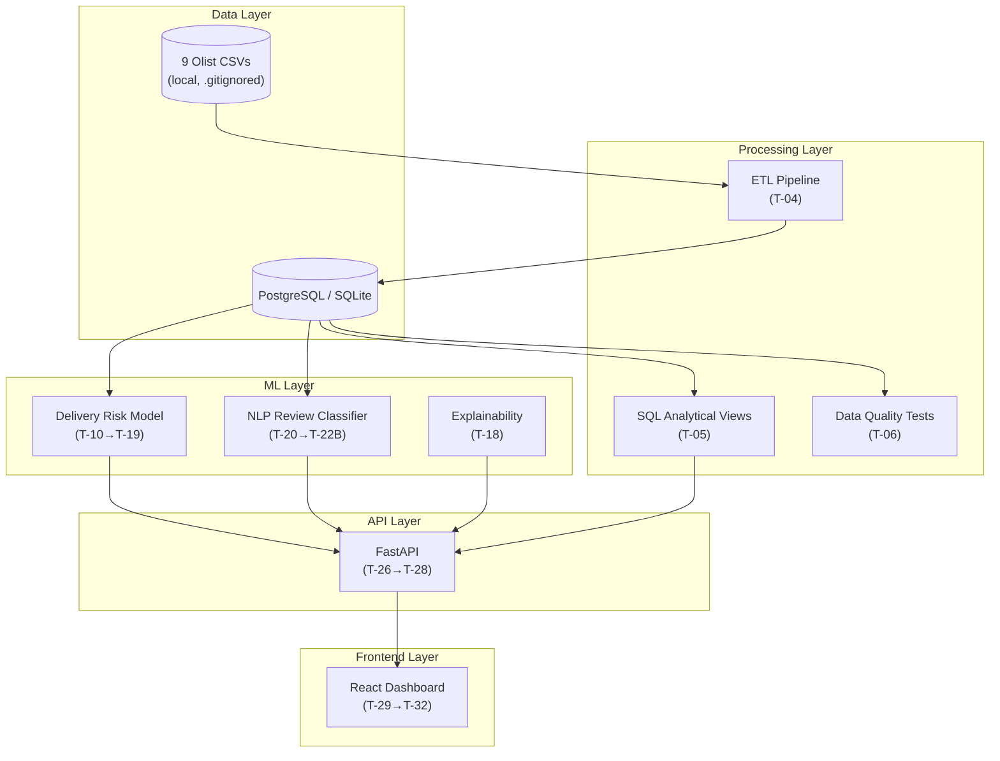
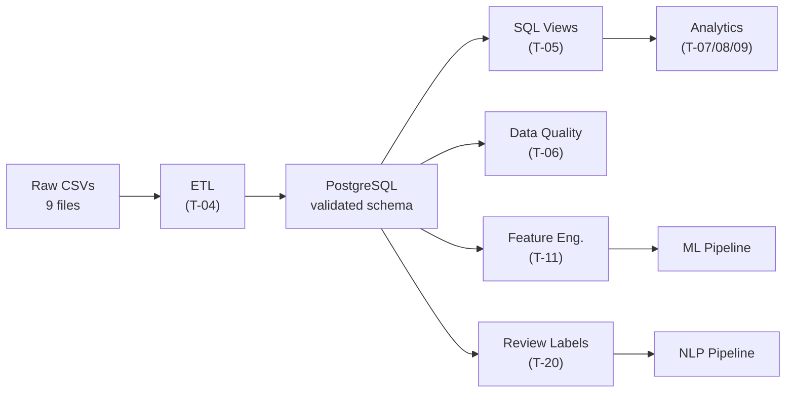
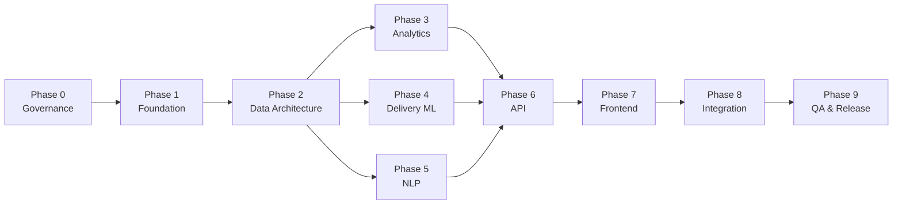
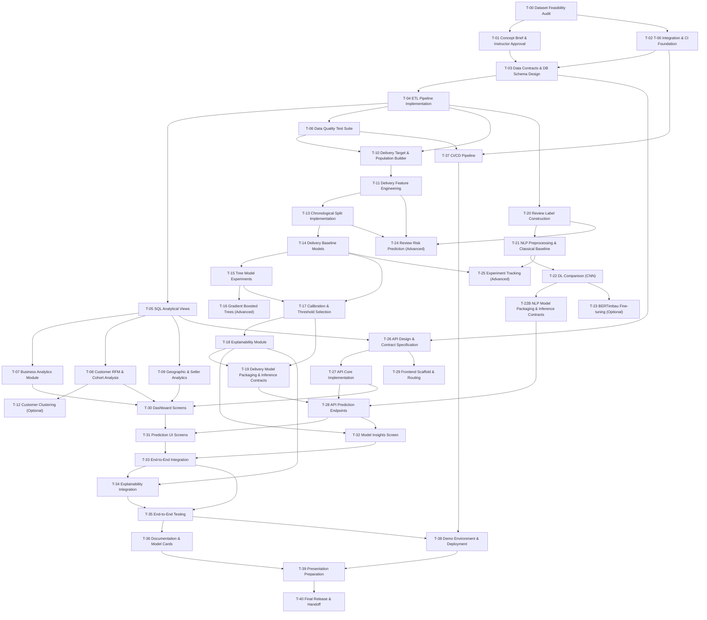
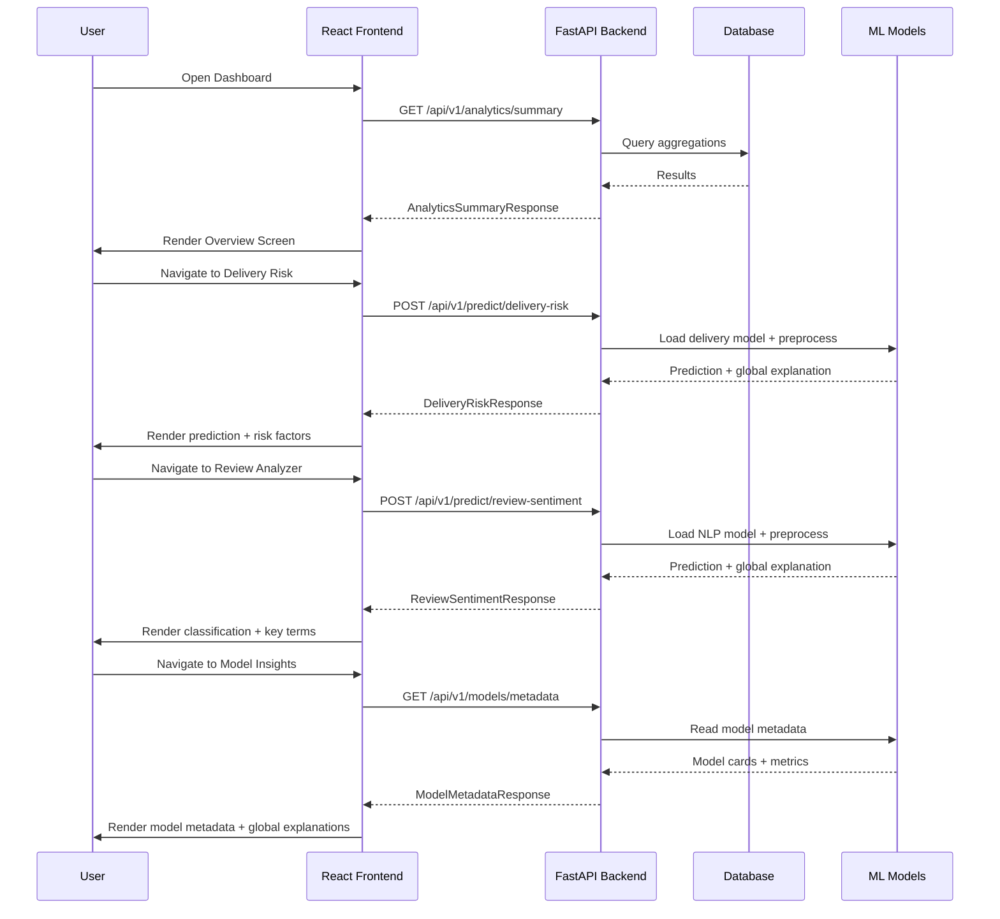
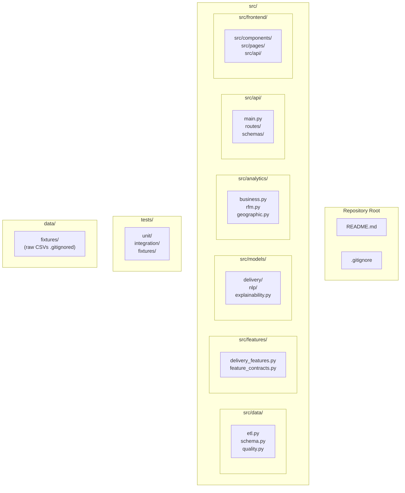

# Olist Intelligence — Master Execution Plan V2.2

**Explainable E-Commerce Analytics & Predictive Intelligence Platform**

**Project:** DEPI Round 5 — Data Scientist Track Graduation Project
**Team:** Wageeh Gadd (Lead), Hamza, Hasnaa, Rana
**Repository:** https://github.com/WageehGadd/olist-intelligence
**Version:** 2.2 (Final targeted engineering patch)
**Date:** 2026-10-12
**Status:** Pending instructor approval (T-01)
**Preceding artifacts:** T-00 Dataset Feasibility Audit (`docs/audits/FINAL_DATASET_AUDIT_REPORT.md`)

---

## Document History

| Version | Date | Changes |
|---|---|---|
| V1 | — | Initial plan |
| V2 | — | Corrections C-01–C-09, audit items 12.1–12.10 |
| V2.2 | 2026-10-12 | Actual audit paths/status, approval gate, purchase input parity, exact validator and schedule reconciliation |
| V2.1 | 2026-10-11 | Engineering audit corrections §1–§13: arithmetic fix, false PASS purge, API contract freeze, T-26 dependency relaxation, NLP packaging (T-22B), Procedure A/B evaluation protocol, explanation contracts, CI semantics, DAG verification, scope classification, workload rebalance, task granularity review, scientific/engineering issue corrections |

---

## Table of Contents

1. [Project Identity & Source Hierarchy](#part-1)
2. [Team Roster & Ownership Rules](#part-2)
3. [Repository Status](#part-3)
4. [T-00 Audit Findings](#part-4)
5. [Scope & Module Architecture](#part-5)
6. [System Diagrams](#part-6)
7. [Repository Structure](#part-7)
8. [API Design](#part-8)
9. [Frontend Design](#part-9)
10. [Task Summary & Workload](#part-10)
11. [Detailed Task Specifications](#part-11)
12. [Technical Decision Records (ADRs)](#part-12)
13. [Scientific Quality Gates](#part-13)
14. [Testing Strategy](#part-14)
15. [Git Workflow and AI Agent Support](#part-15)
16. [Workload Allocation and Scheduling](#part-16)
17. [Risk Register](#part-17)
18. [Outstanding Decisions and Approval Gates](#part-18)
19. [Team-Friendly Summary](#part-19)

---

<a id="part-1"></a>
## Part 1 — Project Identity & Source Hierarchy

### 1.1 Project Name
**Olist Intelligence** — Explainable E-Commerce Analytics & Predictive Intelligence Platform

### 1.2 Source Hierarchy (Descending Authority)

1. **Olist CSV Dataset** — ground truth for all data claims.
2. **T-00 Dataset Feasibility Audit** (`docs/audits/FINAL_DATASET_AUDIT_REPORT.md`) — verified measurements, GO/NO-GO verdicts, baseline experiments.
3. **This Master Execution Plan** — authoritative task-by-task execution reference.
4. **Canonical Task Ledger** (`OLIST_INTELLIGENCE_TASK_LEDGER_V2_2.csv`) — mathematical source of truth for hours, ownership, dependencies.
5. **Team decisions** — documented with `[Decision — team]` tags.
6. **Plan recommendations** — documented with `[Recommendation — this plan]` tags.

### 1.3 Source Traceability Tags

Every factual claim uses one of:

- `[Verified — T-00]` — measured in the audit; cite the specific finding.
- `[Decision — team]` — agreed by team; record the rationale.
- `[Recommendation — this plan]` — proposed here; subject to team review.
- `[Open — unresolved]` — requires future input (instructor, data, experiment).

### 1.4 Invariants

These apply to every task and cannot be overridden:

1. Raw CSVs are never committed to git.
2. Model artifacts (`.pkl`, `.pt`, `.joblib`) are never committed to git.
3. No model selection on test-set performance (ADR-04, §6).
4. All preprocessing fitted on training data only.
5. All population counts must specify their denominator and filter.
6. CI badge reflects Tier A only (C-01).
7. No production-readiness claims (academic demo project).
8. approval_gate_passed=true gates T-03 and all subsequent formal implementation; T-01 administrative closure alone never unlocks it.

Academic context: DEPI Round 5 permits a proposed alternative project only subject to instructor approval. This plan records pending approval, not acceptance. Team formation/task allocation timing and final presentation date require instructor confirmation; no calendar deadline is invented. Administrative response recording is distinct from the academic implementation approval milestone.

---

<a id="part-2"></a>
## Part 2 — Team Roster & Ownership Rules

### 2.1 Team Members

| Member | Role | Strengths | GitHub |
|---|---|---|---|
| **Wageeh Gadd** | Team Lead, Principal ML Engineer | Architecture, ML pipeline, scientific methodology, integration | WageehGadd |
| **Hamza** | Data Engineer, Analytics, Frontend | SQL views, business analytics, tree models, API core, dashboard screens | — |
| **Hasnaa** | ETL, NLP, Customer Intelligence | ETL pipeline, RFM analysis, NLP preprocessing, explainability | — |
| **Rana** | QA, Data Quality, Geographic, Testing | Data quality tests, geographic analytics, review labels, chrono split, testing | — |

### 2.2 Ownership Rules

1. Every task has exactly **one** accountable owner.
2. Owner ≠ Reviewer for every task.
3. Collaborators are listed but the owner is solely accountable.
4. Reviewer must approve the PR before merge; T-01 instructor review is academic response recording, while permission is the separate approval gate.
5. Task reassignment requires team lead approval and ledger update.
6. All assignments are provisional until the onboarding gate (after T-02).

---

<a id="part-3"></a>
## Part 3 — Repository Status

### 3.1 Current State — verified locally 2026-10-12

| Attribute | Value |
|---|---|
| Repository and origin | `WageehGadd/olist-intelligence`; `https://github.com/WageehGadd/olist-intelligence.git` |
| Active branch | `main`; remote default branch NOT VERIFIED |
| Visibility / branch protection | NOT VERIFIED; public/protected are not assumed from the plan |
| Tracked files | `.gitignore`, `README.md` only at pre-patch inspection |
| T-00 analysis | Completed locally; reports, scripts and tests untracked, not shown as merged to GitHub |
| Generated aggregates | `data/processed/t00/`, ignored |
| Raw CSVs / environment | `data/raw/` and `.venv/`, ignored; Python 3.10.20 |
| CI / production implementation | No `.github/workflows/` or `src/` implementation inspected; future tasks |
| Ignore policy | Raw/processed data and `.venv` currently excluded; explicit serialized-model/notebook patterns are future T-02 work |
| License | OPEN; publisher metadata confirmation remains required |

### 3.2 Actual T-00 Artifacts — preserve these locations

```text
olist-intelligence/
├── docs/audits/
│   │   ├── README.md
│   ├── VALIDATION.md
│   └── 00_EXECUTIVE_SUMMARY.md … 10_RISKS_AND_DECISIONS.md
├── scripts/audit/
│   ├── core.py
│   ├── run.py
│   ├── supplement.py
│   ├── baselines.py
│   ├── report.py
│   ├── config.json
│   └── requirements.txt
├── tests/audit/test_core.py
└── data/processed/t00/                 # ignored aggregate JSON/CSV
```

Local completion is distinct from review, staging, commit, PR and merge. T-02 integrates these actual artifacts without relocating them. This patch does not perform those Git mutations.

### 3.3 T-00 reproduction — existing virtual environment

From `/Users/wageehgadd/Desktop/olist-intelligence`:

```sh
.venv/bin/python -B scripts/audit/run.py
.venv/bin/python -B scripts/audit/supplement.py
.venv/bin/python -B scripts/audit/baselines.py
.venv/bin/python -B scripts/audit/report.py
.venv/bin/python -B -m pytest tests/audit -q
```

Generated aggregates remain ignored; preserve immutable authentic CSVs.

---

<a id="part-4"></a>
## Part 4 — T-00 Audit Findings (Authoritative Dataset Evidence)

### 4.1 Dataset Inventory

| Table | Rows | Candidate Key | Uniqueness | Notes |
|---|---|---|---|---|
| olist_orders | 99,441 | order_id | Unique | Central fact table |
| olist_order_items | 112,650 | (order_id, order_item_id) | Unique | 1:N with orders |
| olist_order_payments | 103,886 | (order_id, payment_sequential) | Unique | 1:N with orders |
| olist_order_reviews | 99,224 | source-row surrogate | review_id NOT unique (814 duplicate excess) | 0 orphan rows; 202 conflicting-score orders |
| olist_products | 32,951 | product_id | Unique | |
| olist_sellers | 3,095 | seller_id | Unique | |
| olist_customers | 99,441 | customer_id | Unique (to order) | 96,096 unique customer_unique_id |
| olist_geolocation | 1,000,163 | — | NOT unique on zip | Requires surrogate keys |
| product_category_name_translation | 71 | category (Portuguese) | Unique | |

`[Verified — T-00]`

### 4.2 Data Quality Findings

| Issue | Severity | Count | Mitigation |
|---|---|---|---|
| Missing category names | Medium | 610 products | Flag as 'unknown'; document |
| Missing product dimensions | Medium | 2 products per weight/length/height/width column | Missing indicators; train-only imputation where selected |
| Geolocation non-uniqueness | High | ~1M rows, not unique on zip_code_prefix | Surrogate keys (ADR, 12.5) |
| Review orphans | Low | 0 review rows without matching orders | Preserve validated many-to-one join |
| Conflicting review scores | Medium | 202 orders with multiple conflicting scores | Exclude; document (C-03) |
| Sparse tail months | Medium | Sep–Oct 2018 censored | Exclude from evaluation |

`[Verified — T-00]`

### 4.3 GO/NO-GO Verdicts

| Module | Verdict | Rationale |
|---|---|---|
| SQL Analytics | **GO** | 99K orders, 9 joinable tables, rich dimensions |
| Delivery Risk Prediction | **CONDITIONAL GO** | Calendar lateness: 96,470 eligible, 6,534 positive (6.77%) `[Verified — T-00]` |
| Review Text Classification | **GO** | Strong baseline: AP≈0.850, ROC-AUC≈0.946 `[Verified — T-00]` |
| Customer Intelligence (RFM) | **GO (descriptive)** | 96,096 unique customers; 3.12% repeat rate `[Verified — T-00]` |
| CLV / Loyalty Prediction | **NO-GO** | <300 repeat buyers per 90-day window `[Verified — T-00]` |
| Customer Clustering | **CONDITIONAL GO** | Optional (P2); requires stability benchmarks `[Verified — T-00]` |

### 4.4 Baseline Experiments

#### Delivery Risk

| Model | Split | ROC-AUC | Average Precision | Accuracy |
|---|---|---|---|---|
| DummyClassifier (prior) | Test | 0.500 | 0.04247 | — |
| LogisticRegression | Test | **0.726** | **0.099** | — |

Global eligible population: 96,470 orders, 6,534 late (6.77%). T-00 maturity-filtered test: 32,092 orders, 1,363 late (4.247%). Train/validation/test counts: 41,197 / 16,782 / 32,092. Calendar-day lateness (actual date > estimated date). `[Verified — T-00]`

**Note:** These are T-00 audit benchmarks evaluated on a historical test interval (2018-04-01 to 2018-08-31). They establish baseline performance for pipeline consistency (Procedure A). New model development uses Procedure B (§6 correction). See ADR-04.

#### Review Text Classification

| Model | Split | ROC-AUC | Average Precision |
|---|---|---|---|
| TF-IDF + LogisticRegression | Test | **0.946** | **0.850** |

Binary target: score 1–2 (low-rating) vs. 3–5 (not-low-rating). NOT gold-standard sentiment — this is a rating-proxy classification. `[Verified — T-00]`

### 4.5 Review Label Construction

- Order-level labels require unanimous observed score; exclude 202 conflicting-score orders. No arbitrary first-review selection defines T-00 labels.
- Procedure A NLP reproduces `scripts/audit/baselines.py`: strip/casefold/collapse whitespace; remove ALL globally repeated normalized texts and ALL multi-review orders; require nonempty text and unanimous order score. Split on `review_answer_timestamp` at the same boundaries as delivery. Counts: 14,412 train / 6,987 validation / 12,100 test. `[Verified — T-00]`
- Corpus-wide duplicate filtering changes the population using later-corpus knowledge. Procedure B must freeze its prospective duplicate policy and label revised experiments separately; never claim reproduction after changing it.
- Primary NLP is post-submission rating-proxy classification: 1–2 versus 3–5, not gold sentiment or purchase-time review risk. Three-star sensitivity is OPEN.

### 4.6 Feature Availability at the Primary Purchase Snapshot

Cart, original promise and geography are retrospective snapshot assumptions; their historical version/online availability is NOT proved by Olist. Purchase timestamps exist and are supplied explicitly. The frozen MVP contract in Part 8 uses only the ten T-00 purchase baseline features derivable from the request. No payment/installment, actual delivery, review, final status, historical seller aggregate, geographic distance or catalog-dimension input is mandatory. Any later feature-set experiment must version the raw schema and show request/lookup derivability and parity before serving. Payment approval and carrier snapshots are separate future contracts; no later-snapshot model is silently served as purchase-time risk.

---

<a id="part-5"></a>
## Part 5 — Scope & Module Architecture

### 5.1 Module Overview

| Module | Description | Key Tasks | Scope |
|---|---|---|---|
| **A. Data Foundation** | ETL, schema, quality | T-02, T-03, T-04, T-05, T-06 | MVP |
| **B. Analytics** | SQL queries, RFM, geographic | T-07, T-08, T-09 | MVP |
| **C. Delivery ML** | Target, features, models, calibration | T-10–T-19 | MVP + Advanced |
| **D. NLP** | Review labels, preprocessing, models, packaging | T-20–T-22B | MVP |
| **E. API & Frontend** | FastAPI, React dashboard | T-26–T-32 | MVP |
| **F. Integration & QA** | E2E testing, explainability, deployment | T-18, T-25, T-33–T-38 | MVP + Advanced |
| **G. Governance** | Concept brief, presentation, release | T-00, T-01, T-39, T-40 | Governance |

### 5.2 Scope Classification (§10 Correction)

**Required Academic Delivery Effort** = MVP (294h) + Governance (18h) = **312h**

This is the minimum work to produce a defensible graduation project with:
- Working data pipeline
- Delivery risk model with proper evaluation
- Review text classifier with DL comparison (CNN)
- FastAPI serving both models
- React frontend with 7 screens
- Explainability module
- Documentation and presentation

**Optional Technical Expansion** = Advanced (24h) + Optional (22h) = **46h**

- Advanced: T-16 (Gradient Boosted Trees, 8h), T-24 (Review Risk Prediction, 10h), T-25 (MLflow, 6h)
- Optional: T-12 (Customer Clustering, 8h), T-23 (BERTimbau, 14h)

### 5.3 Scope Rules

1. No mandatory (MVP/Governance) task depends on an Advanced or Optional task. `[Machine-verified]`
2. The CNN comparison (T-22) remains **mandatory** (MVP) — it fulfills the DL requirement. `[Decision — team]`
3. Model explainability (T-18: permutation importance) is **mandatory** (MVP). Optional SHAP is a stretch goal within T-18. `[Decision — team]`
4. The final app can be demonstrated without optional features. Fallback paths exist for every Advanced/Optional task. `[Recommendation — this plan]`
5. P1 tasks (T-15, T-38) are MVP scope — the P1 priority indicates they are important but may be simplified, not that they are optional. `[Recommendation — this plan]`

### 5.4 Explicit Exclusions

- ✗ Customer Lifetime Value (CLV) — NO-GO `[Verified — T-00]`
- ✗ Real-time streaming — out of scope `[Decision — team]`
- ✗ Streamlit — explicitly excluded `[Decision — team]`
- ✗ Production deployment — academic demo only `[Decision — team]`
- ✗ User authentication — not required `[Decision — team]`
- ✗ Mobile app — desktop web only `[Decision — team]`

---

<a id="part-6"></a>
## Part 6 — System Diagrams

### 6.1 High-Level System Architecture



### 6.2 Data Pipeline Flow



### 6.3 Phase Dependency DAG



### 6.4 Task Dependency DAG

Full canonical task-edge coverage; T-01 → T-03 requires approval_gate_passed, not administrative closure.



### 6.5 API–Frontend Sequence Diagram



### 6.6 Repository Module Map



---

<a id="part-7"></a>
## Part 7 — Repository Structure

### 7.1 Target Directory Layout — future components, existing audit paths preserved

```
olist-intelligence/
├── .github/
│   └── workflows/
│       └── ci.yml                    # Tier A CI (GitHub Actions)
├── data/
│   ├── fixtures/                     # Synthetic test data (committed)
│   │   ├── orders_fixture.csv
│   │   ├── items_fixture.csv
│   │   └── ...
│   ├── processed/t00/                # existing generated audit aggregates (ignored)
│   └── raw/                          # Authentic CSVs (.gitignored)
│       ├── olist_orders_dataset.csv
│       └── ...
├── src/
│   ├── data/
│   │   ├── __init__.py
│   │   ├── etl.py                    # T-04
│   │   ├── schema.py                 # T-03
│   │   └── quality.py                # T-06
│   ├── features/
│   │   ├── __init__.py
│   │   ├── delivery_features.py      # T-11
│   │   └── feature_contracts.py      # T-11
│   ├── models/
│   │   ├── __init__.py
│   │   ├── delivery/
│   │   │   ├── baseline.py           # T-14
│   │   │   ├── trees.py              # T-15
│   │   │   ├── calibration.py        # T-17
│   │   │   └── package.py            # T-19
│   │   ├── nlp/
│   │   │   ├── preprocessing.py      # T-21
│   │   │   ├── classical.py          # T-21
│   │   │   ├── cnn.py                # T-22
│   │   │   └── package.py            # T-22B
│   │   └── explainability.py         # T-18
│   ├── analytics/
│   │   ├── __init__.py
│   │   ├── business.py               # T-07
│   │   ├── rfm.py                    # T-08
│   │   └── geographic.py             # T-09
│   ├── api/
│   │   ├── __init__.py
│   │   ├── main.py                   # T-27
│   │   ├── routes/
│   │   │   ├── analytics.py          # T-27
│   │   │   ├── predictions.py        # T-28
│   │   │   └── models.py             # T-28
│   │   └── schemas/
│   │       ├── analytics.py          # T-26
│   │       ├── predictions.py        # T-26
│   │       └── models.py             # T-26
│   └── frontend/                     # React app (T-29)
│       ├── package.json
│       ├── src/
│       │   ├── App.jsx
│       │   ├── pages/
│       │   │   ├── Overview.jsx       # T-30
│       │   │   ├── Sales.jsx          # T-30
│       │   │   ├── Geographic.jsx     # T-30
│       │   │   ├── Customers.jsx      # T-30
│       │   │   ├── DeliveryRisk.jsx   # T-31
│       │   │   ├── ReviewAnalyzer.jsx # T-31
│       │   │   └── ModelInsights.jsx  # T-32
│       │   ├── components/
│       │   └── api/
│       │       └── client.js
│       └── public/
├── tests/
│   ├── audit/                         # existing T-00 tests; Tier B integration pending T-02
│   ├── planning/                      # stdlib plan-validator mutation tests
│   ├── conftest.py
│   ├── unit/
│   ├── integration/
│   └── fixtures/
├── docs/
│   ├── audits/                        # actual T-00 report/README/VALIDATION
│   ├── planning/                      # V2.2 planning package
│   ├── model_cards/
│   └── presentation/
├── scripts/
│   ├── audit/                         # existing T-00 scripts/config/dependencies
│   ├── planning/                      # V2.2 validator
│   └── demo.sh                            # T-38
├── README.md
├── requirements.txt
└── .gitignore
```

### 7.2 CI Configuration (§8 Correction)

**Tier A — GitHub-Hosted CI** (`ci.yml`)

Runs on every push and PR via GitHub Actions:

```yaml
name: Tier A CI
on: [push, pull_request]
jobs:
  test:
    runs-on: ubuntu-latest
    steps:
      - uses: actions/checkout@v4
      - uses: actions/setup-python@v5
        with:
          python-version: '3.10'
      - run: pip install -r requirements.txt
      - run: python -m pytest -m "not full_data" --tb=short
      - run: python -m ruff check src/
```

Key points:
- Uses synthetic fixtures from `data/fixtures/` (committed).
- Selects tests via pytest marker: `-m "not full_data"` (not `--fixtures-only`, which is not a standard pytest option).
- No raw CSVs needed. No authentic data on the runner.
- Badge reflects Tier A results only.

**Tier B — Local Full-Data Validation**

Runs manually on a developer's machine where the nine authentic CSVs exist:

```bash
# Local command — NOT a GitHub Actions workflow
.venv/bin/python -m pytest -m "full_data" --tb=short -v
```

Key points:
- Requires authentic CSVs in `data/raw/`.
- Validates: count reconciliation, metric reproduction, integration tests.
- Results documented in PR description or release notes.
- NOT run via `workflow_dispatch` — GitHub-hosted runners cannot access local `.gitignored` files.
- If a self-hosted runner with authorized dataset access is available, Tier B may optionally use `workflow_dispatch` on that runner. This is not assumed. `[Open — unresolved]`

**Fixture isolation:** Tests marked `not full_data` must not read from `data/raw/`. `conftest.py` provides fixture paths via `@pytest.fixture`. Raw-data paths are injected only for `full_data`-marked tests.

---

<a id="part-8"></a>
## Part 8 — API Design

### 8.1 Canonical Endpoint Registry

The following 10 endpoints are the **frozen API contract**. All frontend screens, task specifications, validation checks, and documentation must reference these exact paths.

| # | Method | Path | Purpose | Backing Data |
|---|---|---|---|---|
| 1 | GET | `/api/v1/health` | Health check | Runtime |
| 2 | GET | `/api/v1/analytics/summary` | Overview dashboard KPIs | SQL views (T-05) |
| 3 | GET | `/api/v1/analytics/trends` | Time-series orders / gross item value plus freight | SQL views (T-05) |
| 4 | GET | `/api/v1/analytics/geographic` | Geographic distribution | SQL views (T-05, T-09) |
| 5 | GET | `/api/v1/analytics/categories` | Product category analysis | SQL views (T-05) |
| 6 | GET | `/api/v1/analytics/customers` | Customer metrics and RFM bands | SQL views (T-05, T-08) |
| 7 | GET | `/api/v1/analytics/sellers` | Seller performance metrics | SQL views (T-05) |
| 8 | POST | `/api/v1/predict/delivery-risk` | Delivery lateness prediction | Delivery model (T-19) |
| 9 | POST | `/api/v1/predict/review-sentiment` | Review text classification | NLP model (T-22B) |
| 10 | GET | `/api/v1/models/metadata` | Model cards and global explanations | Model packages (T-19, T-22B) |

<!-- historical-routes:start -->
**Phantom endpoints purged from V2:** The following paths appeared in the V2 validation report and changelog but do NOT exist in the API contract: `/api/v1/overview/kpis`, `/api/v1/sales/trends`, `/api/v1/geographic/analytics`, `/api/v1/customers/rfm`, `/api/v1/customers/segments`, `/api/v1/predict/review-risk`. These are historical references only.
<!-- historical-routes:end -->

### 8.2 Screen-to-Endpoint Coverage Matrix

| Frontend Screen | Primary Endpoint(s) | Secondary | Task |
|---|---|---|---|
| Overview | `/api/v1/analytics/summary` | `/api/v1/analytics/trends` | T-30 |
| Sales & Trends | `/api/v1/analytics/trends`, `/api/v1/analytics/categories` | | T-30 |
| Geographic | `/api/v1/analytics/geographic` | | T-30 |
| Customers | `/api/v1/analytics/customers` | | T-30 |
| Delivery Risk | `/api/v1/predict/delivery-risk` | `/api/v1/models/metadata` | T-31 |
| Review Analyzer | `/api/v1/predict/review-sentiment` | `/api/v1/models/metadata` | T-31 |
| Model Insights | `/api/v1/models/metadata` | | T-32 |

Every screen has at least one backing endpoint. No screen depends on an endpoint outside this registry.

### 8.3 Endpoint Contracts

All payloads below are SYNTHETIC CONTRACT EXAMPLES, not actual implemented responses or model results. Audited population metadata is explicitly labeled and is distinct from synthetic metrics. No production mocks, API or models exist yet.

#### Endpoint 1: Health Check

```
GET /api/v1/health
Response 200:
{
  "status": "healthy",
  "version": "0.1.0",
  "models_loaded": {
    "delivery_risk": true,
    "review_sentiment": true
  }
}
```

#### Endpoint 2: Analytics Summary

```
GET /api/v1/analytics/summary
Query params: ?start_date=2017-01-01&end_date=2018-08-31 (optional filters)
Response 200:
```

```json
{
  "_meta": {
    "note": "ILLUSTRATIVE SYNTHETIC FIXTURE DATA — not observed Olist results",
    "population": "10 all-status fixture orders; money/AOV use 8 delivered fixture orders",
    "source": "SQL analytical views (T-05)"
  },
  "total_orders": 10,
  "total_item_value_plus_freight_brl": 160.0,
  "total_customers": 6,
  "average_order_value_brl": 20.0,
  "average_review_score": 4.0,
  "delivery_on_time_rate": 0.875,
  "period": {
    "start": "2017-01-01",
    "end": "2018-08-31"
  },
  "monetary_population_order_count": 8,
  "average_order_value_population": "8 delivered fixture orders",
  "delivery_rate_population": "8 eligible fixture orders"
}
```

**Monetary KPI:** gross item value plus charged freight in BRL, restricted to `order_status = delivered` and purchase-date filters; exclude canceled, unavailable, created, approved, invoiced, processing and shipped. It is not Olist revenue, profit or net cash receipts; refunds, fees and margins are unavailable. Total order/customer counts may use all statuses but must expose separate denominators. Aggregate items and payments separately at order grain; correctly summed payments are a separate recorded-payment KPI, not intrinsically installment-inflated. Category breakdown uses item-grain sums and distinct orders; order counts across categories are nonadditive. Delivery rate uses eligible labels only, reviews use unanimous-scored order denominator. Synthetic response figures are contract examples, not audited sums.

#### Endpoint 3: Analytics Trends

```
GET /api/v1/analytics/trends
Query params: ?granularity=monthly&start_date=...&end_date=...
Response 200:
```

```json
{
  "_meta": {
    "note": "ILLUSTRATIVE SYNTHETIC FIXTURE DATA",
    "population": "orders grouped by order_purchase_timestamp"
  },
  "granularity": "monthly",
  "data": [
    {"period": "2017-01", "order_count": 5, "item_value_plus_freight_brl": 100.00},
    {"period": "2017-02", "order_count": 5, "item_value_plus_freight_brl": 60.00}
  ]
}
```

#### Endpoint 4: Analytics Geographic

```
GET /api/v1/analytics/geographic
Query params: ?level=state (state | city)
Response 200:
```

```json
{
  "_meta": {
    "note": "ILLUSTRATIVE SYNTHETIC FIXTURE DATA",
    "population": "all orders with customer geolocation"
  },
  "level": "state",
  "data": [
    {"region": "SP", "order_count": 6, "item_value_plus_freight_brl": 100.00, "avg_delivery_days": 8.2},
    {"region": "RJ", "order_count": 4, "item_value_plus_freight_brl": 60.00, "avg_delivery_days": 10.1}
  ]
}
```

#### Endpoint 5: Analytics Categories

```
GET /api/v1/analytics/categories
Query params: ?top_n=10
Response 200:
```

```json
{
  "_meta": {
    "note": "ILLUSTRATIVE SYNTHETIC FIXTURE DATA",
    "population": "order_items joined with products"
  },
  "data": [
    {"category": "bed_bath_table", "order_count": 3, "item_value_plus_freight_brl": 60.00, "avg_review_score": 4.0}
  ]
}
```

#### Endpoint 6: Analytics Customers

```
GET /api/v1/analytics/customers
Response 200:
```

```json
{
  "_meta": {
    "note": "ILLUSTRATIVE SYNTHETIC FIXTURE DATA",
    "population_total_customers": "6 synthetic fixture customers, NOT audited Olist count",
    "population_rfm": "5 synthetic delivered-order customers; Recency uses purchase time",
    "rfm_note": "RFM bands are descriptive groupings, not predictive segments"
  },
  "total_unique_customers": 6,
  "repeat_customer_rate": 0.16666666666666666,
  "rfm_summary": {
    "population": 5,
    "population_filter": "customers with at least one delivered order",
    "bands": [
      {
        "band": "Champions",
        "count": 1,
        "description": "High R, F, M"
      },
      {
        "band": "Loyal",
        "count": 1,
        "description": "High F, M"
      },
      {
        "band": "At Risk",
        "count": 1,
        "description": "Low R, previously active"
      },
      {
        "band": "Others",
        "count": 2,
        "description": "Remaining customers"
      }
    ],
    "note": "Band counts are ILLUSTRATIVE SYNTHETIC FIXTURE DATA. Actual bands computed by T-08."
  }
}
```

**Population consistency (§7.5):** Total unique customers (96,096) counts all `customer_unique_id`. RFM population (93,358) is the subset with at least one delivered order — Recency uses latest purchase timestamp relative to 2018-09-01; delivered-only is a business population filter, not a universal RFM requirement. These are different populations and must not be mixed.

#### Endpoint 7: Analytics Sellers

```
GET /api/v1/analytics/sellers
Query params: ?top_n=10&sort_by=item_value_plus_freight
Response 200:
```

```json
{
  "_meta": {
    "note": "ILLUSTRATIVE SYNTHETIC FIXTURE DATA",
    "population": "all sellers with at least one order"
  },
  "total_sellers": 2,
  "data": [
    {
      "seller_id": "synthetic-seller-a",
      "order_count": 4,
      "item_value_plus_freight_brl": 80.0,
      "avg_review_score": 4.0,
      "on_time_rate": 0.75
    }
  ]
}
```

#### Endpoint 8: Delivery Risk Prediction — purchase-v1 canonical contract

POST /api/v1/predict/delivery-risk

**Primary snapshot: purchase creation.** Academic retrospective simulator; static Olist rows do not establish historical live availability. Mandatory raw fields are user-entered historical local `purchase_timestamp`, original `estimated_delivery_date`, `customer_state`, and a nonempty `items` array with one row per unit and `product_key`, `seller_key`, `price_brl`, `freight_value_brl`. Repeated keys identify repeated products/sellers solely for counts, never encoded as identity features. No external lookup is required. Metadata keys are synthetic for simulation; dataset IDs may be used internally for retrospective replay only.

Synthetic request (not an observed Olist transaction):

```json
{
  "purchase_timestamp": "2018-05-10T10:30:00",
  "estimated_delivery_date": "2018-05-25",
  "customer_state": "SP",
  "items": [
    {
      "product_key": "synthetic-product-a",
      "seller_key": "synthetic-seller-a",
      "price_brl": 120.0,
      "freight_value_brl": 25.0
    }
  ]
}
```

Canonical raw schema and frozen fixture: `docs/planning/delivery_contract_v2_2.json`.

| Engineered feature | Transformation | Historical source | Inference source / availability |
|---|---|---|---|
| `item_count` | len(items) | `order_items.order_item_id` | Request-derived; purchase cart/promise availability is assumed |
| `item_price` | sum(item.price_brl) | `order_items.price` | Request-derived; purchase cart/promise availability is assumed |
| `freight` | sum(item.freight_value_brl) | `order_items.freight_value` | Request-derived; purchase cart/promise availability is assumed |
| `seller_count` | count distinct seller_key | `order_items.seller_id` | Request-derived; purchase cart/promise availability is assumed |
| `product_count` | count distinct product_key | `order_items.product_id` | Request-derived; purchase cart/promise availability is assumed |
| `purchase_hour` | hour(purchase_timestamp) | `orders.order_purchase_timestamp` | Request-derived; purchase cart/promise availability is assumed |
| `purchase_weekday` | weekday(purchase_timestamp), Monday=0 | `orders.order_purchase_timestamp` | Request-derived; purchase cart/promise availability is assumed |
| `purchase_month` | month(purchase_timestamp) | `orders.order_purchase_timestamp` | Request-derived; purchase cart/promise availability is assumed |
| `promise_days` | (estimated_delivery_date at midnight - purchase_timestamp).total_seconds / 86400 | `orders.order_estimated_delivery_date; order_purchase_timestamp` | Request-derived; purchase cart/promise availability is assumed |
| `customer_state` | customer_state, train-only one-hot | `customers.customer_state` | Request-derived; purchase cart/promise availability is assumed |

Required fields missing/null, invalid dates/states, empty items, empty keys, nonfinite/negative amounts, unsupported timezone offsets and extra fields return 422. No purchase timestamp may come from server time. Date must be at/after purchase calendar date; midnight promise semantics match T-00 engineered lead time. Every item row is one unit, including repeated products. Zero amounts are allowed with documented quality caveats. Customer state is a validated Brazilian code; unseen valid train categories use frozen encoder handling. Training-only imputation of historical missing aggregated cart features is retained in the fitted preprocessor; the serving contract rejects missing mandatory raw fields rather than fabricating them.

No required payment/installment, category, dimension, seller-state, distance or historical aggregate fields. New feature experiments require a new contract version, measured missingness and reliable point-in-time lookup/request provenance before inclusion. The exact same future `src/features/delivery_features.py` transformation and packaged fitted preprocessor must serve training rows and API requests. No transformation implementation is created in this planning patch.

**Frozen parity tests required in T-11/T-19/T-28:** map the fixture to expected ordered ten features (including promise_days=14.5625, weekday=3); compare offline adapter versus request adapter before and after serialization, then compare predictions to numerical tolerance. Include repeated products/sellers, midnight/year boundaries, unseen valid state, missing/null/extra fields and malformed dates; assert 422/503. No production feature function was executed in V2.2.

Synthetic response shape (probability and importance values are illustrative, not fitted model results):

```json
{
  "_meta": {"note": "ILLUSTRATIVE SYNTHETIC FIXTURE DATA", "schema_version": "purchase-v1", "snapshot": "purchase_creation", "limitations": "Academic retrospective simulator; no verified live performance"},
  "prediction": "late",
  "predicted_probability": 0.72,
  "threshold_used": 0.5,
  "probability_note": "Model score with measured calibration limitations; not a guaranteed chance",
  "explanation": {"method": "global_feature_importance", "method_note": "Model-wide associations, not instance causal explanations", "top_factors": []}
}
```

Global audited label denominator is 96,470 with 6,534 late (6.77%); the T-00 chronological test prevalence is 4.247% (1,363 / 32,092). Neither is the future serving population. Return model version, feature schema, snapshot and calibration provenance with actual future predictions.


#### Endpoint 9: Review Sentiment Prediction (§7.3 Correction)

```
POST /api/v1/predict/review-sentiment
Request:
```

```json
{
  "review_text": "Produto chegou com defeito e demorou muito para entregar.",
  "review_title": "Péssimo"
}
```

```
Response 200:
```

```json
{
  "_meta": {
    "model_type": "TF-IDF + LogisticRegression (or best from T-21/T-22 comparison)",
    "target": "rating_proxy: score 1-2 (low-rating) vs 3-5 (not-low-rating)",
    "target_note": "This is a rating-proxy classification, NOT gold-standard sentiment annotation. The model predicts whether a review corresponds to a 1-2 star rating.",
    "population": "T-00 Procedure A nonempty message, unanimous score, excludes ALL multi-review orders and ALL globally repeated normalized texts; NLP is post-submission"
  },
  "prediction": "low_rating",
  "predicted_probability": 0.89,
  "probability_note": "Raw model predicted probability for the low_rating class. Calibration and label quality impose limitations on interpreting this as a true probability.",
  "label_mapping": {"low_rating": "score 1-2", "not_low_rating": "score 3-5"},
  "explanation": {
    "method": "global_feature_importance",
    "method_note": "TF-IDF feature weights or model coefficients. NOT per-instance causal attributions.",
    "top_terms": [
      {"term": "defeito", "weight": 0.85},
      {"term": "péssimo", "weight": 0.78},
      {"term": "demorou", "weight": 0.62}
    ]
  }
}
```

#### Endpoint 10: Model Metadata

```
GET /api/v1/models/metadata
Response 200:
```

```json
{
  "models": [
    {
      "name": "delivery_risk",
      "version": "1.0.0",
      "algorithm": "LogisticRegression",
      "training_data": {
        "eligible_global_population": "96,470 delivered orders [Verified — T-00], NOT training split size",
        "eligible_global_positive_rate": "6.77% (6,534 late), NOT final test prevalence",
        "split": "chronological: train <2018-01-01, val 2018-01-01 to <2018-04-01, test 2018-04-01 to <2018-09-01",
        "fingerprint": "sha256 of training CSV subset"
      },
      "metrics": {
        "note": "Procedure B final evaluation metrics. Reported after model freeze.",
        "test_roc_auc": null,
        "test_average_precision": null,
        "validation_roc_auc": null,
        "calibration_brier_score": null
      },
      "global_explanation": {
        "method": "coefficients or feature_importances_",
        "top_features": []
      },
      "limitations": [
        "Selection bias: only delivered orders; excludes canceled/returned",
        "Temporal coverage: 2017-01 to 2018-08",
        "Class imbalance: 6.77% positive rate",
        "Only customer state used in purchase-v1; geographic distance is not a required model input"
      ],
      "rebuild_procedure": ".venv/bin/python -m src.models.delivery.package --rebuild"
    },
    {
      "name": "review_sentiment",
      "version": "1.0.0",
      "algorithm": "TF-IDF + LogisticRegression (or CNN from T-22)",
      "training_data": {
        "population": "T-00 Procedure A excludes all multi-review orders and globally repeated normalized texts; Procedure B revised policy explicitly versioned",
        "target": "rating proxy (1-2 vs 3-5), NOT sentiment",
        "split": "review_answer_timestamp chronology at same date boundaries; Procedure A counts 14412/6987/12100",
        "fingerprint": "sha256 of training text subset"
      },
      "metrics": {
        "note": "Procedure B final evaluation metrics",
        "test_roc_auc": null,
        "test_average_precision": null
      },
      "global_explanation": {
        "method": "TF-IDF coefficients or CNN feature maps",
        "top_terms": []
      },
      "limitations": [
        "Rating proxy, not gold-standard sentiment",
        "Portuguese text only",
        "3-star ambiguity unresolved [Open — unresolved]",
        "202 conflicting-score orders excluded"
      ],
      "rebuild_procedure": ".venv/bin/python -m src.models.nlp.package --rebuild"
    }
  ]
}
```

**Note:** Metric values are `null` until models are trained and frozen. This is intentional — no fabricated metrics. `[Recommendation — this plan]`

---

<a id="part-9"></a>
## Part 9 — Frontend Design

### 9.1 Screen Inventory

| # | Screen | Description | API Dependencies | Task |
|---|---|---|---|---|
| 1 | Overview | KPIs, summary metrics, trend sparklines | `/api/v1/analytics/summary`, `/api/v1/analytics/trends` | T-30 |
| 2 | Sales & Trends | Time-series charts, category breakdown | `/api/v1/analytics/trends`, `/api/v1/analytics/categories` | T-30 |
| 3 | Geographic | State/city distribution map/charts | `/api/v1/analytics/geographic` | T-30 |
| 4 | Customers | RFM bands, repeat rate, cohort table | `/api/v1/analytics/customers` | T-30 |
| 5 | Delivery Risk | Prediction form + result display | `/api/v1/predict/delivery-risk`, `/api/v1/models/metadata` | T-31 |
| 6 | Review Analyzer | Text input + classification result | `/api/v1/predict/review-sentiment`, `/api/v1/models/metadata` | T-31 |
| 7 | Model Insights | Model cards, metrics, global explanations | `/api/v1/models/metadata` | T-32 |

### 9.2 UI Requirements

All screens must include:
- Loading states (spinner while API responds).
- Error states (network error, API 503, model not loaded).
- Empty states (no data for selected filters).
- Data limitation disclaimers where appropriate.
- No fabricated metrics — display `null` metrics as "Not yet computed" or "Awaiting model training."

### 9.3 Frontend–API Contract Rules

Delivery Risk form follows purchase-v1 unit-item inputs, explicit historical purchase timestamp and promise date; no server-time default, installments or unsupported dimension fields. Show "Academic retrospective simulator — historical/live availability and operational performance unverified". Freeze mock inputs/expected feature ordering from delivery_contract_v2_2.json; mocks are synthetic contract shapes, not observed dataset results.


1. Every chart and table must map to a specific response field from a canonical endpoint.
2. No frontend component may depend on a response field not defined in Part 8.
3. Mock data for development must be clearly separated from live API integration.
4. Contract changes require updating Part 8, T-26 schemas, and affected screen components.

---

<a id="part-10"></a>
## Part 10 — Task Summary & Workload

### 10.1 Task Summary Table

Canonical ledger values, task-by-task; collaboration hours are a pooled task budget across named nonowner collaborators, not hours for each person. Reviewer hours are per task. No per-person split of collaborator budget is claimed.

| Task ID | Title | Owner | Phase | Scope | Priority | Owner Hours | Deps | Status | Collaborators | Reviewer | Collaborator Hours | Reviewer Hours |
| --- | --- | --- | --- | --- | --- | --- | --- | --- | --- | --- | --- | --- |
| T-00 | Dataset Feasibility Audit | Wageeh | 0 — Governance | Governance | — | 0 | — | Completed locally | — | N/A | 0 | 0 |
| T-01 | Concept Brief & Instructor Approval | Wageeh | 0 — Governance | Governance | P0 | 6 | T-00 | Planned | Hamza, Hasnaa, Rana | Instructor | 2 | 1 |
| T-02 | T-00 Integration & CI Foundation | Hamza | 1 — Foundation | MVP | P0 | 10 | T-00 | Planned | Wageeh | Wageeh | 2 | 1 |
| T-03 | Data Contracts & DB Schema Design | Wageeh | 2 — Data Architecture | MVP | P0 | 12 | T-01(approval_gate_passed), T-02 | Planned | Hamza | Hamza | 2 | 1 |
| T-04 | ETL Pipeline Implementation | Hasnaa | 2 — Data Architecture | MVP | P0 | 14 | T-03 | Planned | Wageeh | Wageeh | 2 | 1 |
| T-05 | SQL Analytical Views | Hamza | 2 — Data Architecture | MVP | P0 | 10 | T-04 | Planned | Wageeh | Wageeh | 1 | 1 |
| T-06 | Data Quality Test Suite | Rana | 2 — Data Architecture | MVP | P0 | 10 | T-04 | Planned | Wageeh | Wageeh | 1 | 1 |
| T-07 | Business Analytics Module | Hamza | 3 — Analytics | MVP | P0 | 8 | T-05 | Planned | Wageeh | Rana | 1 | 1 |
| T-08 | Customer RFM & Cohort Analysis | Hasnaa | 3 — Analytics | MVP | P0 | 8 | T-05 | Planned | Wageeh | Hamza | 1 | 1 |
| T-09 | Geographic & Seller Analytics | Rana | 3 — Analytics | MVP | P0 | 8 | T-05 | Planned | Wageeh | Hamza | 1 | 1 |
| T-10 | Delivery Target & Population Builder | Wageeh | 4 — Delivery ML | MVP | P0 | 8 | T-04, T-06 | Planned | Rana | Rana | 1 | 1 |
| T-11 | Delivery Feature Engineering | Wageeh | 4 — Delivery ML | MVP | P0 | 10 | T-10 | Planned | Hamza | Hamza | 1 | 1 |
| T-12 | Customer Clustering (Optional) | Hasnaa | 3 — Analytics | Optional | P2 | 8 | T-08 | Planned | Wageeh | Hamza | 1 | 1 |
| T-13 | Chronological Split Implementation | Rana | 4 — Delivery ML | MVP | P0 | 6 | T-11 | Planned | Wageeh | Wageeh | 1 | 1 |
| T-14 | Delivery Baseline Models | Wageeh | 4 — Delivery ML | MVP | P0 | 10 | T-13 | Planned | Hamza | Hamza | 1 | 1 |
| T-15 | Tree Model Experiments | Hamza | 4 — Delivery ML | MVP | P1 | 10 | T-14 | Planned | Wageeh | Wageeh | 1 | 1 |
| T-16 | Gradient Boosted Trees (Advanced) | Wageeh | 4 — Delivery ML | Advanced | P1 | 8 | T-15 | Planned | Hamza | Hamza | 1 | 1 |
| T-17 | Calibration & Threshold Selection | Wageeh | 4 — Delivery ML | MVP | P0 | 8 | T-14, T-15 | Planned | Rana | Rana | 1 | 1 |
| T-18 | Explainability Module | Hasnaa | 8 — Integration | MVP | P0 | 10 | T-17 | Planned | Wageeh | Wageeh | 1 | 1 |
| T-19 | Delivery Model Packaging & Inference Contracts | Wageeh | 4 — Delivery ML | MVP | P0 | 8 | T-17, T-18 | Planned | Hamza | Hamza | 1 | 1 |
| T-20 | Review Label Construction | Rana | 5 — NLP | MVP | P0 | 8 | T-04 | Planned | Wageeh | Wageeh | 1 | 1 |
| T-21 | NLP Preprocessing & Classical Baseline | Hasnaa | 5 — NLP | MVP | P0 | 12 | T-20 | Planned | Wageeh | Wageeh | 1 | 1 |
| T-22 | DL Comparison (CNN) | Hamza | 5 — NLP | MVP | P0 | 10 | T-21 | Planned | Wageeh | Wageeh | 1 | 1 |
| T-22B | NLP Model Packaging & Inference Contracts | Hasnaa | 5 — NLP | MVP | P0 | 6 | T-22 | Planned | Wageeh | Wageeh | 1 | 1 |
| T-23 | BERTimbau Fine-tuning (Optional) | Wageeh | 5 — NLP | Optional | P2 | 14 | T-22 | Planned | Hasnaa | Hasnaa | 1 | 1 |
| T-24 | Review Risk Prediction (Advanced) | Hamza | 5 — NLP | Advanced | P1 | 10 | T-20, T-11, T-13 | Planned | Wageeh | Wageeh | 1 | 1 |
| T-25 | Experiment Tracking (Advanced) | Rana | 8 — Integration | Advanced | P1 | 6 | T-14, T-21 | Planned | Wageeh | Wageeh | 1 | 1 |
| T-26 | API Design & Contract Specification | Wageeh | 6 — API | MVP | P0 | 6 | T-03, T-05 | Planned | Hamza | Hamza | 1 | 1 |
| T-27 | API Core Implementation | Hamza | 6 — API | MVP | P0 | 10 | T-26 | Planned | Wageeh | Wageeh | 1 | 1 |
| T-28 | API Prediction Endpoints | Hasnaa | 6 — API | MVP | P0 | 8 | T-27, T-19, T-22B | Planned | Wageeh | Wageeh | 1 | 1 |
| T-29 | Frontend Scaffold & Routing | Rana | 7 — Frontend | MVP | P0 | 8 | T-26 | Planned | Hasnaa | Hasnaa | 1 | 1 |
| T-30 | Dashboard Screens | Hamza | 7 — Frontend | MVP | P0 | 14 | T-27, T-07, T-08, T-09 | Planned | Hasnaa | Rana | 2 | 1 |
| T-31 | Prediction UI Screens | Hasnaa | 7 — Frontend | MVP | P0 | 10 | T-28, T-30 | Planned | Rana | Rana | 1 | 1 |
| T-32 | Model Insights Screen | Rana | 7 — Frontend | MVP | P0 | 6 | T-18, T-28 | Planned | Hasnaa | Hasnaa | 1 | 1 |
| T-33 | End-to-End Integration | Hamza | 8 — Integration | MVP | P0 | 10 | T-31, T-32 | Planned | Wageeh | Wageeh | 2 | 1 |
| T-34 | Explainability Integration | Hasnaa | 8 — Integration | MVP | P0 | 6 | T-18, T-33 | Planned | Wageeh | Wageeh | 1 | 1 |
| T-35 | End-to-End Testing | Rana | 9 — QA & Release | MVP | P0 | 8 | T-34, T-33 | Planned | Wageeh | Wageeh | 2 | 1 |
| T-36 | Documentation & Model Cards | Hamza | 9 — QA & Release | MVP | P0 | 8 | T-35 | Planned | Wageeh, Hasnaa, Rana | Wageeh | 2 | 1 |
| T-37 | CI/CD Pipeline | Rana | 9 — QA & Release | MVP | P0 | 8 | T-02, T-06 | Planned | Wageeh | Wageeh | 1 | 1 |
| T-38 | Demo Environment & Deployment | Wageeh | 9 — QA & Release | MVP | P1 | 6 | T-37, T-35 | Planned | Rana | Hamza | 1 | 1 |
| T-39 | Presentation Preparation | Rana | 9 — QA & Release | Governance | P0 | 8 | T-36, T-38 | Planned | Wageeh, Hamza, Hasnaa | Wageeh | 4 | 0 |
| T-40 | Final Release & Handoff | Wageeh | 9 — QA & Release | Governance | P0 | 4 | T-39 | Planned | Hamza, Hasnaa, Rana | Hamza | 2 | 0 |


### 10.2 Workload Summary

All values computed from the canonical task ledger. No independently handwritten totals.

#### By Owner

| Member | MVP | Governance | Advanced | Optional | Total | Percentage |
|---|---|---|---|---|---|---|
| Wageeh | 68 | 10 | 8 | 14 | **100** | 27.9% |
| Hamza | 90 | 0 | 10 | 0 | **100** | 27.9% |
| Hasnaa | 74 | 0 | 0 | 8 | **82** | 22.9% |
| Rana | 62 | 8 | 6 | 0 | **76** | 21.2% |
| **TOTAL** | **294** | **18** | **24** | **22** | **358** | 100% |

#### By Scope

| Scope | Hours | Description |
|---|---|---|
| MVP | 294 | Mandatory engineering work |
| Governance | 18 | Required academic delivery (brief, presentation, release) |
| Advanced | 24 | Conditional technical expansion (P1) |
| Optional | 22 | Stretch goals (P2) |
| **Total Owner** | **358** | |

#### Effort Categories

| Category | Hours |
|---|---|
| Owner implementation hours | 358 |
| Collaborator hours | 53 |
| Reviewer hours | 39 |
| **Total assigned effort** | **450** |
| Estimated shared activities (meetings, syncs, ~5h/person) | ~20 |
| **Required academic delivery** (MVP + Governance owner hours) | **312** |
| **Optional expansion** (Advanced + Optional owner hours) | **46** |

### 10.3 V2 → V2.1 Arithmetic Correction

The V2 plan (Part 10.2) claimed:
- Total owner hours: 322 → **Actual: 358** (was 352 in V2 CSV; +6h for T-22B in V2.1)
- Wageeh: 106 → **Actual: 100** (after rebalancing; V2 CSV had 136)
- MVP: 276 → **Actual: 294** (was 288 in V2 CSV; +6h for T-22B)

**Root cause:** V2 Part 10.2 excluded Governance (18h) and miscounted MVP categories. The per-task hours in the V2 CSV were correct at 352h; only the summary table was wrong.

**V2.1 corrections:**
1. New task T-22B (NLP Packaging, 6h) added → total 352 + 6 = 358h.
2. Workload rebalanced: T-22, T-33 → Hamza; T-37 → Rana; T-28 → Hasnaa. Wageeh drops from 136h to 100h.
3. All summary tables now derived from canonical ledger.

---

<a id="part-11"></a>
## Part 11 — Detailed Task Specifications

Each task uses a 26-field specification template (adds status and collaborator/reviewer hour budgets). Fields: Task ID, Title, Phase, Priority, Scope, Owner, Collaborators, Reviewer, Dependencies, Preconditions, Objective, Implementation Steps, Datasets, Code Paths, Inputs, Outputs, Acceptance Criteria, Testing, Definition of Done, Estimated Hours, Risk/Complexity, Parallelism, Fallback.

---

### T-00 — Dataset Feasibility Audit

| Field | Value |
|---|---|
| **Task ID** | T-00 |
| **Title** | Dataset Feasibility Audit |
| **Phase** | 0 — Governance |
| **Priority** | — |
| **Scope** | Governance |
| **Owner** | Wageeh |
| **Collaborators** | — |
| **Reviewer** | N/A |
| **Dependencies** | None |
| **Preconditions** | Raw Olist CSVs available locally |
| **Objective** | Comprehensive dataset audit: schema validation, data quality, target engineering, baseline experiments, GO/NO-GO verdicts |
| **Implementation Steps** | Completed locally — see `docs/audits/FINAL_DATASET_AUDIT_REPORT.md` and `docs/audits/VALIDATION.md` |
| **Datasets** | All 9 Olist CSVs |
| **Code Paths** | `scripts/audit/`, `tests/audit/` |
| **Inputs** | Raw CSVs |
| **Outputs** | `docs/audits/`; reusable audit scripts/tests; ignored `data/processed/t00/` aggregates |
| **Acceptance Criteria** | Report complete; all GO/NO-GO decisions documented |
| **Testing** | 9 audit tests passed locally; raw SHA-256 manifest checked; integration into Tier A/B remains T-02 |
| **Definition of Done** | Local audit complete; untracked artifacts await review and integration under T-02. No GitHub merge implied |
| **Estimated Hours** | 0 (completed) |
| **Estimated Collaborator Hours** | 0 |
| **Estimated Reviewer Hours** | 0 |
| **Status** | Completed locally |
| **Risk/Complexity** | N/A (done) |
| **Parallelism** | Enables T-01/T-02; formal implementation still requires approval gate |
| **Fallback** | N/A |

---

### T-01 — Concept Brief & Instructor Approval

| Field | Value |
|---|---|
| **Task ID** | T-01 |
| **Title** | Concept Brief & Instructor Approval |
| **Phase** | 0 — Governance |
| **Priority** | P0 |
| **Scope** | Governance |
| **Owner** | Wageeh |
| **Collaborators** | Hamza, Hasnaa, Rana |
| **Reviewer** | Instructor |
| **Dependencies** | T-00 |
| **Preconditions** | T-00 audit complete |
| **Objective** | Draft and submit project concept brief for instructor approval; manage the 6-state approval flow |
| **Implementation Steps** | Prepare proposal → submit → await response → record Approved / Approved with conditions / Rejected. For conditional approval incorporate required changes and obtain acceptance evidence; only then pass approval gate. Rejection sets blocked/scope-revision state, gate false; revise and resubmit rather than unlock T-03. |
| **Datasets** | N/A |
| **Code Paths** | `docs/concept_brief.md` |
| **Inputs** | T-00 audit report |
| **Outputs** | Concept brief document; instructor approval status |
| **Acceptance Criteria** | Brief submitted; approval state tracked; if rejected, escalation documented |
| **Testing** | N/A — governance task |
| **Definition of Done** | Administrative workflow closure: instructor response recorded, including rejection. Approval milestone success is separate: approval_gate_passed=true only for explicit Approved, or Approved with conditions after required changes incorporated AND accepted with evidence. Rejection closes administration but NEVER successfully completes the implementation-unlocking milestone. |
| **Estimated Hours** | 6 |
| **Estimated Collaborator Hours** | 2 |
| **Estimated Reviewer Hours** | 1 |
| **Status** | Planned |
| **Risk/Complexity** | High (blocking) |
| **Parallelism** | Blocks T-03 formally; T-02 can proceed independently |
| **Fallback** | Alternative scope if rejected |

---

### T-02 — T-00 Integration & CI Foundation

| Field | Value |
|---|---|
| **Task ID** | T-02 |
| **Title** | T-00 Integration & CI Foundation |
| **Phase** | 1 — Foundation |
| **Priority** | P0 |
| **Scope** | MVP |
| **Owner** | Hamza |
| **Collaborators** | Wageeh |
| **Reviewer** | Wageeh |
| **Dependencies** | T-00 |
| **Preconditions** | T-00 local artifacts available at actual paths; no prior commit required |
| **Objective** | Review and commit T-00 artifacts; create CI foundation with Tier A fixtures; verify Tier A green |
| **Implementation Steps** | 1. Review real audit reports/scripts/tests and reproduce using Part 3 commands. 2. Separate source/report artifacts from ignored generated aggregates. 3. Integrate existing audit tests: mark raw-dependent tests full_data and ensure Tier A needs neither raw CSVs nor ignored aggregate manifests. 4. Create synthetic fixtures/CI. 5. Verify ignore patterns for raw/processed data, model artifacts and notebooks. 6. Stage ONLY reviewed audit/CI/fixture source files, inspect staged diff and no data/binaries. 7. Owner commits on a task branch and opens PR; reviewer verifies evidence before authorized merge. These are future T-02 actions, not performed by V2.2 patch. |
| **Datasets** | T-00 scripts; synthetic fixtures |
| **Code Paths** | `docs/audits/`, `scripts/audit/`, `tests/audit/`, `data/fixtures/`, `.github/workflows/ci.yml`, `tests/conftest.py` |
| **Inputs** | Untracked `docs/audits/`, `scripts/audit/`, `tests/audit/`; ignored aggregates for local evidence |
| **Outputs** | CI workflow; fixture CSVs; conftest.py |
| **Acceptance Criteria** | Tier A CI runs on PR; badge green; fixtures present; no raw CSVs referenced |
| **Testing** | Tier A: self-testing |
| **Definition of Done** | Reviewed real audit source/reports/tests staged and committed through approved PR; CI fixture-only green; PR merged with hash/reproduction evidence; generated/raw data remain ignored |
| **Estimated Hours** | 10 |
| **Estimated Collaborator Hours** | 2 |
| **Estimated Reviewer Hours** | 1 |
| **Status** | Planned |
| **Risk/Complexity** | Low |
| **Parallelism** | Can run in parallel with T-01 |
| **Fallback** | Minimal CI with lint + build check only |

---

### T-03 — Data Contracts & DB Schema Design

| Field | Value |
|---|---|
| **Task ID** | T-03 |
| **Title** | Data Contracts & DB Schema Design |
| **Phase** | 2 — Data Architecture |
| **Priority** | P0 |
| **Scope** | MVP |
| **Owner** | Wageeh |
| **Collaborators** | Hamza |
| **Reviewer** | Hamza |
| **Dependencies** | T-01(approval_gate_passed), T-02 |
| **Preconditions** | approval_gate_passed=true with instructor evidence; T-02 integrated. T-01 administrative closure or a rejected response never unlocks T-03. |
| **Objective** | Design database schema matching T-00 findings; write DDL; document decisions in ADR-01 |
| **Implementation Steps** | 1. Design PostgreSQL schema (primary) + SQLite fallback. 2. Handle geolocation non-uniqueness with surrogate keys (12.5 correction). 3. Define candidate keys per T-00 findings. 4. Write DDL scripts. 5. Document in ADR-01 (Part 12). 6. Define data contracts: expected types, constraints, nullability. 7. Create schema validation tests. |
| **Datasets** | Schema definitions from T-00 |
| **Code Paths** | `src/data/schema.py`, `docs/adr/ADR-01.md` |
| **Inputs** | T-00 schema findings |
| **Outputs** | Schema DDL; ADR-01; data contracts |
| **Acceptance Criteria** | Schema handles all 9 tables; surrogate keys for geolocation; DDL runs cleanly; contracts documented |
| **Testing** | Tier A: schema validation tests |
| **Definition of Done** | Schema merged; ADR-01 documented; PR approved by Hamza |
| **Estimated Hours** | 12 |
| **Estimated Collaborator Hours** | 2 |
| **Estimated Reviewer Hours** | 1 |
| **Status** | Planned |
| **Risk/Complexity** | Medium |
| **Parallelism** | Blocks T-04 |
| **Fallback** | SQLite-only schema |

---

### T-04 — ETL Pipeline Implementation

| Field | Value |
|---|---|
| **Task ID** | T-04 |
| **Title** | ETL Pipeline Implementation |
| **Phase** | 2 — Data Architecture |
| **Priority** | P0 |
| **Scope** | MVP |
| **Owner** | Hasnaa |
| **Collaborators** | Wageeh |
| **Reviewer** | Wageeh |
| **Dependencies** | T-03 |
| **Preconditions** | Schema DDL finalized |
| **Objective** | Build ETL pipeline to load 9 CSVs into the database with validation |
| **Implementation Steps** | 1. Read CSVs with pandas. 2. Apply type conversions per schema. 3. Handle missing values per T-00 findings. 4. Generate surrogate keys for geolocation. 5. Load into PostgreSQL (primary) or SQLite (fallback). 6. Verify source hashes. 7. Verify row counts match source. 8. Handle encoding (UTF-8 for Portuguese text). |
| **Datasets** | All 9 Olist CSVs |
| **Code Paths** | `src/data/etl.py` |
| **Inputs** | Raw CSVs + schema DDL |
| **Outputs** | Loaded database |
| **Acceptance Criteria** | All tables loaded; row counts verified; hashes preserved; encoding correct |
| **Testing** | Tier A: fixture ETL test. Tier B: full-data load + count verification |
| **Definition of Done** | ETL runs cleanly; counts match; PR merged |
| **Estimated Hours** | 14 |
| **Estimated Collaborator Hours** | 2 |
| **Estimated Reviewer Hours** | 1 |
| **Status** | Planned |
| **Risk/Complexity** | Medium |
| **Parallelism** | Blocks T-05, T-06, T-10, T-20 |
| **Fallback** | Simplified ETL without hash verification |

---

### T-05 — SQL Analytical Views

| Field | Value |
|---|---|
| **Task ID** | T-05 |
| **Title** | SQL Analytical Views |
| **Phase** | 2 — Data Architecture |
| **Priority** | P0 |
| **Scope** | MVP |
| **Owner** | Hamza |
| **Collaborators** | Wageeh |
| **Reviewer** | Wageeh |
| **Dependencies** | T-04 |
| **Preconditions** | Database loaded |
| **Objective** | Create SQL views/queries backing the analytics endpoints; reconcile with T-00 counts |
| **Implementation Steps** | 1. Write aggregation queries for summary KPIs. 2. Write time-series queries (monthly order / gross item value plus freight). 3. Write geographic aggregation queries. 4. Write category analysis queries. 5. Write customer metrics queries (total, repeat rate). 6. Write seller performance queries. 7. Reconcile: monthly order counts must match T-00. 8. Monetary KPI = delivered-only gross item value plus charged freight in BRL, not company revenue/profit; separately sum recorded payments at order grain; excluded statuses and missing payment are explicit. 9. Join-amplification prevention: aggregate child tables before joining. |
| **Datasets** | Loaded database |
| **Code Paths** | `src/analytics/business.py`, `src/analytics/rfm.py`, `src/analytics/geographic.py` |
| **Inputs** | Loaded database |
| **Outputs** | SQL views; reconciliation report |
| **Acceptance Criteria** | Views produce correct results; reconciled with T-00; no join inflation |
| **Testing** | Tier B: count reconciliation |
| **Definition of Done** | Views merged; reconciliation documented; PR approved |
| **Estimated Hours** | 10 |
| **Estimated Collaborator Hours** | 1 |
| **Estimated Reviewer Hours** | 1 |
| **Status** | Planned |
| **Risk/Complexity** | Medium |
| **Parallelism** | Blocks T-07, T-08, T-09, T-26 |
| **Fallback** | Simpler views without all breakdowns |

---

### T-06 — Data Quality Test Suite

| Field | Value |
|---|---|
| **Task ID** | T-06 |
| **Title** | Data Quality Test Suite |
| **Phase** | 2 — Data Architecture |
| **Priority** | P0 |
| **Scope** | MVP |
| **Owner** | Rana |
| **Collaborators** | Wageeh |
| **Reviewer** | Wageeh |
| **Dependencies** | T-04 |
| **Preconditions** | ETL pipeline complete |
| **Objective** | Comprehensive data quality test suite covering schema, counts, constraints |
| **Implementation Steps** | 1. Schema tests: column types, nullability, constraints (Tier A, fixtures). 2. Count tests: row counts per table match expected (Tier B). 3. Key uniqueness tests: candidate keys from T-00 (Tier A for schema, Tier B for data). 4. Referential integrity: foreign key relationships (Tier B). 5. Monthly order count reconciliation with T-00 (Tier B). 6. Missing value documentation tests (Tier B). 7. Mark all tests with appropriate pytest markers (`@pytest.mark.full_data` for Tier B). |
| **Datasets** | Fixtures (Tier A); full data (Tier B) |
| **Code Paths** | `src/data/quality.py`, `tests/unit/test_data_quality.py` |
| **Inputs** | Loaded database; T-00 expected counts |
| **Outputs** | Test suite |
| **Acceptance Criteria** | Tier A tests pass in CI; Tier B tests pass locally; coverage documented |
| **Testing** | Self-testing |
| **Definition of Done** | Test suite merged; Tier A green; Tier B documented |
| **Estimated Hours** | 10 |
| **Estimated Collaborator Hours** | 1 |
| **Estimated Reviewer Hours** | 1 |
| **Status** | Planned |
| **Risk/Complexity** | Low |
| **Parallelism** | Can run in parallel with T-05; blocks T-10, T-37 |
| **Fallback** | Minimum: schema + count tests |

---

### T-07 — Business Analytics Module

| Field | Value |
|---|---|
| **Task ID** | T-07 |
| **Title** | Business Analytics Module |
| **Phase** | 3 — Analytics |
| **Priority** | P0 |
| **Scope** | MVP |
| **Owner** | Hamza |
| **Collaborators** | Wageeh |
| **Reviewer** | Rana |
| **Dependencies** | T-05 |
| **Preconditions** | SQL views available |
| **Objective** | Build analytics queries backing the summary and trends endpoints |
| **Implementation Steps** | 1. Implement summary KPI computation. 2. Implement time-series trend queries. 3. Implement category breakdown. 4. Ensure all metrics specify their denominator/population. 5. Use the Part 8 delivered-only monetary KPI and separately reconciled payments; never claim company revenue/profit. 6. Create visualization-ready output format. |
| **Datasets** | SQL views |
| **Code Paths** | `src/analytics/business.py` |
| **Inputs** | SQL views |
| **Outputs** | Analytics queries; visualization data |
| **Acceptance Criteria** | Metrics match T-00; populations documented; no fabricated values |
| **Testing** | Tier B: metric verification |
| **Definition of Done** | Module merged; PR approved by Rana |
| **Estimated Hours** | 8 |
| **Estimated Collaborator Hours** | 1 |
| **Estimated Reviewer Hours** | 1 |
| **Status** | Planned |
| **Risk/Complexity** | Low |
| **Parallelism** | Blocks T-30 |
| **Fallback** | Simplified metrics subset |

---

### T-08 — Customer RFM & Cohort Analysis

| Field | Value |
|---|---|
| **Task ID** | T-08 |
| **Title** | Customer RFM & Cohort Analysis |
| **Phase** | 3 — Analytics |
| **Priority** | P0 |
| **Scope** | MVP |
| **Owner** | Hasnaa |
| **Collaborators** | Wageeh |
| **Reviewer** | Hamza |
| **Dependencies** | T-05 |
| **Preconditions** | SQL views available |
| **Objective** | Descriptive RFM bands and cohort analysis for the customer screen |
| **Implementation Steps** | 1. Delivered-only RFM is a business-population choice (93,358 measured locally). Recency = 2018-09-01 minus latest PURCHASE timestamp, Frequency = delivered-order count, Monetary = order-aggregated recorded payment (not profit; unknown payment explicit). 2. Define descriptive bands (NOT predictive segments). 3. Compute repeat customer rate (3.12%). 4. Cohort analysis by first-purchase month. 5. Document population: "93,358 customers with at least one delivered order" — NOT all 96,096 customers. 6. Explicitly state: NOT CLV, NOT loyalty prediction. `[Verified — T-00]` |
| **Datasets** | Customer + order data |
| **Code Paths** | `src/analytics/rfm.py` |
| **Inputs** | SQL views |
| **Outputs** | RFM module; cohort tables |
| **Acceptance Criteria** | Population correctly scoped to delivered-only; Recency uses latest purchase timestamp relative to 2018-09-01; bands are descriptive; no CLV claims |
| **Testing** | Tier B: population count verification |
| **Definition of Done** | Module merged; PR approved by Hamza |
| **Estimated Hours** | 8 |
| **Estimated Collaborator Hours** | 1 |
| **Estimated Reviewer Hours** | 1 |
| **Status** | Planned |
| **Risk/Complexity** | Low |
| **Parallelism** | Blocks T-12, T-30 |
| **Fallback** | Simple RFM without cohort analysis |

---

### T-09 — Geographic & Seller Analytics

| Field | Value |
|---|---|
| **Task ID** | T-09 |
| **Title** | Geographic & Seller Analytics |
| **Phase** | 3 — Analytics |
| **Priority** | P0 |
| **Scope** | MVP |
| **Owner** | Rana |
| **Collaborators** | Wageeh |
| **Reviewer** | Hamza |
| **Dependencies** | T-05 |
| **Preconditions** | SQL views available |
| **Objective** | Geographic distribution and seller performance analytics |
| **Implementation Steps** | 1. State-level order distribution. 2. Seller performance metrics. 3. Average delivery times by region. 4. Handle geolocation non-uniqueness (use order-level state, not zip-level coordinates for aggregation). 5. Document known data quality issues (12.5). |
| **Datasets** | Orders, customers, sellers, geolocation |
| **Code Paths** | `src/analytics/geographic.py` |
| **Inputs** | SQL views |
| **Outputs** | Geographic aggregation module |
| **Acceptance Criteria** | State-level metrics correct; seller metrics computed; geolocation issues handled |
| **Testing** | Tier B: count verification |
| **Definition of Done** | Module merged; PR approved by Hamza |
| **Estimated Hours** | 8 |
| **Estimated Collaborator Hours** | 1 |
| **Estimated Reviewer Hours** | 1 |
| **Status** | Planned |
| **Risk/Complexity** | Low |
| **Parallelism** | Blocks T-30 |
| **Fallback** | State-level only; skip city granularity |

---

### T-10 — Delivery Target & Population Builder

| Field | Value |
|---|---|
| **Task ID** | T-10 |
| **Title** | Delivery Target & Population Builder |
| **Phase** | 4 — Delivery ML |
| **Priority** | P0 |
| **Scope** | MVP |
| **Owner** | Wageeh |
| **Collaborators** | Rana |
| **Reviewer** | Rana |
| **Dependencies** | T-04, T-06 |
| **Preconditions** | ETL complete; data quality tests pass |
| **Objective** | Define the delivery lateness target and eligible population |
| **Implementation Steps** | 1. Implement calendar-day lateness: `actual_delivery_date > estimated_delivery_date` (date comparison, not timestamp). 2. Eligibility EXACTLY: status delivered; actual and estimated dates nonnull; actual timestamp >= purchase timestamp. Normalize both dates before target comparison. 3. Verify population: 96,470 eligible orders, 6,534 positive (6.77%). `[Verified — T-00]` 4. Document selection bias: only delivered orders included; canceled/unresolved excluded; returned outcome unavailable. 5. Document timestamp-vs-calendar difference (ADR-05). 6. Exclude Sep–Oct 2018 sparse tail months from evaluation. |
| **Datasets** | Orders table |
| **Code Paths** | `src/models/delivery/target.py` |
| **Inputs** | Loaded database |
| **Outputs** | Target definitions; population counts |
| **Acceptance Criteria** | Population = 96,470; positive rate ≈ 6.77%; selection bias documented |
| **Testing** | Tier B: count verification |
| **Definition of Done** | Target defined; counts verified; PR approved by Rana |
| **Estimated Hours** | 8 |
| **Estimated Collaborator Hours** | 1 |
| **Estimated Reviewer Hours** | 1 |
| **Status** | Planned |
| **Risk/Complexity** | Low |
| **Parallelism** | Blocks T-11 |
| **Fallback** | N/A (mandatory) |

---

### T-11 — Delivery Feature Engineering

| Field | Value |
|---|---|
| **Task ID** | T-11 |
| **Title** | Delivery Feature Engineering |
| **Phase** | 4 — Delivery ML |
| **Priority** | P0 |
| **Scope** | MVP |
| **Owner** | Wageeh |
| **Collaborators** | Hamza |
| **Reviewer** | Hamza |
| **Dependencies** | T-10 |
| **Preconditions** | Target and population defined |
| **Objective** | Design and implement feature engineering with strict availability contracts |
| **Implementation Steps** | Implement shared raw-to-ten-feature transformations exactly per purchase-v1 contract; offline adapter maps original timestamps and one row per item to same request schema. Price/freight sums, counts and calendar features use request data, no payment/distance/dimensions required. Define scaler/imputer/encoder contract here; defer fitting until T-13 splits exist and model training uses train only. Version revised features/assumptions; frozen raw-feature parity fixtures test adapters and boundaries. |
| **Datasets** | Orders, items, products, sellers, customers |
| **Code Paths** | `src/features/delivery_features.py`, `src/features/feature_contracts.py` |
| **Inputs** | Target population from T-10 |
| **Outputs** | Feature matrix; feature contracts; availability documentation |
| **Acceptance Criteria** | purchase-v1 ten-feature order and request/offline raw-feature parity verified on frozen fixtures; availability assumptions/missingness documented; no future features. Define preprocessing here but fit only after T-13 splits in model-training tasks. Serialized/serving parity belongs to T-19/T-28 and does not block this task. |
| **Testing** | Tier A: contract validation. Tier B: feature matrix generation |
| **Definition of Done** | Features merged; contracts tested; PR approved by Hamza |
| **Estimated Hours** | 10 |
| **Estimated Collaborator Hours** | 1 |
| **Estimated Reviewer Hours** | 1 |
| **Status** | Planned |
| **Risk/Complexity** | High (leakage risk) |
| **Parallelism** | Blocks T-13, T-24 |
| **Fallback** | Reduced feature set using only directly available columns |

---

### T-12 — Customer Clustering (Optional)

| Field | Value |
|---|---|
| **Task ID** | T-12 |
| **Title** | Customer Clustering (Optional) |
| **Phase** | 3 — Analytics |
| **Priority** | P2 |
| **Scope** | Optional |
| **Owner** | Hasnaa |
| **Collaborators** | Wageeh |
| **Reviewer** | Hamza |
| **Dependencies** | T-08 |
| **Preconditions** | RFM data available |
| **Objective** | K-Means clustering on RFM features; stability benchmarks |
| **Implementation Steps** | 1. Normalize RFM features. 2. Elbow method + silhouette scores. 3. K-Means with multiple K values. 4. Stability benchmarks: bootstrap resampling to verify cluster assignment stability. 5. Compare with descriptive RFM bands. 6. Document: these are exploratory groupings, NOT causal segments. |
| **Datasets** | RFM features from T-08 |
| **Code Paths** | `src/analytics/clustering.py` |
| **Inputs** | RFM feature matrix |
| **Outputs** | K-Means clustering module |
| **Acceptance Criteria** | Stability benchmarks computed; not presented as causal; compared with descriptive bands |
| **Testing** | Tier B: clustering validation |
| **Definition of Done** | Module merged; stability documented; PR approved |
| **Estimated Hours** | 8 |
| **Estimated Collaborator Hours** | 1 |
| **Estimated Reviewer Hours** | 1 |
| **Status** | Planned |
| **Risk/Complexity** | Medium |
| **Parallelism** | Does not block any mandatory task |
| **Fallback** | Skip entirely; descriptive RFM bands suffice |

---

### T-13 — Chronological Split Implementation

| Field | Value |
|---|---|
| **Task ID** | T-13 |
| **Title** | Chronological Split Implementation |
| **Phase** | 4 — Delivery ML |
| **Priority** | P0 |
| **Scope** | MVP |
| **Owner** | Rana |
| **Collaborators** | Wageeh |
| **Reviewer** | Wageeh |
| **Dependencies** | T-11 |
| **Preconditions** | Feature matrix available |
| **Objective** | Implement chronological train/validation/test split with verified counts |
| **Implementation Steps** | 1. Split by `order_purchase_timestamp`: train < 2018-01-01, validation 2018-01-01 to < 2018-04-01, test 2018-04-01 to < 2018-09-01. 2. Verify split counts and positive rates per partition. 3. Procedure A requires label known before partition end (actual delivery or latest review answer), preserving T-00 maturity filters. Report discarded late outcomes and selection bias; Procedure B freezes any revised follow-up/embargo policy separately. No data leakage across partitions. 4. No random shuffling — strictly chronological. 5. Train/test contamination test. 6. Document split identity, population, and class distribution per partition. |
| **Datasets** | Feature matrix |
| **Code Paths** | `src/models/delivery/splitter.py` |
| **Inputs** | Feature matrix from T-11 |
| **Outputs** | Splitter module; partition counts |
| **Acceptance Criteria** | Counts verified; no leakage; chronological ordering maintained |
| **Testing** | Tier A: contamination test. Tier B: count verification |
| **Definition of Done** | Splitter merged; counts documented; PR approved |
| **Estimated Hours** | 6 |
| **Estimated Collaborator Hours** | 1 |
| **Estimated Reviewer Hours** | 1 |
| **Status** | Planned |
| **Risk/Complexity** | Low |
| **Parallelism** | Blocks T-14, T-24 |
| **Fallback** | N/A (mandatory) |

---

### T-14 — Delivery Baseline Models (§6 Correction: Procedure A/B)

| Field | Value |
|---|---|
| **Task ID** | T-14 |
| **Title** | Delivery Baseline Models |
| **Phase** | 4 — Delivery ML |
| **Priority** | P0 |
| **Scope** | MVP |
| **Owner** | Wageeh |
| **Collaborators** | Hamza |
| **Reviewer** | Hamza |
| **Dependencies** | T-13 |
| **Preconditions** | Chronological split implemented |
| **Objective** | Establish baseline models with proper evaluation protocol |
| **Implementation Steps** | **Procedure A — T-00 Reproduction:** 1. Reproduce T-00 DummyClassifier and LogisticRegression baselines using the same split and features. 2. Verify reproduced metrics approximate T-00 benchmarks (ROC-AUC≈0.726, AP≈0.099). 3. Clearly label: "Retrospective baseline reproduction against a historical evaluation interval already examined in T-00." 4. Report metrics but do NOT use them for model selection. **Procedure B — New Development:** 5. Train models using train set only. 6. Evaluate candidates on validation set only. 7. Select model family based on validation metrics. 8. Report monthly metric stability (cohort analysis on validation). 9. Do NOT evaluate on test set until all model choices are frozen (after T-17). 10. Document: dataset version/fingerprint, eligibility population, split identity, evaluation timestamp, selected metrics. |
| **Datasets** | Split data from T-13 |
| **Code Paths** | `src/models/delivery/baseline.py` |
| **Inputs** | Train/validation/test splits |
| **Outputs** | Dummy + LogReg baselines; Procedure A reproduction report; Procedure B validation metrics |
| **Acceptance Criteria** | Procedure A reproduces T-00 within tolerance; Procedure B reports validation-only metrics; no test-set model selection |
| **Testing** | Tier B: metric reproduction |
| **Definition of Done** | Baselines merged; both procedures documented; PR approved |
| **Estimated Hours** | 10 |
| **Estimated Collaborator Hours** | 1 |
| **Estimated Reviewer Hours** | 1 |
| **Status** | Planned |
| **Risk/Complexity** | Medium |
| **Parallelism** | Blocks T-15, T-17, T-25 |
| **Fallback** | LogReg-only baseline |

---

### T-15 — Tree Model Experiments

| Field | Value |
|---|---|
| **Task ID** | T-15 |
| **Title** | Tree Model Experiments |
| **Phase** | 4 — Delivery ML |
| **Priority** | P1 |
| **Scope** | MVP |
| **Owner** | Hamza |
| **Collaborators** | Wageeh |
| **Reviewer** | Wageeh |
| **Dependencies** | T-14 |
| **Preconditions** | Baselines established |
| **Objective** | Train decision tree and random forest models; compare against baselines using Procedure B |
| **Implementation Steps** | 1. Train DecisionTree on training set. 2. Train RandomForest on training set. 3. Evaluate on validation set only (Procedure B). 4. Compare: ROC-AUC, Average Precision, calibration curves. 5. Assess feature importance (global). 6. Monthly metric stability on validation. 7. Do NOT evaluate on test set. |
| **Datasets** | Split data from T-13 |
| **Code Paths** | `src/models/delivery/trees.py` |
| **Inputs** | Train/validation splits; baseline metrics |
| **Outputs** | Decision tree + random forest results |
| **Acceptance Criteria** | Models trained; compared against baselines on validation; no test evaluation |
| **Testing** | Tier B: metric comparison |
| **Definition of Done** | Models merged; comparison documented; PR approved |
| **Estimated Hours** | 10 |
| **Estimated Collaborator Hours** | 1 |
| **Estimated Reviewer Hours** | 1 |
| **Status** | Planned |
| **Risk/Complexity** | Medium |
| **Parallelism** | Blocks T-16, T-17 |
| **Fallback** | Skip RF; use DecisionTree only |

---

### T-16 — Gradient Boosted Trees (Advanced)

| Field | Value |
|---|---|
| **Task ID** | T-16 |
| **Title** | Gradient Boosted Trees (Advanced) |
| **Phase** | 4 — Delivery ML |
| **Priority** | P1 |
| **Scope** | Advanced |
| **Owner** | Wageeh |
| **Collaborators** | Hamza |
| **Reviewer** | Hamza |
| **Dependencies** | T-15 |
| **Preconditions** | Tree experiments complete |
| **Objective** | Train XGBoost and/or LightGBM; compare against tree models |
| **Implementation Steps** | 1. Train XGBoost on training set. 2. Optionally train LightGBM. 3. Evaluate on validation set only. 4. Compare against T-14/T-15 results. 5. Document resource usage and training time. |
| **Datasets** | Split data from T-13 |
| **Code Paths** | `src/models/delivery/boosted.py` |
| **Inputs** | Train/validation splits |
| **Outputs** | XGBoost/LightGBM comparison |
| **Acceptance Criteria** | Models trained; compared fairly on validation; no test evaluation |
| **Testing** | Tier B: metric comparison |
| **Definition of Done** | Models merged; comparison documented; PR approved |
| **Estimated Hours** | 8 |
| **Estimated Collaborator Hours** | 1 |
| **Estimated Reviewer Hours** | 1 |
| **Status** | Planned |
| **Risk/Complexity** | Medium |
| **Parallelism** | Does not block any mandatory task |
| **Fallback** | Skip entirely; RF from T-15 suffices |

---

### T-17 — Calibration & Threshold Selection

| Field | Value |
|---|---|
| **Task ID** | T-17 |
| **Title** | Calibration & Threshold Selection |
| **Phase** | 4 — Delivery ML |
| **Priority** | P0 |
| **Scope** | MVP |
| **Owner** | Wageeh |
| **Collaborators** | Rana |
| **Reviewer** | Rana |
| **Dependencies** | T-14, T-15 |
| **Preconditions** | Baseline and tree models trained |
| **Objective** | Calibrate the selected model; select operating threshold on validation set; final test evaluation |
| **Implementation Steps** | Procedure B select model/features/hyperparameters on time-aware inner training folds or model-selection validation segment ONLY. Reserve nonoverlapping chronological calibration and threshold segments before final test: e.g. January 2018 model selection, February calibration, March threshold/evaluation with label maturity at each boundary. Freeze partitions before fitting; use separate calibration fit and threshold assessment or nested time-aware out-of-fold predictions if insufficient positives. Never reuse calibration-fit observations as unbiased calibration assessment. Freeze family, calibration method and threshold before single final test; no test-driven edits; disclose T-00 historical exposure and measured calibration limitations. |
| **Datasets** | Training/selection, calibration-fit, threshold-assessment segments separated chronologically; final test untouched for Procedure B decisions |
| **Code Paths** | `src/models/delivery/calibration.py` |
| **Inputs** | Trained models from T-14, T-15 |
| **Outputs** | Calibrated model; threshold report; final test metrics |
| **Acceptance Criteria** | Threshold selected on validation only; test used once after freeze; calibration documented |
| **Testing** | Tier B: calibration and metric verification |
| **Definition of Done** | Calibrated model merged; threshold documented; final evaluation complete; PR approved |
| **Estimated Hours** | 8 |
| **Estimated Collaborator Hours** | 1 |
| **Estimated Reviewer Hours** | 1 |
| **Status** | Planned |
| **Risk/Complexity** | High (scientific rigor critical) |
| **Parallelism** | Blocks T-18, T-19 |
| **Fallback** | Default threshold 0.5 with documented calibration gap |

---

### T-18 — Explainability Module

| Field | Value |
|---|---|
| **Task ID** | T-18 |
| **Title** | Explainability Module |
| **Phase** | 8 — Integration |
| **Priority** | P0 |
| **Scope** | MVP |
| **Owner** | Hasnaa |
| **Collaborators** | Wageeh |
| **Reviewer** | Wageeh |
| **Dependencies** | T-17 |
| **Preconditions** | Calibrated model selected |
| **Objective** | Implement model explanation capabilities (§7.1 correction) |
| **Implementation Steps** | 1. **MVP (mandatory):** Implement global feature importance using permutation importance or model-native importances (logistic coefficients, tree `feature_importances_`). 2. Clearly label: these are global explanations, not per-instance causal attributions. 3. **Stretch goal (optional within T-18):** Implement SHAP for local (per-instance) explanations. 4. If SHAP implemented: SHAP values provide genuine per-instance attribution. Document computational cost. 5. Ensure explanation output format matches the API contract (Part 8, endpoint 8). 6. Handle sign interpretation correctly: for logistic regression, coefficient sign × feature value direction = effect direction. |
| **Datasets** | Trained model from T-17 |
| **Code Paths** | `src/models/explainability.py` |
| **Inputs** | Trained and calibrated model |
| **Outputs** | Permutation importance; optional SHAP |
| **Acceptance Criteria** | Global importance implemented; method labeled correctly; SHAP optional; API format compatible |
| **Testing** | Tier A: output format tests. Tier B: importance computation |
| **Definition of Done** | Module merged; method documented; PR approved |
| **Estimated Hours** | 10 |
| **Estimated Collaborator Hours** | 1 |
| **Estimated Reviewer Hours** | 1 |
| **Status** | Planned |
| **Risk/Complexity** | Medium |
| **Parallelism** | Blocks T-19, T-32, T-34 |
| **Fallback** | Global importance only; skip SHAP |

---

### T-19 — Delivery Model Packaging & Inference Contracts

| Field | Value |
|---|---|
| **Task ID** | T-19 |
| **Title** | Delivery Model Packaging & Inference Contracts |
| **Phase** | 4 — Delivery ML |
| **Priority** | P0 |
| **Scope** | MVP |
| **Owner** | Wageeh |
| **Collaborators** | Hamza |
| **Reviewer** | Hamza |
| **Dependencies** | T-17, T-18 |
| **Preconditions** | Model calibrated; explainability implemented |
| **Objective** | Package the delivery model for serving; define inference contracts |
| **Implementation Steps** | Package shared raw-input transform plus train-fitted preprocessor, calibrated model and threshold. Manifest lists exact ordered ten features, purchase-v1 schema, availability assumptions, hashes and limitations. Rebuild documented using project .venv. Frozen input fixture must match offline features and serialized prediction numerically; artifacts ignored. |
| **Datasets** | Trained model from T-17 |
| **Code Paths** | `src/models/delivery/package.py` |
| **Inputs** | Calibrated model; preprocessor; explainability module |
| **Outputs** | Serialized package; inference contract; rebuild docs |
| **Acceptance Criteria** | purchase-v1 package loads/predicts with shared transform and fitted preprocessor; ordered features/model/schema/hash/calibration manifest complete; frozen offline/request and serialized prediction parity verified; rebuild documented; no server-time substitution or unavailable inputs. |
| **Testing** | Tier A: smoke test with fixture. Tier B: full inference verification |
| **Definition of Done** | Package merged; rebuild documented; PR approved |
| **Estimated Hours** | 8 |
| **Estimated Collaborator Hours** | 1 |
| **Estimated Reviewer Hours** | 1 |
| **Status** | Planned |
| **Risk/Complexity** | Medium |
| **Parallelism** | Blocks T-28 |
| **Fallback** | Simplified packaging without hash verification |

---

### T-20 — Review Label Construction

| Field | Value |
|---|---|
| **Task ID** | T-20 |
| **Title** | Review Label Construction |
| **Phase** | 5 — NLP |
| **Priority** | P0 |
| **Scope** | MVP |
| **Owner** | Rana |
| **Collaborators** | Wageeh |
| **Reviewer** | Wageeh |
| **Dependencies** | T-04 |
| **Preconditions** | Database loaded |
| **Objective** | Construct binary review labels with proper exclusions |
| **Implementation Steps** | Post-submission rating proxy 1–2 versus 3–5. Order label requires unanimous score; 202 conflicting-score orders excluded. Procedure A NLP follows baselines.py: remove ALL repeated normalized messages and ALL multi-review orders, nonempty message, split by answer timestamp; not first review per order. Procedure B freezes prospective duplicate policy and labels revisions explicitly; 3-star sensitivity separate. Review-risk task uses separate unanimous order labels, never text-required eligibility. |
| **Datasets** | Reviews + orders |
| **Code Paths** | `src/models/nlp/labels.py` |
| **Inputs** | Loaded database |
| **Outputs** | Label matrix; exclusion documentation |
| **Acceptance Criteria** | 202 conflicting excluded; population documented; label mapping explicit |
| **Testing** | Tier B: count verification |
| **Definition of Done** | Labels merged; exclusions documented; PR approved |
| **Estimated Hours** | 8 |
| **Estimated Collaborator Hours** | 1 |
| **Estimated Reviewer Hours** | 1 |
| **Status** | Planned |
| **Risk/Complexity** | Medium |
| **Parallelism** | Blocks T-21, T-24 |
| **Fallback** | Strict exclusion (no dedup sensitivity) |

---

### T-21 — NLP Preprocessing & Classical Baseline

| Field | Value |
|---|---|
| **Task ID** | T-21 |
| **Title** | NLP Preprocessing & Classical Baseline |
| **Phase** | 5 — NLP |
| **Priority** | P0 |
| **Scope** | MVP |
| **Owner** | Hasnaa |
| **Collaborators** | Wageeh |
| **Reviewer** | Wageeh |
| **Dependencies** | T-20 |
| **Preconditions** | Review labels constructed |
| **Objective** | Portuguese text preprocessing; TF-IDF + LogReg baseline using Procedure A/B |
| **Implementation Steps** | Procedure A runs exact T-00 strip/casefold/whitespace normalization, no added stopword/stemming transforms; TF-IDF unigrams+bigrams min_df=3 max_features=20000 sublinear_tf=true, train-only vocabulary; seed 42. NLP chronology uses review_answer_timestamp, not purchase, at T-00 boundaries. Reproduce 14412/6987/12100 populations and known metrics without selection. Procedure B compares revised Portuguese processing on validation only; preserve accents and negation unless tested; disclose population changes and error analysis. |
| **Datasets** | Review text + labels |
| **Code Paths** | `src/models/nlp/preprocessing.py`, `src/models/nlp/classical.py` |
| **Inputs** | Labels from T-20 |
| **Outputs** | TF-IDF + LogReg pipeline; Procedure A/B reports |
| **Acceptance Criteria** | Procedure A approximates T-00; Procedure B on validation only; TF-IDF fit on train only |
| **Testing** | Tier A: preprocessing unit tests. Tier B: metric reproduction |
| **Definition of Done** | Pipeline merged; error analysis documented; PR approved |
| **Estimated Hours** | 12 |
| **Estimated Collaborator Hours** | 1 |
| **Estimated Reviewer Hours** | 1 |
| **Status** | Planned |
| **Risk/Complexity** | Medium |
| **Parallelism** | Blocks T-22, T-25 |
| **Fallback** | Simplified preprocessing; skip stemming |

---

### T-22 — DL Comparison (CNN)

| Field | Value |
|---|---|
| **Task ID** | T-22 |
| **Title** | DL Comparison (CNN) |
| **Phase** | 5 — NLP |
| **Priority** | P0 |
| **Scope** | MVP |
| **Owner** | Hamza |
| **Collaborators** | Wageeh |
| **Reviewer** | Wageeh |
| **Dependencies** | T-21 |
| **Preconditions** | Classical baseline established |
| **Objective** | CNN model for review classification; fair comparison with classical baseline |
| **Implementation Steps** | 1. Design small CNN architecture suitable for text classification. 2. Tokenization and embedding (word2vec, GloVe for Portuguese, or learned embeddings). 3. Train on training set. 4. Evaluate on validation set (Procedure B). 5. Fair comparison: same data, same split, same metric definitions. 6. Document: architecture, hyperparameters, training time, resource usage. 7. Analysis: where does CNN outperform classical? Where does it struggle? 8. Resource documentation: intended small CPU experiment; actual runtime/memory must be measured. |
| **Datasets** | Review text + labels (same split as T-21) |
| **Code Paths** | `src/models/nlp/cnn.py` |
| **Inputs** | Preprocessed text from T-21 |
| **Outputs** | CNN model; comparison report |
| **Acceptance Criteria** | Fair comparison documented; architecture described; resource usage noted |
| **Testing** | Tier B: metric comparison |
| **Definition of Done** | CNN merged; comparison documented; PR approved |
| **Estimated Hours** | 10 |
| **Estimated Collaborator Hours** | 1 |
| **Estimated Reviewer Hours** | 1 |
| **Status** | Planned |
| **Risk/Complexity** | Medium |
| **Parallelism** | Blocks T-22B, T-23 |
| **Fallback** | Simplified CNN architecture |

---

### T-22B — NLP Model Packaging & Inference Contracts (§5 Correction)

| Field | Value |
|---|---|
| **Task ID** | T-22B |
| **Title** | NLP Model Packaging & Inference Contracts |
| **Phase** | 5 — NLP |
| **Priority** | P0 |
| **Scope** | MVP |
| **Owner** | Hasnaa |
| **Collaborators** | Wageeh |
| **Reviewer** | Wageeh |
| **Dependencies** | T-22 |
| **Preconditions** | CNN comparison complete; best NLP model selected |
| **Objective** | Package the selected NLP model for serving; mirror T-19 for the NLP pipeline |
| **Implementation Steps** | 1. Select winning NLP model (classical or CNN) based on validation metrics. 2. Freeze text preprocessing pipeline (tokenizer, vectorizer/embeddings). 3. Serialize model weights or pipeline (joblib for classical, torch.save for CNN). 4. Serialize tokenizer/vectorizer artifact. 5. Write model manifest: algorithm, version, training data fingerprint, vocabulary size, label mapping (`{0: 'not_low_rating', 1: 'low_rating'}`), evaluation metrics, known limitations. 6. Define inference contract: input (raw text string) → preprocessing → model input → prediction output. 7. Document rebuild procedure: `.venv/bin/python -m src.models.nlp.package --rebuild`. 8. Smoke test: load serialized model, predict on fixture input, verify output. 9. Resource requirements documentation. 10. Ensure compatibility with FastAPI serving (T-28). 11. Do NOT block on optional BERTimbau (T-23). |
| **Datasets** | Trained NLP model from T-21/T-22 |
| **Code Paths** | `src/models/nlp/package.py` |
| **Inputs** | Selected model; preprocessing pipeline |
| **Outputs** | Serialized NLP package; inference contract; rebuild procedure |
| **Acceptance Criteria** | Model loads and predicts; manifest complete; label mapping explicit; rebuild works; not blocked by T-23 |
| **Testing** | Tier A: smoke test with fixture text. Tier B: full inference verification |
| **Definition of Done** | Package merged; rebuild documented; PR approved |
| **Estimated Hours** | 6 |
| **Estimated Collaborator Hours** | 1 |
| **Estimated Reviewer Hours** | 1 |
| **Status** | Planned |
| **Risk/Complexity** | Medium |
| **Parallelism** | Blocks T-28 |
| **Fallback** | Package classical (TF-IDF + LogReg) only |

---

### T-23 — BERTimbau Fine-tuning (Optional)

| Field | Value |
|---|---|
| **Task ID** | T-23 |
| **Title** | BERTimbau Fine-tuning (Optional) |
| **Phase** | 5 — NLP |
| **Priority** | P2 |
| **Scope** | Optional |
| **Owner** | Wageeh |
| **Collaborators** | Hasnaa |
| **Reviewer** | Hasnaa |
| **Dependencies** | T-22 |
| **Preconditions** | CNN comparison complete; GPU availability confirmed |
| **Objective** | Fine-tune BERTimbau for Portuguese review classification |
| **Implementation Steps** | 1. Confirm GPU availability. `[Open — unresolved]` 2. Load BERTimbau pre-trained model (~440MB). 3. Fine-tune on training set. 4. Evaluate on validation set (Procedure B). 5. Compare with classical and CNN. 6. Document resource usage (GPU hours, memory). |
| **Datasets** | Review text + labels |
| **Code Paths** | `src/models/nlp/bert.py` |
| **Inputs** | Preprocessed text |
| **Outputs** | Fine-tuned BERTimbau model |
| **Acceptance Criteria** | Fair comparison; resource usage documented; GPU requirement noted |
| **Testing** | Tier B: metric comparison |
| **Definition of Done** | Model merged; comparison documented; PR approved |
| **Estimated Hours** | 14 |
| **Estimated Collaborator Hours** | 1 |
| **Estimated Reviewer Hours** | 1 |
| **Status** | Planned |
| **Risk/Complexity** | High (GPU dependency) |
| **Parallelism** | Does not block any mandatory task |
| **Fallback** | Skip entirely; CNN suffices for DL comparison |

---

### T-24 — Review Risk Prediction (Advanced)

| Field | Value |
|---|---|
| **Task ID** | T-24 |
| **Title** | Review Risk Prediction (Advanced) |
| **Phase** | 5 — NLP |
| **Priority** | P1 |
| **Scope** | Advanced |
| **Owner** | Hamza |
| **Collaborators** | Wageeh |
| **Reviewer** | Wageeh |
| **Dependencies** | T-20, T-11, T-13 |
| **Preconditions** | Review labels, delivery features, and chronological split available |
| **Objective** | Predict review risk at purchase time using order/product features (no review text) |
| **Implementation Steps** | 1. Use purchase-time features (from T-11 feature contracts). 2. Target: likelihood of low-rating review. 3. Train on orders that have reviews. 4. Document selection bias: only reviewed orders. 5. Evaluate on validation (Procedure B). 6. Clearly distinguish from T-22 (post-review classification vs. pre-review prediction). |
| **Datasets** | Orders with reviews + purchase-time features |
| **Code Paths** | `src/models/nlp/review_risk.py` |
| **Inputs** | Purchase-time features; review labels |
| **Outputs** | Purchase-time review-risk model |
| **Acceptance Criteria** | Purchase-time features only; unanimous ORDER labels independent of text eligibility; review creation after purchase and answer-time maturity; selection bias documented; distinguish task/population from post-review classifier, do not rank them as interchangeable models |
| **Testing** | Tier B: metric evaluation |
| **Definition of Done** | Model merged; comparison documented; PR approved |
| **Estimated Hours** | 10 |
| **Estimated Collaborator Hours** | 1 |
| **Estimated Reviewer Hours** | 1 |
| **Status** | Planned |
| **Risk/Complexity** | Medium |
| **Parallelism** | Does not block any mandatory task |
| **Fallback** | Skip entirely |

---

### T-25 — Experiment Tracking (Advanced)

| Field | Value |
|---|---|
| **Task ID** | T-25 |
| **Title** | Experiment Tracking (Advanced) |
| **Phase** | 8 — Integration |
| **Priority** | P1 |
| **Scope** | Advanced |
| **Owner** | Rana |
| **Collaborators** | Wageeh |
| **Reviewer** | Wageeh |
| **Dependencies** | T-14, T-21 |
| **Preconditions** | At least one model trained |
| **Objective** | Lightweight MLflow tracking for experiment reproducibility |
| **Implementation Steps** | 1. Set up local MLflow tracking server (or file-based). 2. Log model parameters, metrics, artifacts. 3. Integrate with delivery model training (T-14/T-15) and NLP training (T-21/T-22). 4. Document experiment comparison workflow. |
| **Datasets** | N/A |
| **Code Paths** | `src/tracking/`, `mlruns/` (.gitignored) |
| **Inputs** | Trained models |
| **Outputs** | MLflow setup; experiment logs |
| **Acceptance Criteria** | Experiments logged; comparison possible; lightweight setup |
| **Testing** | N/A |
| **Definition of Done** | Tracking merged; workflow documented; PR approved |
| **Estimated Hours** | 6 |
| **Estimated Collaborator Hours** | 1 |
| **Estimated Reviewer Hours** | 1 |
| **Status** | Planned |
| **Risk/Complexity** | Low |
| **Parallelism** | Does not block any mandatory task |
| **Fallback** | JSON-based manual logging |

---

### T-26 — API Design & Contract Specification (§4 Correction)

| Field | Value |
|---|---|
| **Task ID** | T-26 |
| **Title** | API Design & Contract Specification |
| **Phase** | 6 — API |
| **Priority** | P0 |
| **Scope** | MVP |
| **Owner** | Wageeh |
| **Collaborators** | Hamza |
| **Reviewer** | Hamza |
| **Dependencies** | T-03, T-05 |
| **Preconditions** | T-03 schema and T-05 SQL views ready. Purchase-v1 raw schema is already frozen in Part 8; T-11 is an implementation verification consumer, not a hidden dependency. |
| **Objective** | Define the complete API contract (10 endpoints from Part 8); enable early frontend development |
| **Implementation Steps** | 1. Write OpenAPI specification for all 10 endpoints. 2. Define Pydantic request/response schemas. 3. **Analytics endpoints (1-7):** Fully definable from schema and SQL views — these contracts are final. 4. **Prediction endpoints (8-9):** Define request schemas from the frozen Part 8 purchase-v1 contract and the specified rating-proxy mapping; later T-11/T-20 implementation must verify them. Response schemas include prediction, probability, and explanation fields. Mark model-dependent fields as "populated after T-19/T-22B." 5. **Model metadata (10):** Define structure; actual values populated after model training. 6. Create mock responses for all endpoints (sufficient for frontend development). 7. Document contract change management: any schema change requires updating Part 8, this task, and affected frontend tasks. 8. Validation: 422 for bad input, 503 for model not loaded. |
| **Datasets** | Schema from T-03; SQL views from T-05 |
| **Code Paths** | `src/api/schemas/`, `docs/openapi.yaml` |
| **Inputs** | Part 8 purchase-v1 contract; schema/SQL view definitions; NLP rating-proxy contract |
| **Outputs** | OpenAPI spec; Pydantic schemas; mock contracts |
| **Acceptance Criteria** | All ten canonical endpoints and purchase-v1 request schema specified; Pydantic schemas compile; clearly synthetic mocks validate; frozen input/expected-vector contract included; frontend can begin. Actual T-11/T-19/T-28 model-pipeline parity is later verification, not a prerequisite for this contract-design task. |
| **Testing** | Tier A: schema compilation |
| **Definition of Done** | OpenAPI spec merged; schemas compilable; mock responses available; PR approved |
| **Estimated Hours** | 6 |
| **Estimated Collaborator Hours** | 1 |
| **Estimated Reviewer Hours** | 1 |
| **Status** | Planned |
| **Risk/Complexity** | Medium |
| **Parallelism** | Blocks T-27, T-29. Dependency relaxation enables frontend parallelism: T-29 and T-30 can begin with mocks while model training proceeds. |
| **Fallback** | Simplified schemas without all optional query params |

**§4 Correction Note:** V2 had T-26 depending on T-19 and T-21, which delayed frontend start until models were packaged. V2.1 relaxes T-26 dependencies to T-03 and T-05. Analytics contracts are fully definable from schema/views. Prediction requests use the already frozen Part 8 raw schema; T-11 must implement and verify it later. No hidden T-11 prerequisite blocks T-26. The final model-backed contract freeze happens when T-28 integrates actual model artifacts (T-19, T-22B).

---

### T-27 — API Core Implementation

| Field | Value |
|---|---|
| **Task ID** | T-27 |
| **Title** | API Core Implementation |
| **Phase** | 6 — API |
| **Priority** | P0 |
| **Scope** | MVP |
| **Owner** | Hamza |
| **Collaborators** | Wageeh |
| **Reviewer** | Wageeh |
| **Dependencies** | T-26 |
| **Preconditions** | API contracts defined |
| **Objective** | Implement FastAPI application with analytics endpoints |
| **Implementation Steps** | 1. Create FastAPI application structure. 2. Implement health endpoint. 3. Implement 6 analytics endpoints (backed by SQL views). 4. Error handling: 422 (validation), 500 (server), 503 (model not loaded). 5. CORS configuration for React frontend. 6. Request logging. 7. Use Pydantic schemas from T-26. |
| **Datasets** | Database via SQL views |
| **Code Paths** | `src/api/main.py`, `src/api/routes/analytics.py` |
| **Inputs** | Pydantic schemas from T-26; SQL views from T-05 |
| **Outputs** | FastAPI application; core endpoints |
| **Acceptance Criteria** | All analytics endpoints return valid responses; error handling works; tests pass |
| **Testing** | Tier A: TestClient tests with fixtures. Tier B: integration with real data |
| **Definition of Done** | API core merged; tests pass; PR approved |
| **Estimated Hours** | 10 |
| **Estimated Collaborator Hours** | 1 |
| **Estimated Reviewer Hours** | 1 |
| **Status** | Planned |
| **Risk/Complexity** | Medium |
| **Parallelism** | Blocks T-28, T-30 |
| **Fallback** | Implement endpoints incrementally |

---

### T-28 — API Prediction Endpoints (§5, §7.1, §7.2 Corrections)

| Field | Value |
|---|---|
| **Task ID** | T-28 |
| **Title** | API Prediction Endpoints |
| **Phase** | 6 — API |
| **Priority** | P0 |
| **Scope** | MVP |
| **Owner** | Hasnaa |
| **Collaborators** | Wageeh |
| **Reviewer** | Wageeh |
| **Dependencies** | T-27, T-19, T-22B |
| **Preconditions** | API core running; delivery model packaged; NLP model packaged |
| **Objective** | Implement prediction and model metadata endpoints with proper inference integration |
| **Implementation Steps** | Implement POST /api/v1/predict/delivery-risk, POST /api/v1/predict/review-sentiment and GET /api/v1/models/metadata using packaged shared transformations and fitted preprocessing. Validate purchase-v1 inputs, forbid extra fields/payment features and never replace purchase timestamp with server time. Frozen fixture parity: offline adapter versus API versus loaded package; reject missing inputs 422 and unloaded model 503. NLP uses submitted message only and frozen preprocessing. Display global explanations and calibrated-score limitations without causal claims. |
| **Datasets** | Model packages from T-19, T-22B |
| **Code Paths** | `src/api/routes/predictions.py`, `src/api/routes/models.py` |
| **Inputs** | Serialized models; inference contracts |
| **Outputs** | Prediction endpoints; inference integration |
| **Acceptance Criteria** | Both prediction endpoints and metadata work; purchase-v1 request/API/offline/loaded-package parity verified on frozen fixtures; 422 unsupported input and 503 unavailable model tested; global explanations/probability limitations correct; no server timestamp substitution. |
| **Testing** | Tier A: TestClient with fixture models. Tier B: integration with real models |
| **Definition of Done** | Endpoints merged; integration verified; PR approved |
| **Estimated Hours** | 8 |
| **Estimated Collaborator Hours** | 1 |
| **Estimated Reviewer Hours** | 1 |
| **Status** | Planned |
| **Risk/Complexity** | High (integration complexity) |
| **Parallelism** | Blocks T-31, T-32 |
| **Fallback** | Implement one prediction endpoint first, then the other |

---

### T-29 — Frontend Scaffold & Routing

| Field | Value |
|---|---|
| **Task ID** | T-29 |
| **Title** | Frontend Scaffold & Routing |
| **Phase** | 7 — Frontend |
| **Priority** | P0 |
| **Scope** | MVP |
| **Owner** | Rana |
| **Collaborators** | Hasnaa |
| **Reviewer** | Hasnaa |
| **Dependencies** | T-26 |
| **Preconditions** | API contracts defined |
| **Objective** | Create React application scaffold with routing for 7 screens |
| **Implementation Steps** | 1. Initialize React app (Create React App or Vite). 2. Set up routing for 7 screens (see Part 9). 3. Create API client module using T-26 contracts. 4. Navigation bar/sidebar with links. 5. Loading/error/empty state components. 6. Basic layout and styling. |
| **Datasets** | N/A |
| **Code Paths** | `src/frontend/` |
| **Inputs** | API contracts from T-26 |
| **Outputs** | React app scaffold; routing |
| **Acceptance Criteria** | All 7 routes work; navigation functional; API client module created |
| **Testing** | Tier A: build check, component tests |
| **Definition of Done** | Scaffold merged; routes work; PR approved |
| **Estimated Hours** | 8 |
| **Estimated Collaborator Hours** | 1 |
| **Estimated Reviewer Hours** | 1 |
| **Status** | Planned |
| **Risk/Complexity** | Low |
| **Parallelism** | Can run in parallel with model training (T-10–T-22) |
| **Fallback** | Minimal routing without styling |

---

### T-30 — Dashboard Screens

| Field | Value |
|---|---|
| **Task ID** | T-30 |
| **Title** | Dashboard Screens |
| **Phase** | 7 — Frontend |
| **Priority** | P0 |
| **Scope** | MVP |
| **Owner** | Hamza |
| **Collaborators** | Hasnaa |
| **Reviewer** | Rana |
| **Dependencies** | T-27, T-07, T-08, T-09 |
| **Preconditions** | API core running; analytics modules complete |
| **Objective** | Build 4 dashboard screens: Overview, Sales & Trends, Geographic, Customers |
| **Implementation Steps** | 1. **Overview screen:** KPI cards (total orders, gross item value plus freight, customers, avg review), trend sparklines. Maps to `/api/v1/analytics/summary` + `/api/v1/analytics/trends`. 2. **Sales & Trends screen:** Monthly order / gross item value plus freight charts, category breakdown. Maps to `/api/v1/analytics/trends` + `/api/v1/analytics/categories`. 3. **Geographic screen:** State-level distribution, regional delivery times. Maps to `/api/v1/analytics/geographic`. 4. **Customers screen:** RFM band distribution, repeat rate, cohort table. Maps to `/api/v1/analytics/customers`. Population disclaimer: RFM uses delivered-only customers (93,358), not total (96,096). 5. All screens: loading states, error states, empty states, data limitation disclaimers. 6. Charts must map to specific API response fields from Part 8. |
| **Datasets** | API responses |
| **Code Paths** | `src/frontend/src/pages/Overview.jsx`, `Sales.jsx`, `Geographic.jsx`, `Customers.jsx` |
| **Inputs** | API responses from analytics endpoints |
| **Outputs** | 4 dashboard screens |
| **Acceptance Criteria** | All 4 screens render; real API integration (not mocks); loading/error states; population disclaimers |
| **Testing** | Tier A: component tests. Tier B: integration with real API |
| **Definition of Done** | All 4 screens merged; integration verified; PR approved by Rana |
| **Estimated Hours** | 14 |
| **Estimated Collaborator Hours** | 2 |
| **Estimated Reviewer Hours** | 1 |
| **Status** | Planned |
| **Risk/Complexity** | Medium |
| **Parallelism** | Blocks T-31 |
| **Fallback** | Prioritize Overview + Customers; simplify Sales + Geographic |

**Note (§12):** T-30 covers 4 screens at 14h. This is manageable with Hasnaa as collaborator — pair-program on two screens each. If the scope proves too large during implementation, the team may split into T-30A (Overview + Sales, 7h) and T-30B (Geographic + Customers, 7h) with the same total hours and owners.

---

### T-31 — Prediction UI Screens

| Field | Value |
|---|---|
| **Task ID** | T-31 |
| **Title** | Prediction UI Screens |
| **Phase** | 7 — Frontend |
| **Priority** | P0 |
| **Scope** | MVP |
| **Owner** | Hasnaa |
| **Collaborators** | Rana |
| **Reviewer** | Rana |
| **Dependencies** | T-28, T-30 |
| **Preconditions** | Prediction endpoints working; dashboard screens complete |
| **Objective** | Build Delivery Risk and Review Analyzer screens |
| **Implementation Steps** | Delivery form requires historical purchase timestamp, original promised date, valid customer state and editable unit-item rows with product/seller keys and price/freight. No installment field or implicit current timestamp. Validate purchase-v1; display academic retrospective limitations and schema/model version. Review Analyzer accepts submitted Portuguese message, explains rating proxy and does not claim future risk. Handle 422/503 and loading states. |
| **Datasets** | API responses |
| **Code Paths** | `src/frontend/src/pages/DeliveryRisk.jsx`, `ReviewAnalyzer.jsx` |
| **Inputs** | Prediction API responses |
| **Outputs** | 2 prediction screens |
| **Acceptance Criteria** | purchase-v1 form requires explicit historical timestamp/promise/state/unit items; no installments or current-time defaults. Both prediction screens validate/display actual API results with academic/rating-proxy caveats and 422/503 handling; frozen request fixture matches API contract. |
| **Testing** | Tier A: component tests. Tier B: integration with real models |
| **Definition of Done** | Both screens merged; integration verified; PR approved |
| **Estimated Hours** | 10 |
| **Estimated Collaborator Hours** | 1 |
| **Estimated Reviewer Hours** | 1 |
| **Status** | Planned |
| **Risk/Complexity** | Medium |
| **Parallelism** | Blocks T-33 |
| **Fallback** | One screen at a time |

---

### T-32 — Model Insights Screen

| Field | Value |
|---|---|
| **Task ID** | T-32 |
| **Title** | Model Insights Screen |
| **Phase** | 7 — Frontend |
| **Priority** | P0 |
| **Scope** | MVP |
| **Owner** | Rana |
| **Collaborators** | Hasnaa |
| **Reviewer** | Hasnaa |
| **Dependencies** | T-18, T-28 |
| **Preconditions** | Explainability module complete; model metadata endpoint working |
| **Objective** | Display model cards, metrics, and global explanations |
| **Implementation Steps** | 1. Display model cards for delivery risk and review sentiment models. 2. Show metrics (or "Awaiting model training" if null). 3. Display global feature importance / top terms. 4. Show limitations and caveats. 5. Label explanation method correctly: "Global Feature Importance (not per-instance explanation)." 6. No fabricated metrics — display actual values from API. |
| **Datasets** | `/api/v1/models/metadata` API response |
| **Code Paths** | `src/frontend/src/pages/ModelInsights.jsx` |
| **Inputs** | Model metadata API response |
| **Outputs** | Model Insights screen |
| **Acceptance Criteria** | Model cards display; explanation methods labeled; no fabricated metrics |
| **Testing** | Tier A: component tests |
| **Definition of Done** | Screen merged; PR approved |
| **Estimated Hours** | 6 |
| **Estimated Collaborator Hours** | 1 |
| **Estimated Reviewer Hours** | 1 |
| **Status** | Planned |
| **Risk/Complexity** | Low |
| **Parallelism** | Blocks T-33 |
| **Fallback** | Simple text-based model card display |

---

### T-33 — End-to-End Integration

| Field | Value |
|---|---|
| **Task ID** | T-33 |
| **Title** | End-to-End Integration |
| **Phase** | 8 — Integration |
| **Priority** | P0 |
| **Scope** | MVP |
| **Owner** | Hamza |
| **Collaborators** | Wageeh |
| **Reviewer** | Wageeh |
| **Dependencies** | T-31, T-32 |
| **Preconditions** | All frontend screens complete; all API endpoints working |
| **Objective** | Verify full stack integration: frontend ↔ API ↔ models ↔ database |
| **Implementation Steps** | 1. Verify all 7 frontend screens load data from real API (not mocks). 2. Verify both prediction endpoints return valid responses through the frontend. 3. Verify model metadata displays correctly. 4. Cross-browser testing (Chrome, Firefox minimum). 5. Document any integration issues and their resolutions. 6. Performance check: API response times acceptable for demo. |
| **Datasets** | Full stack |
| **Code Paths** | Integration test scripts |
| **Inputs** | Complete frontend + API |
| **Outputs** | Integration verification report |
| **Acceptance Criteria** | All screens work with real data; predictions flow end-to-end; no mock data in final build |
| **Testing** | Tier B: full integration testing |
| **Definition of Done** | Integration verified; issues resolved; PR approved |
| **Estimated Hours** | 10 |
| **Estimated Collaborator Hours** | 2 |
| **Estimated Reviewer Hours** | 1 |
| **Status** | Planned |
| **Risk/Complexity** | High (integration risk) |
| **Parallelism** | Blocks T-34, T-35 |
| **Fallback** | Prioritize critical screens (Overview, Delivery Risk) |

---

### T-34 — Explainability Integration

| Field | Value |
|---|---|
| **Task ID** | T-34 |
| **Title** | Explainability Integration |
| **Phase** | 8 — Integration |
| **Priority** | P0 |
| **Scope** | MVP |
| **Owner** | Hasnaa |
| **Collaborators** | Wageeh |
| **Reviewer** | Wageeh |
| **Dependencies** | T-18, T-33 |
| **Preconditions** | Explainability module complete; E2E integration verified |
| **Objective** | Integrate model explanations into frontend display |
| **Implementation Steps** | 1. Connect global importance/coefficients to the prediction screens. 2. Connect model metadata explanations to Model Insights screen. 3. If SHAP available (T-18 stretch): integrate local explanations. 4. Ensure all explanation methods are labeled correctly (global vs. local). 5. Visual display: bar charts for feature importance; word highlights for NLP. |
| **Datasets** | Explanation outputs via API |
| **Code Paths** | `src/frontend/src/components/Explanation.jsx` |
| **Inputs** | Explainability data from API |
| **Outputs** | Explainability display in frontend |
| **Acceptance Criteria** | Explanations display correctly; methods labeled; no false causal claims |
| **Testing** | Tier B: visual verification |
| **Definition of Done** | Integration merged; methods verified; PR approved |
| **Estimated Hours** | 6 |
| **Estimated Collaborator Hours** | 1 |
| **Estimated Reviewer Hours** | 1 |
| **Status** | Planned |
| **Risk/Complexity** | Medium |
| **Parallelism** | Blocks T-35 |
| **Fallback** | Display global importance only; skip visual enhancements |

---

### T-35 — End-to-End Testing

| Field | Value |
|---|---|
| **Task ID** | T-35 |
| **Title** | End-to-End Testing |
| **Phase** | 9 — QA & Release |
| **Priority** | P0 |
| **Scope** | MVP |
| **Owner** | Rana |
| **Collaborators** | Wageeh |
| **Reviewer** | Wageeh |
| **Dependencies** | T-34, T-33 |
| **Preconditions** | Full integration complete with explainability |
| **Objective** | Comprehensive end-to-end testing |
| **Implementation Steps** | 1. Write integration test suite covering: all 7 screens load, all API endpoints respond, predictions return valid results, model metadata displays. 2. Edge cases: empty database, model not loaded (503), invalid inputs (422). 3. Manual testing checklist. 4. Performance benchmarks. 5. Document test results. |
| **Datasets** | Full stack |
| **Code Paths** | `tests/integration/` |
| **Inputs** | Complete application |
| **Outputs** | Test suite; test report |
| **Acceptance Criteria** | All tests pass; edge cases handled; results documented |
| **Testing** | Tier B: full E2E testing |
| **Definition of Done** | Tests merged; report generated; PR approved |
| **Estimated Hours** | 8 |
| **Estimated Collaborator Hours** | 2 |
| **Estimated Reviewer Hours** | 1 |
| **Status** | Planned |
| **Risk/Complexity** | Medium |
| **Parallelism** | Blocks T-36, T-38 |
| **Fallback** | Manual testing checklist if automated E2E is too complex |

---

### T-36 — Documentation & Model Cards

| Field | Value |
|---|---|
| **Task ID** | T-36 |
| **Title** | Documentation & Model Cards |
| **Phase** | 9 — QA & Release |
| **Priority** | P0 |
| **Scope** | MVP |
| **Owner** | Hamza |
| **Collaborators** | Wageeh, Hasnaa, Rana |
| **Reviewer** | Wageeh |
| **Dependencies** | T-35 |
| **Preconditions** | Testing complete; final metrics available |
| **Objective** | Write project documentation, model cards, and README |
| **Implementation Steps** | 1. Write/update README.md: project overview, setup instructions, quick start, team credits. 2. Write model cards for delivery risk model and NLP model: task description, training data, metrics, limitations, ethical considerations, intended use. 3. Document setup procedure: clone → install → ETL → train → serve → demo. 4. Document known limitations (Part 4 data quality, feature assumptions, temporal coverage). 5. Document API endpoints (or link to auto-generated OpenAPI docs). |
| **Datasets** | N/A |
| **Code Paths** | `README.md`, `docs/model_cards/` |
| **Inputs** | Final metrics; testing results |
| **Outputs** | Complete documentation package |
| **Acceptance Criteria** | README has setup instructions; model cards complete; limitations documented; no fabricated metrics |
| **Testing** | N/A — documentation task |
| **Definition of Done** | Documentation merged; setup instructions verified by team member other than author; PR merged |
| **Estimated Hours** | 8 |
| **Estimated Collaborator Hours** | 2 |
| **Estimated Reviewer Hours** | 1 |
| **Status** | Planned |
| **Risk/Complexity** | Low |
| **Parallelism** | Blocks T-39 |
| **Fallback** | Minimal README + model cards; expand later |

---

### T-37 — CI/CD Pipeline

| Field | Value |
|---|---|
| **Task ID** | T-37 |
| **Title** | CI/CD Pipeline |
| **Phase** | 9 — QA & Release |
| **Priority** | P0 |
| **Scope** | MVP |
| **Owner** | Rana |
| **Collaborators** | Wageeh |
| **Reviewer** | Wageeh |
| **Dependencies** | T-02, T-06 |
| **Preconditions** | Tier A CI from T-02; data quality tests from T-06 |
| **Objective** | Extend CI pipeline to cover full project; maintain Tier A/B distinction |
| **Implementation Steps** | 1. Extend `ci.yml` Tier A to include: Python linting (ruff), unit tests for ETL/features/models/API (fixture-based, `-m "not full_data"`), frontend build check, optional type checking. 2. Document Tier B local procedure: `.venv/bin/python -m pytest -m "full_data"` (local machine only, requires authentic CSVs). 3. Ensure CI badge reflects Tier A only (C-01 correction). 4. Document which quality gate checks require Tier B evidence. 5. Add PR template with checklist. 6. Ensure fixture-based tests cannot accidentally read `data/raw/` files. |
| **Datasets** | Fixtures for Tier A |
| **Code Paths** | `.github/workflows/ci.yml` |
| **Inputs** | Test suites from all modules |
| **Outputs** | Extended CI pipeline |
| **Acceptance Criteria** | Tier A runs on every PR; badge accurate; Tier B documented as local-only; PR template added |
| **Testing** | Tier A: self-testing |
| **Definition of Done** | CI pipeline covers full project; documentation clear; PR merged |
| **Estimated Hours** | 8 |
| **Estimated Collaborator Hours** | 1 |
| **Estimated Reviewer Hours** | 1 |
| **Status** | Planned |
| **Risk/Complexity** | Medium |
| **Parallelism** | Can work in parallel with frontend/integration tasks; blocks T-38 |
| **Fallback** | Minimum: linting + fixture tests in Tier A |

---

### T-38 — Demo Environment & Deployment

| Field | Value |
|---|---|
| **Task ID** | T-38 |
| **Title** | Demo Environment & Deployment |
| **Phase** | 9 — QA & Release |
| **Priority** | P1 |
| **Scope** | MVP |
| **Owner** | Wageeh |
| **Collaborators** | Rana |
| **Reviewer** | Hamza |
| **Dependencies** | T-37, T-35 |
| **Preconditions** | CI green; end-to-end tests pass |
| **Objective** | Create a reproducible demo environment; optional Docker setup |
| **Implementation Steps** | 1. Write `scripts/demo.sh`: setup → ETL → train → serve API → serve frontend. 2. Verify demo works from clean clone + raw data. 3. Optional: create Docker Compose for API + frontend. 4. Document demo procedure in README. 5. Do NOT claim production readiness. `[Decision — team]` |
| **Datasets** | Requires full data locally |
| **Code Paths** | `scripts/demo.sh`, optional `docker-compose.yml` |
| **Inputs** | Complete project |
| **Outputs** | Working demo script; optional Docker setup |
| **Acceptance Criteria** | Demo script works from clean state; procedure documented; no production claims |
| **Testing** | Manual: run demo from clean clone |
| **Definition of Done** | Demo script merged; tested by another team member; PR merged |
| **Estimated Hours** | 6 |
| **Estimated Collaborator Hours** | 1 |
| **Estimated Reviewer Hours** | 1 |
| **Status** | Planned |
| **Risk/Complexity** | Medium |
| **Parallelism** | Blocks T-39 |
| **Fallback** | Skip Docker; provide script-only demo |

---

### T-39 — Presentation Preparation

| Field | Value |
|---|---|
| **Task ID** | T-39 |
| **Title** | Presentation Preparation |
| **Phase** | 9 — QA & Release |
| **Priority** | P0 |
| **Scope** | Governance |
| **Owner** | Rana |
| **Collaborators** | Wageeh, Hamza, Hasnaa |
| **Reviewer** | Wageeh |
| **Dependencies** | T-36, T-38 |
| **Preconditions** | Documentation complete; demo working |
| **Objective** | Prepare the DEPI graduation presentation |
| **Implementation Steps** | 1. Create presentation slides: project overview, dataset summary, architecture, ML methodology, results, DL comparison, demo screenshots, limitations, team contributions. 2. Assign speaking sections to each member. 3. Rehearse presentation. 4. Prepare demo walkthrough. 5. Prepare for Q&A (anticipated questions: why no CLV, why low delivery F1 at default threshold, DL vs classical results). |
| **Datasets** | N/A |
| **Code Paths** | `docs/presentation/` |
| **Inputs** | Complete documentation and demo |
| **Outputs** | Presentation slides; rehearsal notes |
| **Acceptance Criteria** | All team members have speaking parts; demo works during rehearsal; limitations mentioned; Q&A prepared |
| **Testing** | N/A — governance task |
| **Definition of Done** | Presentation ready; rehearsal complete; team confident |
| **Estimated Hours** | 8 |
| **Estimated Collaborator Hours** | 4 |
| **Estimated Reviewer Hours** | 0 |
| **Status** | Planned |
| **Risk/Complexity** | Low |
| **Parallelism** | Blocks T-40 |
| **Fallback** | Simplify slides; focus on core workflow demo |

---

### T-40 — Final Release & Handoff

| Field | Value |
|---|---|
| **Task ID** | T-40 |
| **Title** | Final Release & Handoff |
| **Phase** | 9 — QA & Release |
| **Priority** | P0 |
| **Scope** | Governance |
| **Owner** | Wageeh |
| **Collaborators** | Hamza, Hasnaa, Rana |
| **Reviewer** | Hamza |
| **Dependencies** | T-39 |
| **Preconditions** | Presentation ready; all quality gates pass |
| **Objective** | Final release checklist and project handoff |
| **Implementation Steps** | 1. Verify all quality gates pass (see Part 13). 2. Verify README is complete. 3. Verify .gitignore is correct. 4. Tag release version on GitHub. 5. Verify no secrets or raw data committed. 6. Final team sign-off. 7. Submit to instructor (if required). |
| **Datasets** | N/A |
| **Code Paths** | Repository root |
| **Inputs** | Complete project |
| **Outputs** | Tagged release; handoff documentation |
| **Acceptance Criteria** | All gates pass; release tagged; no secrets committed; instructor submission if required |
| **Testing** | Release gate checklist |
| **Definition of Done** | Release tagged; instructor submission complete (if applicable); team sign-off |
| **Estimated Hours** | 4 |
| **Estimated Collaborator Hours** | 2 |
| **Estimated Reviewer Hours** | 0 |
| **Status** | Planned |
| **Risk/Complexity** | Low |
| **Parallelism** | Terminal task |
| **Fallback** | N/A |

---

<a id="part-12"></a>
## Part 12 — Technical Decision Records (ADRs)

### ADR-01 — Database Choice: PostgreSQL vs. SQLite

| Field | Value |
|---|---|
| **Context** | Nine relational tables, ~1M geolocation rows, 99K orders. Need validated keys and analytical queries. |
| **Alternatives** | PostgreSQL (full RDBMS); SQLite (embedded, zero-config) |
| **Recommendation** | PostgreSQL as primary; SQLite as tested fallback. `[Decision — team]` |
| **Trade-offs** | PostgreSQL: richer SQL, proper constraints, concurrent access. SQLite: zero setup, simpler CI, single-file. |
| **Dataset evidence** | Geolocation table (1M rows) benefits from PostgreSQL indexes; SQLite handles it but slower for complex joins. `[Verified — T-00]` |
| **Reversal criteria** | If PostgreSQL setup proves prohibitive for all team members, fall back to SQLite. |

### ADR-02 — Frontend: React

| Field | Value |
|---|---|
| **Context** | Need interactive dashboard with 7 screens, charts, forms. |
| **Alternatives** | React; Vue; plain HTML/JS; Streamlit |
| **Recommendation** | React. `[Decision — team]` |
| **Trade-offs** | React: large ecosystem, component model, team learning curve. Streamlit explicitly excluded. |
| **Reversal criteria** | If React proves too complex, consider simpler alternatives (but not Streamlit). |

### ADR-03 — Modular Monorepo

| Field | Value |
|---|---|
| **Context** | Four students working on data, ML, API, frontend. |
| **Recommendation** | Single monorepo with modular `src/` structure. `[Decision — team]` |
| **Trade-offs** | Monorepo: simpler CI, shared code, single PR flow. Microservices: unnecessary for four students. |

### ADR-04 — Evaluation Protocol (C-04 + §6 Correction)

| Field | Value |
|---|---|
| **Context** | V1 allowed model selection on test set, introducing leakage. T-00 test interval already examined. |
| **Recommendation** | **Two-procedure evaluation protocol:** |
| **Procedure A** | Reproduce T-00 baseline metrics on the historical evaluation interval. Clearly labeled as retrospective reproduction. Metrics reported but NOT used for model selection. `[Recommendation — this plan, per §6]` |
| **Procedure B** | Develop and compare models using train + validation only, with nonoverlapping model-selection/calibration-fit/threshold-assessment segments or nested time-aware out-of-fold predictions (T-17). All model choices (family, hyperparameters, calibration, threshold, features) frozen before any test evaluation. Exactly one final evaluation on the test set after freeze. `[Recommendation — this plan, per §6]` |
| **T-00 benchmark status** | The T-00 test metrics are an audit benchmark — they establish baseline performance from a historical experiment. `[Recommendation — this plan, per C-04]` |
| **Test-set disclosure** | T-00 has examined the test interval. Full independence cannot be claimed. This limitation is disclosed rather than hidden. If temporal coverage or sample size prevents a genuinely untouched final test set, walk-forward or nested time-aware cross-validation may supplement the evaluation. `[Recommendation — this plan, per §6]` |
| **Reversal criteria** | None — this is established scientific methodology. |

### ADR-05 — Calendar-Day Lateness

| Field | Value |
|---|---|
| **Context** | Two target definitions: calendar day vs. exact timestamp. |
| **Recommendation** | Calendar-day comparison (actual date > estimated date). `[Verified — T-00]` |
| **Evidence** | Calendar: 96,470 examples, 6,534 positive (6.77%). Timestamp: 7,826 positive (8.11%) but includes 1,292 same-day "late" deliveries. `[Verified — T-00]` |
| **Reversal criteria** | Stakeholder decision on business definition. |

### ADR-06 — Review NLP Task Framing

| Field | Value |
|---|---|
| **Context** | Post-review text classification; rating proxy, not gold sentiment. |
| **Recommendation** | Binary: score 1–2 (low-rating) vs. 3–5 (not-low-rating). Post-review analysis, NOT future prediction. `[Verified — T-00]` |
| **Evidence** | Strong classical baseline (test AP ≈0.850, ROC-AUC ≈0.946). `[Verified — T-00]` |
| **Sensitivity** | 3-star treatment requires stakeholder analysis. `[Open — unresolved]` |

### ADR-07 — CNN vs. Transformer for NLP

| Field | Value |
|---|---|
| **Context** | DL comparison required; BERTimbau available for Portuguese. |
| **Recommendation** | Small CNN as MVP DL comparison; BERTimbau as optional stretch. `[Recommendation — this plan]` |
| **Trade-offs** | CNN: intended CPU experiment, unbenchmarked. BERTimbau: ~440MB float32 weight estimate, training uses more memory; GPU preferred. `[Recommendation — this plan]` |
| **Reversal criteria** | GPU availability confirmed → prioritize BERTimbau. |

### ADR-08 — Customer Segmentation Approach

| Field | Value |
|---|---|
| **Context** | 96,096 customers; 3.12% repeat; frequency near-constant. |
| **Recommendation** | Descriptive RFM bands (MVP); optional K-Means with stability benchmarks (Advanced). `[Verified — T-00]` |
| **Evidence** | NO-GO for CLV: <300 repeat buyers per 90-day window. `[Verified — T-00]` |

### ADR-09 — MLflow Usage

| Field | Value |
|---|---|
| **Context** | Need experiment tracking; four students. |
| **Recommendation** | Lightweight local MLflow tracking (Advanced). `[Recommendation — this plan]` |
| **Trade-offs** | Avoid elaborate platform. JSON logs as fallback. |

### ADR-10 — Docker & Deployment

| Field | Value |
|---|---|
| **Context** | Academic demo, not production deployment. |
| **Recommendation** | Optional Docker Compose for demo; script-based demo as minimum. `[Decision — team]` |
| **Trade-offs** | No Kubernetes. No production claims. |

### ADR-11 — Local vs. Cloud Training

| Field | Value |
|---|---|
| **Context** | Classical models train on CPU; BERTimbau needs GPU. |
| **Recommendation** | Local CPU for all MVP models. Cloud/GPU only for optional BERTimbau (T-23). `[Recommendation — this plan]` |
| **Reversal criteria** | GPU access confirmed → use for T-23. `[Open — unresolved]` |

### ADR-12 — Model Packaging & Inference

| Field | Value |
|---|---|
| **Context** | Models .gitignored; clean clone can't serve predictions. |
| **Recommendation** | Documented rebuild procedure + versioned manifest. Serialized artifacts stored locally with hash verification. Both delivery (T-19) and NLP (T-22B) models have explicit packaging tasks. `[Recommendation — this plan, per §5 and 12.3]` |
| **Trade-offs** | No artifact registry for four students; rebuild is simple enough. |

---

<a id="part-13"></a>
## Part 13 — Scientific Quality Gates

### Gate 1 — Data Foundation

| Check | Evidence Source | Tier |
|---|---|---|
| Source hashes preserved and verified | T-04 hash verification | B |
| Candidate keys validated per T-00 | T-06 data quality tests | B |
| Join amplification prevented | T-05 reconciliation queries | B |
| SQL reconciliation documented | T-05 output | B |
| Surrogate keys for non-unique identifiers | T-03 schema (geolocation, reviews) | A |
| Data quality tests pass | T-06 test suite | A+B |
| Metrics defined consistently | T-05 view contracts (Part 8 KPI definition) | B |
| Monthly order counts match T-00 | T-06 verification | B |

**Phase exit:** T-03 + T-04 + T-05 + T-06 complete. Gate does not demand artifacts from later phases.

### Gate 2 — Delivery Model

| Check | Evidence Source | Tier |
|---|---|---|
| Valid target: calendar lateness, delivered-only | T-10 | B |
| Population = 96,470 with 6,534 positive | T-10 count verification | B |
| No future-target leakage | T-11 feature contracts | A |
| Chronological split with verified counts | T-13 | B |
| Dummy baseline established | T-14 | B |
| Improvement measured against dummy | T-14, T-15 | B |
| Monthly metric stability assessed | T-14 evaluation | B |
| Calibration assessed | T-17 | B |
| Threshold selected on VALIDATION only | T-17 protocol (Procedure B) | B |
| Test used exactly once, after freeze | T-17 protocol (Procedure B) | B |
| Procedure A/B separation documented | T-14, T-17 | — |
| Selection-bias limitations documented | T-14 documentation | — |
| Feature availability contract validated | T-11 purchase-v1 contracts (historical assumptions disclosed) | A |
| Offline/request feature parity fixtures | T-11; packaging/serving checks later in Gate 4 | A |

**Phase exit:** T-10 + T-11 + T-13 + T-14 + T-17 complete.

### Gate 3 — NLP

| Check | Evidence Source | Tier |
|---|---|---|
| Text/label alignment verified | T-20 | B |
| 202 conflicting-score orders excluded | T-20 count verification | B |
| Deduplication policy documented | T-20 | — |
| Chronological split with verified counts | T-21 | B |
| Portuguese text preprocessing correct | T-21 | B |
| TF-IDF vocabulary fit on train only | T-21 | A |
| Classical baseline established | T-21 | B |
| DL comparison performed fairly | T-22 | B |
| Error analysis documented | T-21 | B |
| No unsupported sentiment claims | T-21 documentation | — |
| Resource usage documented | T-22 | — |
| NLP model packaging complete | T-22B | B |
| Inference contract defined | T-22B | A |

**Phase exit:** T-20 + T-21 + T-22 + T-22B complete.

### Gate 4 — API

| Check | Evidence Source | Tier |
|---|---|---|
| Typed Pydantic validation | T-26, T-27 | A |
| All 10 canonical endpoints implemented | T-27, T-28 | A |
| Correct model/preprocessing versions loaded | T-28 | B |
| Error handling (422, 503) | T-27 | A |
| API tests pass | T-27, T-28 | A |
| No unavailable predictive features demanded | T-28 purchase-v1 schema; assumptions disclosed | A |
| Training/serving serialization parity | T-11, T-19, T-28 frozen fixture tests | A |
| Documented inference inputs | T-26 | — |
| All 7 frontend screens have backing endpoints | T-26 screen-to-endpoint matrix | A |
| Explanation methods correctly labeled (§7.1) | T-28 | A |
| Probability terminology correct (§7.3) | T-28 | A |

**Phase exit:** T-26 + T-27 + T-28 complete.

### Gate 5 — Frontend

| Check | Evidence Source | Tier |
|---|---|---|
| Real API integration (not mocks) | T-33 | B |
| Correct chart semantics | T-30, T-31 | B |
| Loading/error/empty states | T-30, T-31 | A |
| Data limitations explained (disclaimers) | T-30, T-31, T-32 | A |
| Accessible core workflows | T-33 | B |
| No fabricated metrics | T-30, T-32 | — |
| Population disclaimers on RFM | T-30 (§7.5) | A |

**Phase exit:** T-30 + T-31 + T-32 + T-33 complete.

### Gate 6 — Release

| Check | Evidence Source | Tier |
|---|---|---|
| Reproducible setup (clean clone → demo) | T-38 | B |
| Tier A CI tests pass | T-37 | A |
| Tier B validation documented | T-37, T-35 | B |
| Safe dataset handling (.gitignore verified) | T-02 | A |
| Demo reproducibility verified | T-38 | B |
| GitHub documentation complete | T-36 | — |
| Team contributions documented | T-36 | — |
| Instructor approval obtained | T-01 approval_gate_passed=true | — |
| Presentation ready | T-39 | — |
| No secrets committed | T-40 checklist | A |

**Phase exit:** All preceding gates pass. Instructor approval_gate_passed MUST be true with evidence; rejection or unaccepted conditions block release (C-06 correction).

---

<a id="part-14"></a>
## Part 14 — Testing Strategy

### 14.1 Test Matrix

| Test Type | Tier | Tools | Owner | Tasks |
|---|---|---|---|---|
| Unit tests (ETL logic, feature functions) | A | pytest, fixtures | Per module owner | T-04, T-11, T-13 |
| Data quality tests | A+B | pytest, DB | Rana | T-06 |
| Schema validation | A | pytest | Hamza | T-02, T-03 |
| SQL reconciliation | B | pytest, DB | Hamza | T-05 |
| Temporal leakage tests | A | pytest | Wageeh | T-11, T-13 |
| Train/test contamination | A | pytest | Rana | T-13 |
| Feature consistency | A | pytest | Wageeh | T-11 |
| ML evaluation regression | B | pytest | Wageeh | T-14, T-15 |
| NLP text-processing | A+B | pytest | Hasnaa | T-21 |
| Model packaging smoke tests | A | pytest | Wageeh, Hasnaa | T-19, T-22B |
| FastAPI endpoint tests | A | pytest, TestClient | Hamza, Hasnaa | T-27, T-28 |
| Frontend component tests | A | Jest/RTL | Per screen owner | T-30, T-31, T-32 |
| Integration tests | B | pytest | Rana | T-35 |
| End-to-end tests | B | Manual + scripts | Rana | T-35 |
| Smoke tests | A | pytest | Rana | T-37 |
| Deployment readiness | B | Manual | Wageeh | T-38 |

### 14.2 Tier A vs. Tier B Summary (§8 Correction)

| Aspect | Tier A (CI) | Tier B (Full Data) |
|---|---|---|
| **Data** | Synthetic fixtures (10–50 rows) | Authentic 9 Olist CSVs |
| **Execution** | Every push/PR via GitHub Actions | Manual local: `.venv/bin/python -m pytest -m "full_data"` |
| **Badge** | Reflected in PR badge | NOT reflected in PR badge |
| **Purpose** | Schema contracts, unit logic, API routes, frontend build | Count verification, metric reproduction, integration |
| **Raw CSVs required** | No | Yes |
| **Test selection** | `.venv/bin/python -m pytest -m "not full_data"` | `.venv/bin/python -m pytest -m "full_data"` |
| **Runner** | GitHub-hosted (ubuntu-latest) | Developer's local machine |

**Note:** Tier B does NOT use `workflow_dispatch` on GitHub Actions unless a self-hosted runner with dataset access is available. `--fixtures-only` is not a standard pytest option; use marker-based selection instead (§8 correction).

### 14.3 Tooling

- **Python testing:** pytest with markers (`@pytest.mark.full_data` for Tier B tests).
- **Fixtures:** `data/fixtures/` with synthetic CSVs; `conftest.py` for auto-detection.
- **API testing:** FastAPI TestClient with fixture database.
- **Frontend testing:** Jest + React Testing Library.
- **Linting:** ruff (preferred) or flake8.
- **CI:** GitHub Actions.

---

<a id="part-15"></a>
## Part 15 — Git Workflow and AI Agent Support

### 15.1 Branch Strategy

- Intended policy: protect `main` with PR + at least 1 review; actual branch protection is NOT VERIFIED, configuration is future authorized repository work.
- Feature branches: `feature/T-XX-short-description` (e.g., `feature/T-04-etl-pipeline`).
- Merge strategy: squash or merge commit (team preference).

### 15.2 PR Requirements

- Title references task ID: `T-04: Implement ETL pipeline`.
- Description includes: what changed, how to test, which tier tests pass.
- At least 1 reviewer approval.
- Tier A CI green.

### 15.3 Commit Conventions

```
T-XX: Short description of change

Longer explanation if needed.
```

### 15.4 Data and Artifact Policies

- Raw CSVs: NEVER committed. `.gitignore` enforced.
- Model artifacts: NEVER committed. `.gitignore` enforced.
- Synthetic fixtures: committed in `data/fixtures/`.
- T-00 reports/scripts/tests: locally untracked at verification; reviewed/staged/committed and PR-integrated by T-02. Generated aggregates remain ignored.
- Notebooks: `.gitignore`d (exploratory only).

### 15.5 AI Coding Agent Support

The team leader uses AI coding assistants (Codex, Claude, etc.). Each task specification in Part 11 includes enough context for an agent to implement independently.

**Task Execution Prompt Template:**

```
## Task: T-XX — [Title]
Repository: https://github.com/WageehGadd/olist-intelligence
Branch: feature/T-XX-short-description

### Context
[Copy objective and preconditions from Part 11]

### Requirements
[Copy implementation steps from Part 11]

### Files to Create/Modify
[Copy code paths from Part 11]

### Tests Required
[Copy testing requirements from Part 11]

### Constraints
- Do NOT modify files outside the scope of this task.
- Do NOT commit raw data files.
- Do NOT select models based on test-set performance.
- Follow existing code conventions.
- All preprocessing fit on training data only.

### Acceptance Criteria
[Copy from Part 11]

### Definition of Done
[Copy from Part 11]
```

### 15.6 Weekly Integration Cadence

- Weekly team sync (organizer: Wageeh).
- Review open PRs.
- Merge completed tasks.
- Update shared contracts if needed.
- Identify blockers.

---

<a id="part-16"></a>
## Part 16 — Workload Allocation and Scheduling

### 16.1 Detailed Workload by Member

All values computed from the canonical task ledger.

#### Wageeh Gadd — 100 hours total

| Task | Scope | Hours |
|---|---|---|
| T-01 Concept Brief | Governance | 6 |
| T-03 Data Contracts & DB Schema | MVP | 12 |
| T-10 Delivery Target & Population | MVP | 8 |
| T-11 Feature Engineering | MVP | 10 |
| T-14 Baseline Models | MVP | 10 |
| T-16 Gradient Boosted Trees | Advanced | 8 |
| T-17 Calibration & Threshold | MVP | 8 |
| T-19 Delivery Model Packaging | MVP | 8 |
| T-23 BERTimbau (Optional) | Optional | 14 |
| T-26 API Design | MVP | 6 |
| T-38 Demo & Deployment | MVP | 6 |
| T-40 Final Release | Governance | 4 |
| **Subtotals** | **MVP: 68, Gov: 10, Adv: 8, Opt: 14** | **100** |

#### Hamza — 100 hours total

| Task | Scope | Hours |
|---|---|---|
| T-02 T-00 Integration & CI | MVP | 10 |
| T-05 SQL Analytical Views | MVP | 10 |
| T-07 Business Analytics | MVP | 8 |
| T-15 Tree Model Experiments | MVP | 10 |
| T-22 DL Comparison (CNN) | MVP | 10 |
| T-24 Review Risk (Advanced) | Advanced | 10 |
| T-27 API Core Implementation | MVP | 10 |
| T-30 Dashboard Screens | MVP | 14 |
| T-33 End-to-End Integration | MVP | 10 |
| T-36 Documentation | MVP | 8 |
| **Subtotals** | **MVP: 90, Adv: 10** | **100** |

#### Hasnaa — 82 hours total

| Task | Scope | Hours |
|---|---|---|
| T-04 ETL Pipeline | MVP | 14 |
| T-08 Customer RFM & Cohort | MVP | 8 |
| T-12 Customer Clustering (Optional) | Optional | 8 |
| T-18 Explainability Module | MVP | 10 |
| T-21 NLP Preprocessing & Baseline | MVP | 12 |
| T-22B NLP Model Packaging | MVP | 6 |
| T-28 API Prediction Endpoints | MVP | 8 |
| T-31 Prediction UI Screens | MVP | 10 |
| T-34 Explainability Integration | MVP | 6 |
| **Subtotals** | **MVP: 74, Opt: 8** | **82** |

#### Rana — 76 hours total

| Task | Scope | Hours |
|---|---|---|
| T-06 Data Quality Tests | MVP | 10 |
| T-09 Geographic & Seller Analytics | MVP | 8 |
| T-13 Chronological Split | MVP | 6 |
| T-20 Review Label Construction | MVP | 8 |
| T-25 Experiment Tracking (Advanced) | Advanced | 6 |
| T-29 Frontend Scaffold | MVP | 8 |
| T-32 Model Insights Screen | MVP | 6 |
| T-35 End-to-End Testing | MVP | 8 |
| T-37 CI/CD Pipeline | MVP | 8 |
| T-39 Presentation | Governance | 8 |
| **Subtotals** | **MVP: 62, Gov: 8, Adv: 6** | **76** |

### 16.2 Summary Quantities

| Category | Hours |
|---|---|
| 1. MVP task-owner hours | **294** |
| 2. Governance task-owner hours | **18** |
| 3. Required academic delivery (MVP + Governance) | **312** |
| 4. Advanced task-owner hours (P1) | **24** |
| 5. Optional task-owner hours (P2) | **22** |
| 6. Total task-owner hours | **358** |
| 7. Collaborator hours | **53** |
| 8. Reviewer hours | **39** |
| 9. Total assigned effort | **450** |
| 10. Estimated shared activities (~5h/person) | **~20** |
| 11. Contingency buffer (15% of required academic owner hours) | **46.8** |
| 12. Mandatory collaborator hours | **48** |
| 13. Mandatory reviewer hours | **34** |
| 14. Mandatory effort incl. shared + contingency | **460.8** |
| 15. All-scope effort incl. shared + contingency | **523.7** |

### 16.3 Schedule Scenarios — checked capacity arithmetic, not a resource schedule

Canonical assumptions: `schedule_config_v2_2.json`; the displayed assumptions below are checked against it.

| Assumption | Value |
|---|---|
| Team size | 4 |
| Hours/person/week | 12 |
| Shared hours/person | 5 |
| Contingency rate | 0.15 |
| Contingency basis | selected scope owner hours |

Contingency is 15% of selected scope OWNER hours. Mandatory overhead is 48 collaboration + 34 review hours; all-scope overhead is 53 + 39. Shared activities are additional and not counted twice in task budgets. No actual academic deadline or dependency/resource-feasible calendar is known.

| Scenario | Weeks | Scopes | Capacity | Owner | Collaboration | Review | Shared | Contingency | Required | Balance | Hours/person/week needed | Capacity verdict |
|---|---|---|---|---|---|---|---|---|---|---|---|---|
| 6-week mandatory | 6 | MVP, Governance | 288.00 | 312.00 | 48.00 | 34.00 | 20.00 | 46.80 | 460.80 | -172.80 | 19.2000 | EXCEEDS CAPACITY |
| 8-week mandatory | 8 | MVP, Governance | 384.00 | 312.00 | 48.00 | 34.00 | 20.00 | 46.80 | 460.80 | -76.80 | 14.4000 | EXCEEDS CAPACITY |
| 10-week mandatory | 10 | MVP, Governance | 480.00 | 312.00 | 48.00 | 34.00 | 20.00 | 46.80 | 460.80 | 19.20 | 11.5200 | CAPACITY ONLY |
| 10-week all-scope | 10 | MVP, Governance, Advanced, Optional | 480.00 | 358.00 | 53.00 | 39.00 | 20.00 | 53.70 | 523.70 | -43.70 | 13.0925 | EXCEEDS CAPACITY |

Six/eight weeks at 12h/person/week do not fit mandatory scope; scope-independent T-02 may proceed while approval is pending, but waiting time is not free capacity. Ten weeks supports mandatory effort only by aggregate capacity; it does not establish resource/dependency feasibility. All-scope ten weeks exceeds capacity including contingency, so advanced/optional execution is conditional on confirmed extra availability. Even six weeks at 15h/person/week supplies only 360h, below 460.8h; do not call that feasible. Estimates and owner allocation are unchanged.


### 16.4 Critical Path Analysis

The longest dependency chain (measured in estimated owner hours):

```
T-02(10h) → T-03(12h) → T-04(14h) → T-06(10h) → T-10(8h) → T-11(10h) → T-13(6h) → T-14(10h) → T-15(10h) → T-17(8h) → T-18(10h) → T-19(8h) → T-28(8h) → T-31(10h) → T-33(10h) → T-34(6h) → T-35(8h) → T-36(8h) → T-39(8h) → T-40(4h)
```

**Critical path total:** 178 owner hours. `[Machine-verified]`

**Note:** This is the longest path by cumulative task effort, a lower-bound planning approximation. It does not account for finite team-member availability or parallel workload. A resource-constrained schedule would be longer. `[Recommendation — this plan, per §9]`

**Bottleneck analysis:** The positive-effort critical path contains 20 tasks (T-00 is a zero-effort predecessor). The critical path is distributed across 4 owners (Hamza, Wageeh, Hasnaa, Rana). No single member owns more than ~60h of critical-path tasks. The workload rebalancing in V2.1 (Wageeh: 136h → 100h) significantly reduces the lead bottleneck.

**Parallel workstreams:**
- NLP pipeline (T-20 → T-21 → T-22 → T-22B) runs in parallel with delivery ML pipeline (T-10 → ... → T-19).
- Analytics (T-07/T-08/T-09) and data quality (T-06) run in parallel with each other.
- Frontend scaffold (T-29) can begin immediately after T-26, while models are still training.

### 16.5 V2.1 Workload Rebalancing (§11 Correction)

| Change | From | To | Hours | Rationale |
|---|---|---|---|---|
| T-22 (DL CNN) | Wageeh | Hamza | 10 | Hamza can implement CNN with Wageeh as reviewer |
| T-33 (E2E Integration) | Wageeh | Hamza | 10 | Integration testing; Hamza already owns API core |
| T-37 (CI/CD Pipeline) | Wageeh | Rana | 8 | Rana owns testing; natural CI ownership |
| T-28 (API Predictions) | Wageeh | Hasnaa | 8 | Hasnaa implements with Wageeh review; packages both models |

**Result:** Wageeh drops from 136h (38.6%) to 100h (27.9%). No member exceeds 100h. Architectural decisions (T-03, T-11, T-14, T-17, T-19, T-26) remain with Wageeh.

---

<a id="part-17"></a>
## Part 17 — Risk Register

| # | Risk | Severity | Likelihood | Impact | Mitigation | Owner |
|---|---|---|---|---|---|---|
| R-01 | Instructor rejects project scope | High | Medium | Project blocked | Record response separately from approval gate; rejected or unaccepted conditions block T-03 and downstream formal work; revise/resubmit (T-01) | Wageeh |
| R-02 | Incomplete data capture / censoring | High | Confirmed | Biased results | Declare observation limits; fixed follow-up; keep unknown outcomes unlabeled `[Verified — T-00]` | Wageeh |
| R-03 | Selection bias (delivered/reviewed-only) | High | Confirmed | Misleading claims | Report cohort denominators; document selection `[Verified — T-00]` | Wageeh |
| R-04 | Temporal leakage | High | Medium | Invalid models | Feature contracts; point-in-time enforcement; T-11 guardrails `[Verified — T-00]` | Wageeh |
| R-05 | Class imbalance / drift | High | Confirmed | Poor precision | Use AP, monthly cohorts, calibration, top-K `[Verified — T-00]` | Wageeh |
| R-06 | Review score ambiguity (conflicting reviews) | Medium | Confirmed | Label noise | Exclude 202 conflicting; sensitivity experiments `[Verified — T-00]` | Rana |
| R-07 | Join inflation | High | Confirmed | Wrong totals | Validate keys; aggregate children separately `[Verified — T-00]` | Hamza |
| R-08 | Catalog / geography data errors | Medium | Confirmed | Feature noise | Missing flags; screened coordinates `[Verified — T-00]` | Hasnaa |
| R-09 | Privacy / license risk | High | Low | Legal/ethical | No raw text exports; mask demo snippets; verify license `[Verified — T-00]` | Wageeh |
| R-10 | DL compute unavailability | Medium | Medium | T-23 blocked | CNN fallback (CPU); approve GPU separately `[Open — unresolved]` | Wageeh |
| R-11 | Integration / deployment issues | Medium | Medium | Demo fails | Versioned feature schema; end-to-end testing (T-35); Docker optional | Hamza |
| R-12 | Scope / team workload overrun | High | Medium | Deadline missed | Prioritize MVP; defer advanced/optional; weekly check-ins | Wageeh |
| R-13 | CI gives false confidence | Medium | Medium | Hidden failures | Tier A/B distinction; badge accuracy `[Recommendation — this plan, per C-01]` | Rana |
| R-14 | Model artifact not reproducible | Medium | Low | Can't serve predictions | Documented rebuild procedure; manifest (T-19, T-22B) `[Recommendation — this plan, per §5/12.3]` | Wageeh |
| R-15 | Test-set model selection leakage | High | Low (mitigated) | Invalid evaluation | Procedure A/B protocol; C-04 + §6 corrections enforced | Wageeh |
| R-16 | NLP deduplication policy mismatch | Medium | Medium | Non-reproducible baseline | Document T-00 policy; separate sensitivity experiments `[Verified — T-00, per C-03]` | Rana |
| R-17 | Sparse tail months contaminate evaluation | Medium | Low | Biased splits | Exclude Sep–Oct 2018; use Jan 2017–Aug 2018 `[Verified — T-00]` | Rana |
| R-18 | Geolocation non-uniqueness breaks DB constraints | Medium | Confirmed | Schema errors | Surrogate keys; no invalid uniqueness constraints `[Verified — T-00, per 12.5]` | Wageeh |
| R-19 | NLP model packaging gap blocks API | High | Low (mitigated) | API can't serve NLP predictions | T-22B explicitly addresses this (§5 correction) | Hasnaa |

---

<a id="part-18"></a>
## Part 18 — Outstanding Decisions and Approval Gates

### 18.1 Blocking Decisions

| Decision | Owner | Status | Gate |
|---|---|---|---|
| Instructor approval of project scope | Wageeh → Instructor | `[Open — unresolved]` | T-01 approval_gate_passed=true with evidence before T-03 |
| 3-star review treatment | Team + Instructor | `[Open — unresolved]` | Before finalizing T-20 label policy |
| GPU availability for BERTimbau | Wageeh | `[Open — unresolved]` | Before starting T-23 |
| Business cost function for delivery threshold | Team + Instructor | `[Open — unresolved]` | Informs T-17 threshold selection |
| Final DEPI deadline | Instructor | `[Open — unresolved]` | Determines 6/8/10-week scenario |

### 18.2 Approval State Machine — administrative closure versus permission

| State | Administrative workflow closed? | approval_gate_passed | Permitted action |
|---|---|---|---|
| Proposal prepared | No | false | Submit proposal |
| Proposal submitted | No | false | Await response |
| Awaiting instructor response | No | false | T-02 integration/onboarding only; drafts are provisional |
| Approved | Yes | true only with explicit approval evidence | Unlock T-03 once T-02 complete |
| Approved with conditions | Yes once response recorded | true only if conditions incorporated AND accepted with evidence | Otherwise blocked pending revision/acceptance |
| Rejected | Yes once response recorded | false | Block formal implementation; scope revision and resubmission |

Current status is **pending**, represented conservatively as Awaiting instructor response with no evidence; submission itself is NOT VERIFIED. No claim of approval is made. `docs/planning/approval_state_v2_2.json` is the explicit gate state. The CSV annotation `T-01(approval_gate_passed)` is a semantic prerequisite: a task DAG alone cannot prove an instructor response or acceptance of changes. Automation checks state consistency and gate logic; it cannot authenticate evidence. A closed rejected T-01 may be recorded administratively but the approval milestone remains unsuccessful. After revision reset gate false and resubmit.

T-02 may integrate existing technical audit work before approval. Preparatory schema/API drafts and onboarding are provisional only, never completed formal T-03 or downstream implementation. T-03 and every downstream formal task require a live approval gate, including release. Rejection pauses the rejected scope, irrespective of task closure.


### 18.3 Quality Gate Prerequisites

No quality gate demands artifacts from a later phase. Each gate's evidence comes from tasks in the same or earlier phases.

---

<a id="part-19"></a>
## Part 19 — Team-Friendly Summary

### What is Olist Intelligence?

An end-to-end Data Science graduation project that demonstrates:
- **SQL analytics** on a real Brazilian e-commerce dataset (9 tables, 99K orders)
- **Delivery risk prediction** — will this order arrive late?
- **Review text analysis** — is this Portuguese review negative? (with DL comparison)
- **Customer intelligence** — who are our customers? (descriptive, not CLV)
- **FastAPI + React** — a real application, not just notebooks
- **Explainability** — why did the model predict this?

### Team Responsibilities at a Glance

| Member | Hours | Primary Focus | Key Tasks |
|---|---|---|---|
| **Wageeh** | 100 (27.9%) | Architecture, ML pipeline, scientific methodology | Schema, features, baselines, calibration, delivery packaging, API design, demo, release |
| **Hamza** | 100 (27.9%) | SQL, analytics, DL comparison, API, frontend, integration | T-00 integration, SQL views, analytics, tree models, CNN, API core, dashboards, E2E integration, docs |
| **Hasnaa** | 82 (22.9%) | ETL, NLP, explainability, prediction API, prediction UI | ETL, RFM, NLP baseline+packaging, explainability, API predictions, prediction screens |
| **Rana** | 76 (21.2%) | Data quality, geographic, splits, testing, CI, presentation | Data quality, geographic, labels, chrono split, scaffold, model insights, E2E testing, CI/CD, presentation |

### What V2.1 Fixed from V2

1. **Arithmetic corrected** — Total owner hours: 322 → **358** (Part 10.2 excluded Governance and miscounted MVP)
2. **False PASS checks purged** — Validation report rebuilt with machine-verified results
3. **API contract frozen** — 10 canonical endpoints; 6 phantom paths removed from all documents
4. **T-26 dependencies relaxed** — API design starts after schema/views (T-03, T-05), not after models (T-19, T-21), enabling early frontend
5. **NLP packaging gap filled** — New task T-22B mirrors T-19 for the NLP pipeline
6. **Evaluation protocol formalized** — Procedure A (T-00 reproduction) vs. Procedure B (new development)
7. **Explanation contracts clarified** — Global importance ≠ local explanations; `predicted_probability` replaces `confidence`
8. **CI semantics repaired** — Tier B = local command only; `--fixtures-only` → `-m "not full_data"`
9. **Workload rebalanced** — Wageeh: 136h (38.6%) → 100h (27.9%); no member >100h
10. **Scope classification explicit** — MVP vs. Governance vs. Advanced vs. Optional; required academic delivery = 312h

### First Two Weeks Plan

**Week 1:**
- T-01: Wageeh drafts and submits concept brief.
- T-02: Hamza reviews T-00 artifacts, creates CI foundation and fixtures.

**Week 2:**
- T-01: Await instructor response.
- T-02: Complete CI setup, verify Tier A green.
- T-03 (preparatory): Wageeh begins schema design using T-00 findings (drafting only if approval not yet received).
- T-26 preparation: Wageeh begins drafting API contracts based on T-00 findings and expected schema.
- All: Onboarding — team members review T-00 audit report, set up local dev environments.

**After approval_gate_passed=true (explicit approval, or accepted incorporated conditions):**
- T-03: Finalize and merge schema.
- T-04: Hasnaa begins ETL. T-06: Rana begins data quality tests only after T-04 ETL completes; it can then parallel T-05.
- T-26: Wageeh finalizes API contracts once T-05 views are available.
- T-29: Rana begins frontend scaffold (once T-26 contracts available).

---

## End of Olist Intelligence — Master Execution Plan V2.2

**Document status:** V2.2 targeted correction. Machine checks validate document consistency, not instructor approval, production feature parity or resource-constrained schedule feasibility. See V2.2 validation report for executed evidence and OPEN decisions.

**This document is the proposed source of truth for implementing Olist Intelligence with the four-person DEPI team, pending instructor approval (T-01).**

**Canonical task ledger:** `OLIST_INTELLIGENCE_TASK_LEDGER_V2_2.csv` — all summary tables in this document are derived from it.
